# Examples

Sample renders of every post type and format, made by `pnpm examples` from `examples/sessions/`.

<!-- gallery:start -->

## Ngobrol Karier di Tech

FORA · Sabtu, 23 Januari 2027 · 19.30 WIB · `fora-ngobrol-karier`

### Announce

**Instagram**

     

**X**


**LinkedIn**

   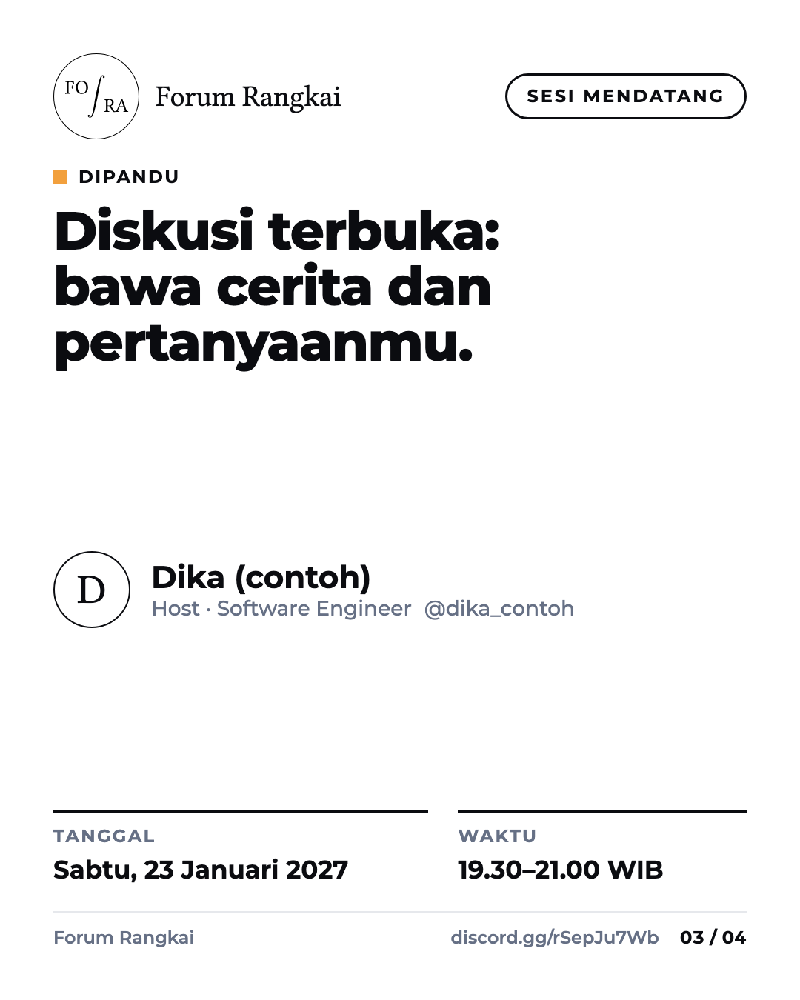  [PDF](fora-ngobrol-karier/li-doc/announce.pdf)

<details>
<summary>Captions</summary>

**Instagram**

```text
🎙 Ngobrol Karier di Tech
Sesi FORA

Diskusi terbuka tanpa pembicara tamu. Bawa cerita dan pertanyaan soal kerja di tech, mulai dari cari kerja pertama, pindah peran, sampai belajar sambil kerja.

📅 Sabtu, 23 Januari 2027, 19.30–21.00 WIB
Di voice channel fora-voice Discord FORA. Ngobrol langsung lewat suara, bukan webinar.
Dipandu Dika (contoh) @dika_contoh.

Yang kita bahas:
• Cari kerja pertama di tech
• Belajar sambil kerja
• Pindah peran, misalnya dari developer ke SRE

Cara ikut:
1. Buka Discord FORA lewat link di bio, atau langsung ke discord.gg/rSepJu7Wb
2. Masuk ke voice channel fora-voice
3. Siapa pun boleh ikut ngobrol dan bertanya, tinggal masuk.

💬 Simpan postingan ini dan ajak teman yang mungkin tertarik.

#FORA #KomunitasTech #ForumRangkai #KarierTech #Karier
```

**X**

```text
🎙 Ngobrol Karier di Tech
Sab, 23 Jan, 19.30–21.00 WIB
Ngobrol santai di voice channel fora-voice Discord FORA, siapa pun boleh ikut bicara dan bertanya.
https://discord.gg/rSepJu7Wb
#FORA #Karier
```

**LinkedIn**

```text
Ngobrol Karier di Tech
Sesi FORA

Diskusi terbuka tanpa pembicara tamu. Bawa cerita dan pertanyaan soal kerja di tech, mulai dari cari kerja pertama, pindah peran, sampai belajar sambil kerja.

Sabtu, 23 Januari 2027, 19.30–21.00 WIB, dipandu Dika (contoh) @dika_contoh.

Yang akan kita bahas:
• Cari kerja pertama di tech
• Belajar sambil kerja
• Pindah peran, misalnya dari developer ke SRE

Cocok untuk siapa pun yang tertarik pada topik ini, dari yang baru mulai sampai yang sudah berpengalaman.

Formatnya talk santai di voice channel fora-voice Discord FORA, bukan webinar. Tidak perlu daftar: cukup masuk, dan siapa pun boleh bicara serta bertanya langsung.

Gabung lewat undangan Discord: https://discord.gg/rSepJu7Wb

#FORA #ForumRangkai #KomunitasTech #Karier #KarierTech
```

</details>

### Reminder

**Instagram**

 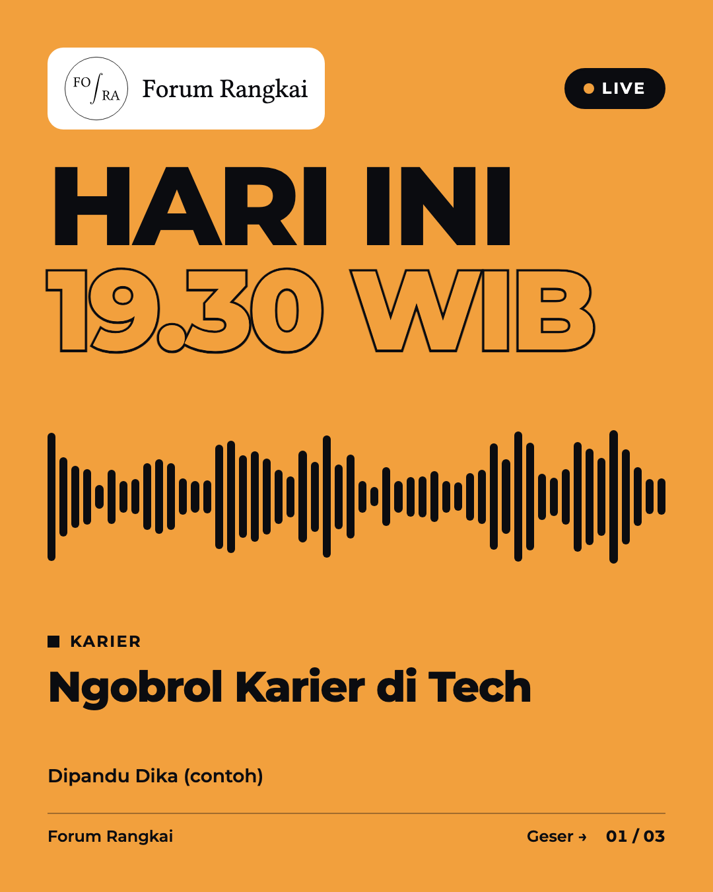   

**X**


**LinkedIn**

    [PDF](fora-ngobrol-karier/li-doc/reminder.pdf)

<details>
<summary>Captions</summary>

**Instagram**

```text
🔴 Hari ini, 19.30 WIB
Ngobrol Karier di Tech

Sesi FORA mulai 19.30 WIB. Kalau sudah mulai, langsung join aja, boleh masuk kapan pun.

Di voice channel fora-voice Discord FORA. Ngobrol langsung lewat suara, bukan webinar.
Dipandu Dika (contoh) @dika_contoh.

Hari ini kita bahas:
• Cari kerja pertama di tech
• Belajar sambil kerja
• Pindah peran, misalnya dari developer ke SRE

Cara ikut:
1. Buka Discord FORA lewat link di bio, atau langsung ke discord.gg/rSepJu7Wb
2. Masuk ke voice channel fora-voice
3. Siapa pun boleh ikut ngobrol dan bertanya, tinggal masuk.

Kirim ke teman yang mau ikut, lalu ketemu di voice channel.

#FORA #KomunitasTech #ForumRangkai #KarierTech #Karier
```

**X**

```text
🔴 Hari ini 19.30 WIB
Ngobrol Karier di Tech
Sudah mulai? Langsung join ke voice channel fora-voice Discord FORA. Siapa pun boleh ngobrol dan bertanya.
https://discord.gg/rSepJu7Wb
#FORA #Karier
```

**LinkedIn**

```text
Hari ini, 19.30 WIB
Ngobrol Karier di Tech

FORA berkumpul hari ini pukul 19.30–21.00 WIB, dipandu Dika (contoh) @dika_contoh. Kalau sudah mulai, langsung join saja.

Yang akan kita bahas:
• Cari kerja pertama di tech
• Belajar sambil kerja
• Pindah peran, misalnya dari developer ke SRE

Formatnya talk santai di voice channel fora-voice Discord FORA, bukan webinar. Tidak perlu daftar: cukup masuk, dan siapa pun boleh bicara serta bertanya langsung.

Gabung lewat undangan Discord: https://discord.gg/rSepJu7Wb

#FORA #ForumRangkai #KomunitasTech #Karier #KarierTech
```

</details>

### Recap

**Instagram**

 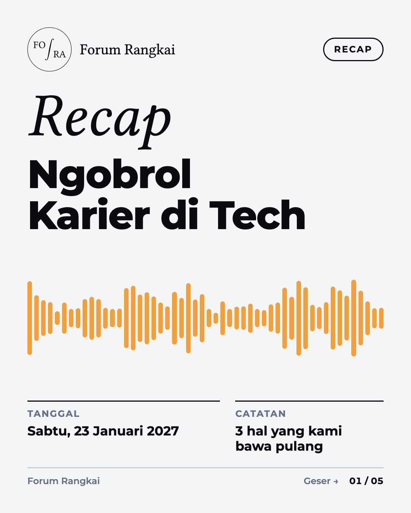     

**X**


**LinkedIn**

  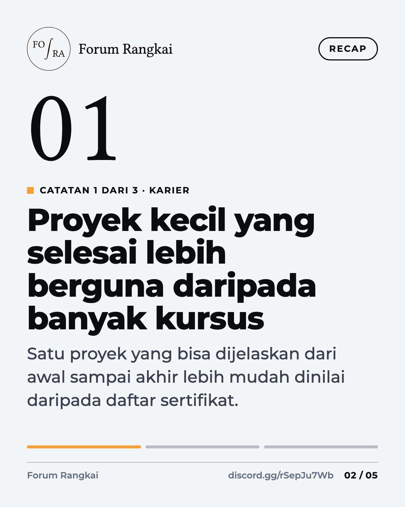  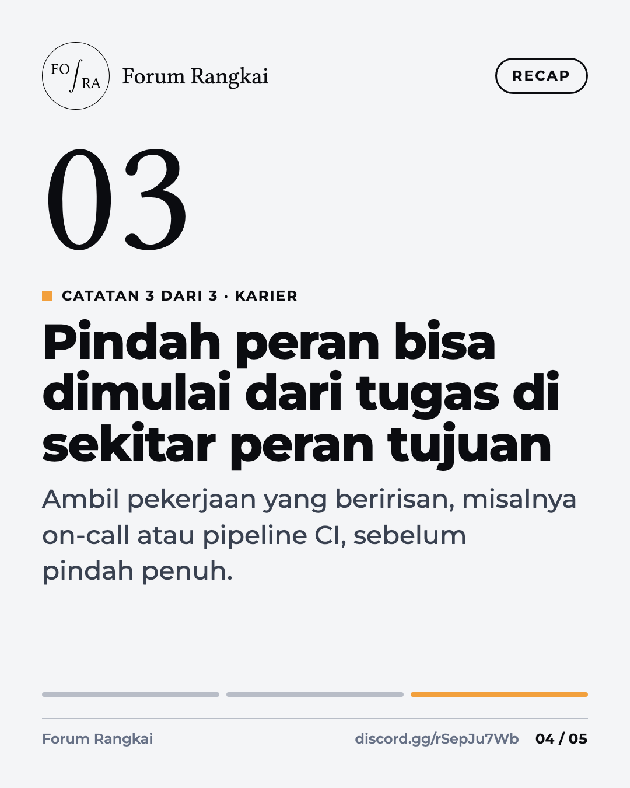  [PDF](fora-ngobrol-karier/li-doc/recap.pdf)

<details>
<summary>Captions</summary>

**Instagram**

```text
✅ Rangkuman sesi
Ngobrol Karier di Tech

Makasih Dika (contoh) @dika_contoh! Ada 9 orang yang ikut ngobrol di voice channel.

Poin-poin yang kita bawa pulang:
1. Proyek kecil yang selesai lebih berguna daripada banyak kursus: Satu proyek yang bisa dijelaskan dari awal sampai akhir lebih mudah dinilai daripada daftar sertifikat.
2. Belajar dengan target yang jelas: Pilih satu masalah nyata di pekerjaan atau proyek, lalu pelajari apa yang dibutuhkan untuk menyelesaikannya.
3. Pindah peran bisa dimulai dari tugas di sekitar peran tujuan: Ambil pekerjaan yang beririsan, misalnya on-call atau pipeline CI, sebelum pindah penuh.

Sesi berikutnya diumumkan di Discord FORA. Gabung dulu lewat link di bio atau discord.gg/rSepJu7Wb, biar nggak ketinggalan.

Simpan postingan ini buat dibaca ulang.

#FORA #KomunitasTech #ForumRangkai #KarierTech #Karier
```

**X 1/3**

```text
Rangkuman "Ngobrol Karier di Tech". 9 orang ngobrol di voice channel. Makasih Dika (contoh) @dika_contoh!
```

**X 2/3**

```text
Poin-poin utamanya:
1. Proyek kecil yang selesai lebih berguna daripada banyak kursus
2. Belajar dengan target yang jelas
3. Pindah peran bisa dimulai dari tugas di sekitar peran tujuan
```

**X 3/3**

```text
Sesi berikutnya diumumkan di Discord FORA. Gabung dulu, siapa pun boleh ikut ngobrol dan bertanya:
https://discord.gg/rSepJu7Wb
#FORA #Karier
```

**LinkedIn**

```text
Rangkuman sesi FORA
Ngobrol Karier di Tech

Terima kasih Dika (contoh) @dika_contoh. 9 orang ikut ngobrol di voice channel.

Beberapa poin yang kami bawa pulang:
1. Proyek kecil yang selesai lebih berguna daripada banyak kursus: Satu proyek yang bisa dijelaskan dari awal sampai akhir lebih mudah dinilai daripada daftar sertifikat.
2. Belajar dengan target yang jelas: Pilih satu masalah nyata di pekerjaan atau proyek, lalu pelajari apa yang dibutuhkan untuk menyelesaikannya.
3. Pindah peran bisa dimulai dari tugas di sekitar peran tujuan: Ambil pekerjaan yang beririsan, misalnya on-call atau pipeline CI, sebelum pindah penuh.

Sesi berikutnya akan diumumkan di Discord FORA. Format tetap sama: talk santai di voice channel, terbuka untuk siapa pun. https://discord.gg/rSepJu7Wb

#FORA #ForumRangkai #KomunitasTech #Karier #KarierTech
```

</details>

### Cover

**Instagram**

    

**X**


**LinkedIn**

    [PDF](fora-ngobrol-karier/li-doc/cover.pdf)

<details>
<summary>Captions</summary>

**Instagram**

```text
🎙 Karier bareng FORA

Diskusi terbuka tanpa pembicara tamu. Bawa cerita dan pertanyaan soal kerja di tech, mulai dari cari kerja pertama, pindah peran, sampai belajar sambil kerja.

Sesi: Ngobrol Karier di Tech
📅 Sabtu, 23 Januari 2027, 19.30–21.00 WIB
Di voice channel fora-voice Discord FORA. Ngobrol langsung lewat suara, bukan webinar.

Cara ikut:
1. Buka Discord FORA lewat link di bio, atau langsung ke discord.gg/rSepJu7Wb
2. Masuk ke voice channel fora-voice
3. Siapa pun boleh ikut ngobrol dan bertanya, tinggal masuk.

💬 Ikuti akun ini supaya nggak ketinggalan sesi Karier berikutnya.

#FORA #KomunitasTech #ForumRangkai #KarierTech #Karier
```

**X**

```text
Karier bareng FORA
Sesi: Ngobrol Karier di Tech
Sab, 23 Jan, 19.30–21.00 WIB
Ngobrol santai di voice channel fora-voice Discord FORA, siapa pun boleh ikut bicara dan bertanya.
https://discord.gg/rSepJu7Wb
#FORA #Karier
```

**LinkedIn**

```text
Karier bareng FORA

Diskusi terbuka tanpa pembicara tamu. Bawa cerita dan pertanyaan soal kerja di tech, mulai dari cari kerja pertama, pindah peran, sampai belajar sambil kerja.

Sesi: Ngobrol Karier di Tech, Sabtu, 23 Januari 2027, 19.30–21.00 WIB.

Cocok untuk siapa pun yang tertarik pada topik ini, dari yang baru mulai sampai yang sudah berpengalaman.

Formatnya talk santai di voice channel fora-voice Discord FORA, bukan webinar. Tidak perlu daftar: cukup masuk, dan siapa pun boleh bicara serta bertanya langsung.

Gabung lewat undangan Discord: https://discord.gg/rSepJu7Wb

#FORA #ForumRangkai #KomunitasTech #Karier #KarierTech
```

</details>

### SIG intro

**Instagram**

  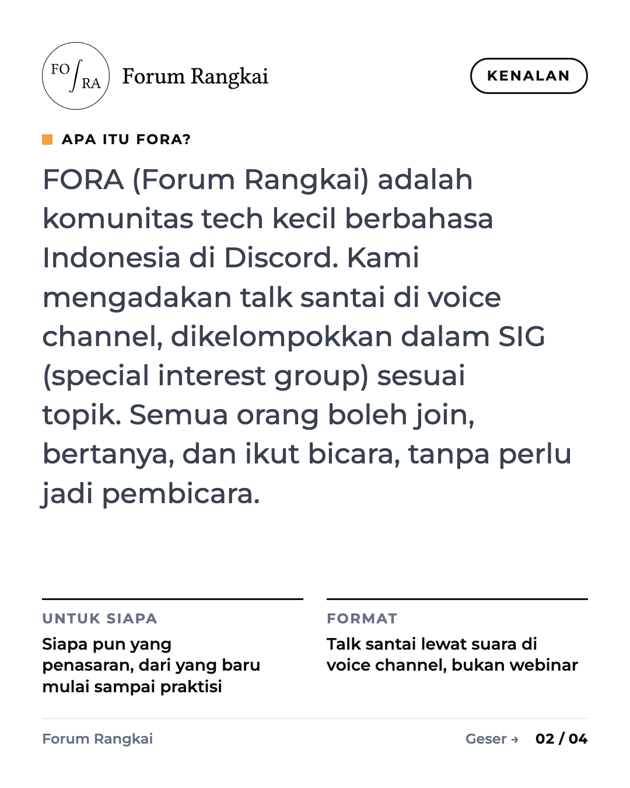   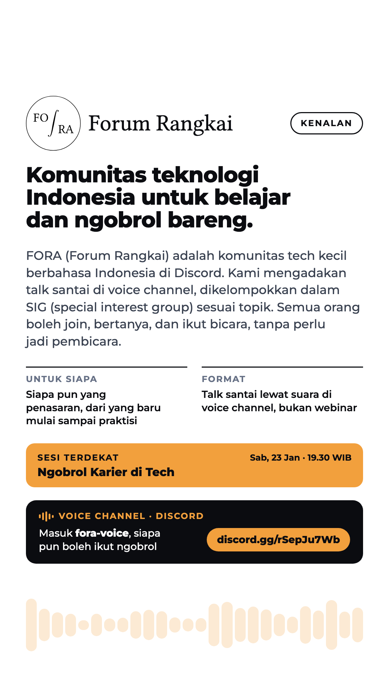

**X**


**LinkedIn**

    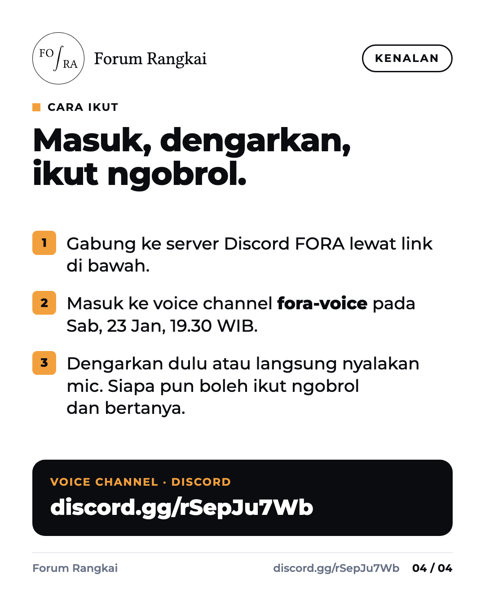 [PDF](fora-ngobrol-karier/li-doc/sig-intro.pdf)

<details>
<summary>Captions</summary>

**Instagram**

```text
🎙 Kenalan sama FORA: Komunitas teknologi Indonesia untuk belajar dan ngobrol bareng.

FORA (Forum Rangkai) adalah komunitas tech kecil berbahasa Indonesia di Discord. Kami mengadakan talk santai di voice channel, dikelompokkan dalam SIG (special interest group) sesuai topik. Semua orang boleh join, bertanya, dan ikut bicara, tanpa perlu jadi pembicara.

Untuk siapa? Siapa pun yang suka ngobrol soal tech, dari mahasiswa sampai yang sudah bertahun-tahun bekerja. Pemula sangat boleh, nggak ada pertanyaan yang terlalu dasar.

Sesi terdekat: Ngobrol Karier di Tech
📅 Sabtu, 23 Januari 2027, 19.30–21.00 WIB
Di voice channel fora-voice Discord FORA. Ngobrol langsung lewat suara, bukan webinar.

Cara ikut:
1. Buka Discord FORA lewat link di bio, atau langsung ke discord.gg/rSepJu7Wb
2. Masuk ke voice channel fora-voice
3. Siapa pun boleh ikut ngobrol dan bertanya, tinggal masuk.

💬 Ajak teman yang tertarik ikut ngobrol di FORA.

#FORA #KomunitasTech #ForumRangkai #KarierTech #Karier
```

**X**

```text
Kenalan sama FORA: Komunitas teknologi Indonesia untuk belajar dan ngobrol bareng.
Sesi terdekat: Ngobrol Karier di Tech, Sab, 23 Jan.
Ngobrol santai di voice channel fora-voice Discord FORA, pemula boleh banget ikut.
https://discord.gg/rSepJu7Wb
#FORA #Karier
```

**LinkedIn**

```text
Kenalan dengan FORA: Komunitas teknologi Indonesia untuk belajar dan ngobrol bareng.

FORA (Forum Rangkai) adalah komunitas tech kecil berbahasa Indonesia di Discord. Kami mengadakan talk santai di voice channel, dikelompokkan dalam SIG (special interest group) sesuai topik. Semua orang boleh join, bertanya, dan ikut bicara, tanpa perlu jadi pembicara.

Untuk siapa? Siapa pun yang suka ngobrol soal tech, dari mahasiswa sampai yang sudah bertahun-tahun bekerja.

Formatnya talk santai di voice channel fora-voice Discord FORA, bukan webinar. Tidak perlu daftar: cukup masuk, dan siapa pun boleh bicara serta bertanya langsung. Sesi terdekat: Ngobrol Karier di Tech, Sabtu, 23 Januari 2027, 19.30–21.00 WIB.

Gabung lewat undangan Discord: https://discord.gg/rSepJu7Wb

#FORA #ForumRangkai #KomunitasTech #Karier #KarierTech
```

</details>


## Kubernetes untuk Pemula

SIG CN · Sabtu, 12 Desember 2026 · 19.30 WIB · `sigcn-kubernetes-pemula`

### Announce

**Instagram**

     

**X**

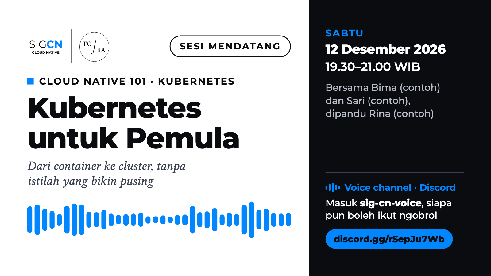

**LinkedIn**

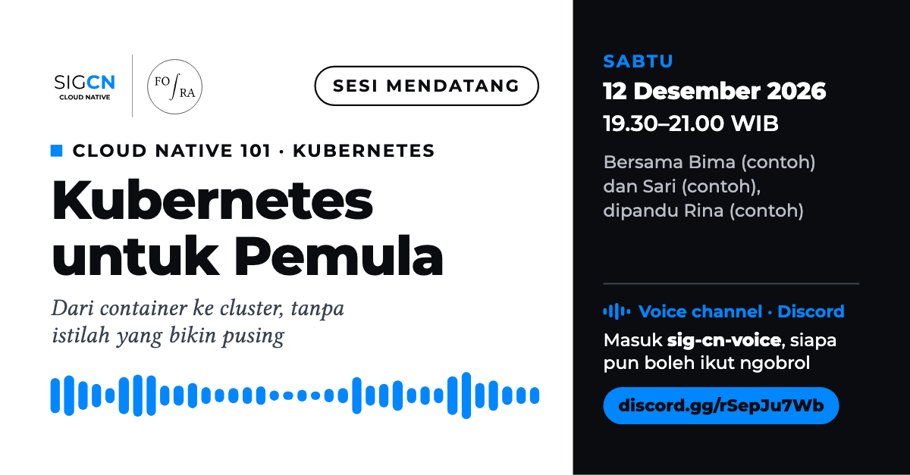    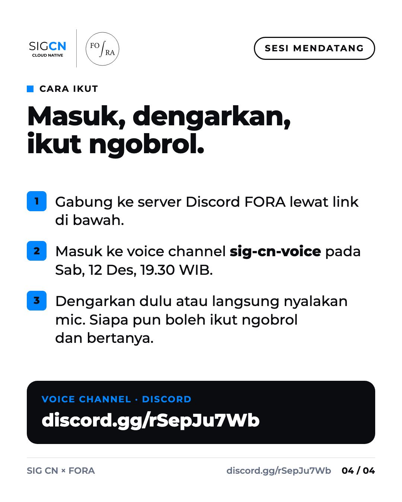 [PDF](sigcn-kubernetes-pemula/li-doc/announce.pdf)

<details>
<summary>Captions</summary>

**Instagram**

```text
🎙 Kubernetes untuk Pemula
Sesi SIG CN × FORA

Sesi pertama Cloud Native 101. Kita kenalan dengan Kubernetes dari nol, mulai dari kenapa container butuh orkestrasi sampai deploy aplikasi pertama ke cluster lokal.

📅 Sabtu, 12 Desember 2026, 19.30–21.00 WIB
Di voice channel sig-cn-voice Discord FORA. Ngobrol langsung lewat suara, bukan webinar.
Bersama Bima (contoh) @bima_contoh dan Sari (contoh) @sari_contoh, dipandu Rina (contoh) @rina_contoh.

Yang kita bahas:
• Container vs Kubernetes, kenapa butuh orkestrasi
• Pod, Deployment, dan Service
• Deploy aplikasi pertama di cluster lokal
• Debug dasar dengan kubectl

Cara ikut:
1. Buka Discord FORA lewat link di bio, atau langsung ke discord.gg/rSepJu7Wb
2. Masuk ke voice channel sig-cn-voice
3. Siapa pun boleh ikut ngobrol dan bertanya, tinggal masuk.

💬 Simpan postingan ini dan ajak teman yang mungkin tertarik.

#FORA #KomunitasTech #SIGCN #CloudNative #Kubernetes #DevOps #Container
```

**X**

```text
🎙 Kubernetes untuk Pemula
Sab, 12 Des, 19.30–21.00 WIB
Ngobrol santai di voice channel sig-cn-voice Discord FORA, siapa pun boleh ikut bicara dan bertanya.
https://discord.gg/rSepJu7Wb
#SIGCN #FORA
```

**LinkedIn**

```text
Kubernetes untuk Pemula
Sesi SIG CN × FORA

Sesi pertama Cloud Native 101. Kita kenalan dengan Kubernetes dari nol, mulai dari kenapa container butuh orkestrasi sampai deploy aplikasi pertama ke cluster lokal.

Sabtu, 12 Desember 2026, 19.30–21.00 WIB, bersama Bima (contoh) @bima_contoh dan Sari (contoh) @sari_contoh, dipandu Rina (contoh) @rina_contoh.

Yang akan kita bahas:
• Container vs Kubernetes, kenapa butuh orkestrasi
• Pod, Deployment, dan Service
• Deploy aplikasi pertama di cluster lokal
• Debug dasar dengan kubectl

Cocok untuk siapa pun yang tertarik pada topik ini, dari yang baru mulai sampai yang sudah berpengalaman.

Formatnya talk santai di voice channel sig-cn-voice Discord FORA, bukan webinar. Tidak perlu daftar: cukup masuk, dan siapa pun boleh bicara serta bertanya langsung.

Gabung lewat undangan Discord: https://discord.gg/rSepJu7Wb

#SIGCN #CloudNative #Kubernetes #DevOps #Container
```

</details>

### Reminder

**Instagram**

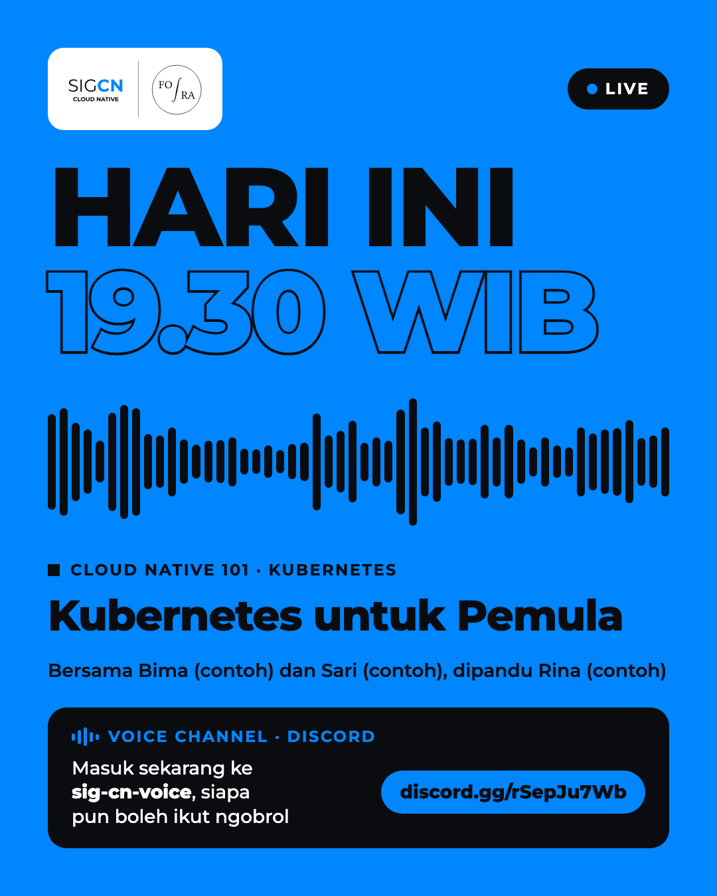    

**X**

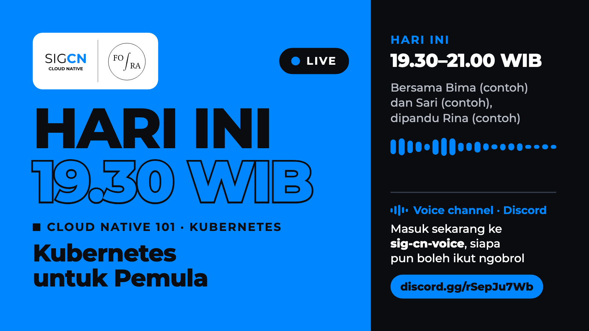

**LinkedIn**

    [PDF](sigcn-kubernetes-pemula/li-doc/reminder.pdf)

<details>
<summary>Captions</summary>

**Instagram**

```text
🔴 Hari ini, 19.30 WIB
Kubernetes untuk Pemula

Sesi SIG CN × FORA mulai 19.30 WIB. Kalau sudah mulai, langsung join aja, boleh masuk kapan pun.

Di voice channel sig-cn-voice Discord FORA. Ngobrol langsung lewat suara, bukan webinar.
Bersama Bima (contoh) @bima_contoh dan Sari (contoh) @sari_contoh, dipandu Rina (contoh) @rina_contoh.

Hari ini kita bahas:
• Container vs Kubernetes, kenapa butuh orkestrasi
• Pod, Deployment, dan Service
• Deploy aplikasi pertama di cluster lokal
• Debug dasar dengan kubectl

Cara ikut:
1. Buka Discord FORA lewat link di bio, atau langsung ke discord.gg/rSepJu7Wb
2. Masuk ke voice channel sig-cn-voice
3. Siapa pun boleh ikut ngobrol dan bertanya, tinggal masuk.

Kirim ke teman yang mau ikut, lalu ketemu di voice channel.

#FORA #KomunitasTech #SIGCN #CloudNative #Kubernetes #DevOps #Container
```

**X**

```text
🔴 Hari ini 19.30 WIB
Kubernetes untuk Pemula
Sudah mulai? Langsung join ke voice channel sig-cn-voice Discord FORA. Siapa pun boleh ngobrol dan bertanya.
https://discord.gg/rSepJu7Wb
#SIGCN #FORA
```

**LinkedIn**

```text
Hari ini, 19.30 WIB
Kubernetes untuk Pemula

SIG CN × FORA berkumpul hari ini pukul 19.30–21.00 WIB, bersama Bima (contoh) @bima_contoh dan Sari (contoh) @sari_contoh, dipandu Rina (contoh) @rina_contoh. Kalau sudah mulai, langsung join saja.

Yang akan kita bahas:
• Container vs Kubernetes, kenapa butuh orkestrasi
• Pod, Deployment, dan Service
• Deploy aplikasi pertama di cluster lokal
• Debug dasar dengan kubectl

Formatnya talk santai di voice channel sig-cn-voice Discord FORA, bukan webinar. Tidak perlu daftar: cukup masuk, dan siapa pun boleh bicara serta bertanya langsung.

Gabung lewat undangan Discord: https://discord.gg/rSepJu7Wb

#SIGCN #CloudNative #Kubernetes #DevOps #Container
```

</details>

### Recap

**Instagram**

       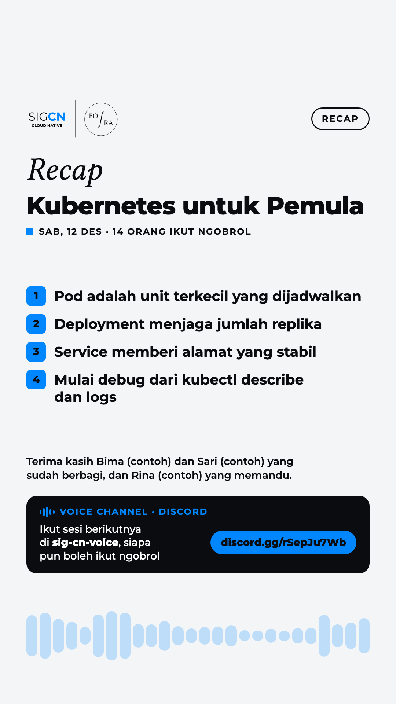

**X**


**LinkedIn**

    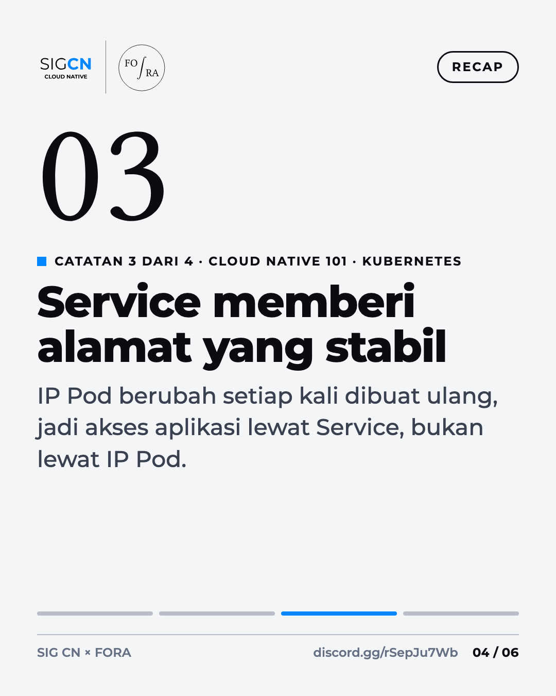   [PDF](sigcn-kubernetes-pemula/li-doc/recap.pdf)

<details>
<summary>Captions</summary>

**Instagram**

```text
✅ Rangkuman sesi
Kubernetes untuk Pemula

Makasih Bima (contoh) @bima_contoh dan Sari (contoh) @sari_contoh! Ada 14 orang yang ikut ngobrol di voice channel.

Poin-poin yang kita bawa pulang:
1. Pod adalah unit terkecil yang dijadwalkan: Satu Pod bisa berisi satu atau beberapa container yang berbagi network dan storage.
2. Deployment menjaga jumlah replika: Kalau sebuah Pod mati, Deployment membuat penggantinya supaya jumlah replika sesuai yang diminta.
3. Service memberi alamat yang stabil: IP Pod berubah setiap kali dibuat ulang, jadi akses aplikasi lewat Service, bukan lewat IP Pod.
4. Mulai debug dari kubectl describe dan logs: Event di describe dan output logs biasanya sudah cukup untuk menemukan penyebab Pod gagal jalan.

Bacaan lanjutan:
• Dokumentasi Kubernetes: https://kubernetes.io/docs/home/
• Tutorial minikube: https://minikube.sigs.k8s.io/docs/start/

Sesi berikutnya diumumkan di Discord FORA. Gabung dulu lewat link di bio atau discord.gg/rSepJu7Wb, biar nggak ketinggalan.

Simpan postingan ini buat dibaca ulang.

#FORA #KomunitasTech #SIGCN #CloudNative #Kubernetes #DevOps #Container
```

**X 1/3**

```text
Rangkuman "Kubernetes untuk Pemula". 14 orang ngobrol di voice channel. Makasih Bima (contoh) @bima_contoh dan Sari (contoh) @sari_contoh!
```

**X 2/3**

```text
Poin-poin utamanya:
1. Pod adalah unit terkecil yang dijadwalkan
2. Deployment menjaga jumlah replika
3. Service memberi alamat yang stabil
4. Mulai debug dari kubectl describe dan logs
```

**X 3/3**

```text
Bacaan: Dokumentasi Kubernetes https://kubernetes.io/docs/home/
Sesi berikutnya diumumkan di Discord FORA. Gabung dulu, siapa pun boleh ikut ngobrol dan bertanya:
https://discord.gg/rSepJu7Wb
#SIGCN #FORA
```

**LinkedIn**

```text
Rangkuman sesi SIG CN × FORA
Kubernetes untuk Pemula

Terima kasih Bima (contoh) @bima_contoh dan Sari (contoh) @sari_contoh. 14 orang ikut ngobrol di voice channel.

Beberapa poin yang kami bawa pulang:
1. Pod adalah unit terkecil yang dijadwalkan: Satu Pod bisa berisi satu atau beberapa container yang berbagi network dan storage.
2. Deployment menjaga jumlah replika: Kalau sebuah Pod mati, Deployment membuat penggantinya supaya jumlah replika sesuai yang diminta.
3. Service memberi alamat yang stabil: IP Pod berubah setiap kali dibuat ulang, jadi akses aplikasi lewat Service, bukan lewat IP Pod.
4. Mulai debug dari kubectl describe dan logs: Event di describe dan output logs biasanya sudah cukup untuk menemukan penyebab Pod gagal jalan.

Bacaan lanjutan:
• Dokumentasi Kubernetes: https://kubernetes.io/docs/home/
• Tutorial minikube: https://minikube.sigs.k8s.io/docs/start/

Sesi berikutnya akan diumumkan di Discord FORA. Format tetap sama: talk santai di voice channel, terbuka untuk siapa pun. https://discord.gg/rSepJu7Wb

#SIGCN #CloudNative #Kubernetes #DevOps #Container
```

</details>

### Cover

**Instagram**

 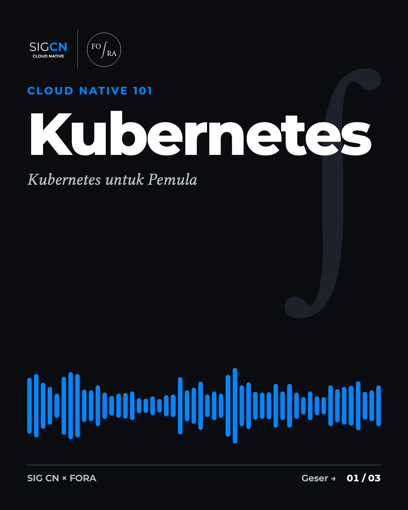 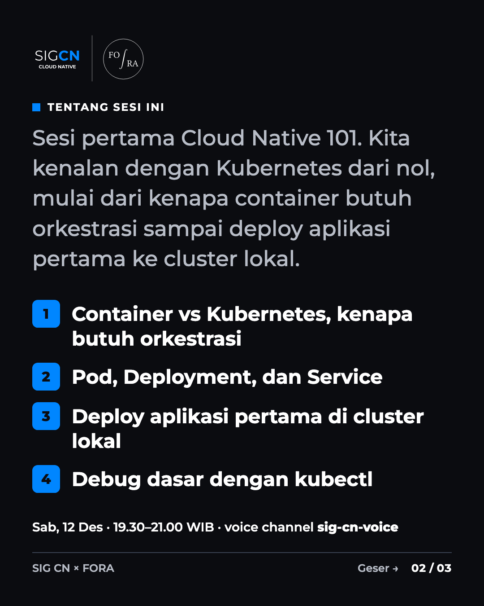  

**X**


**LinkedIn**

    [PDF](sigcn-kubernetes-pemula/li-doc/cover.pdf)

<details>
<summary>Captions</summary>

**Instagram**

```text
🎙 Cloud Native 101 bareng SIG CN × FORA

Sesi pertama Cloud Native 101. Kita kenalan dengan Kubernetes dari nol, mulai dari kenapa container butuh orkestrasi sampai deploy aplikasi pertama ke cluster lokal.

Sesi: Kubernetes untuk Pemula
📅 Sabtu, 12 Desember 2026, 19.30–21.00 WIB
Di voice channel sig-cn-voice Discord FORA. Ngobrol langsung lewat suara, bukan webinar.

Cara ikut:
1. Buka Discord FORA lewat link di bio, atau langsung ke discord.gg/rSepJu7Wb
2. Masuk ke voice channel sig-cn-voice
3. Siapa pun boleh ikut ngobrol dan bertanya, tinggal masuk.

💬 Ikuti akun ini supaya nggak ketinggalan sesi Cloud Native 101 berikutnya.

#FORA #KomunitasTech #SIGCN #CloudNative #Kubernetes #DevOps #Container
```

**X**

```text
Cloud Native 101 bareng SIG CN × FORA
Sesi: Kubernetes untuk Pemula
Sab, 12 Des, 19.30–21.00 WIB
Ngobrol santai di voice channel sig-cn-voice Discord FORA, siapa pun boleh ikut bicara dan bertanya.
https://discord.gg/rSepJu7Wb
#SIGCN #FORA
```

**LinkedIn**

```text
Cloud Native 101 bareng SIG CN × FORA

Sesi pertama Cloud Native 101. Kita kenalan dengan Kubernetes dari nol, mulai dari kenapa container butuh orkestrasi sampai deploy aplikasi pertama ke cluster lokal.

Sesi: Kubernetes untuk Pemula, Sabtu, 12 Desember 2026, 19.30–21.00 WIB.

Cocok untuk siapa pun yang tertarik pada topik ini, dari yang baru mulai sampai yang sudah berpengalaman.

Formatnya talk santai di voice channel sig-cn-voice Discord FORA, bukan webinar. Tidak perlu daftar: cukup masuk, dan siapa pun boleh bicara serta bertanya langsung.

Gabung lewat undangan Discord: https://discord.gg/rSepJu7Wb

#SIGCN #CloudNative #Kubernetes #DevOps #Container
```

</details>

### SIG intro

**Instagram**

 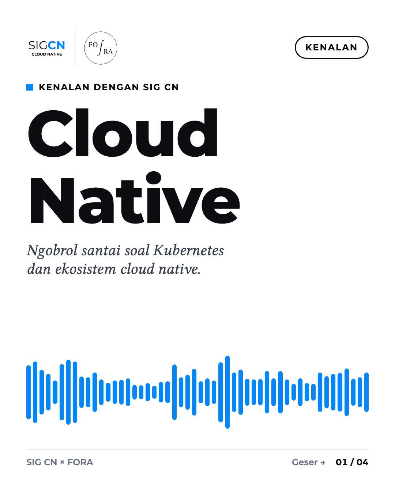 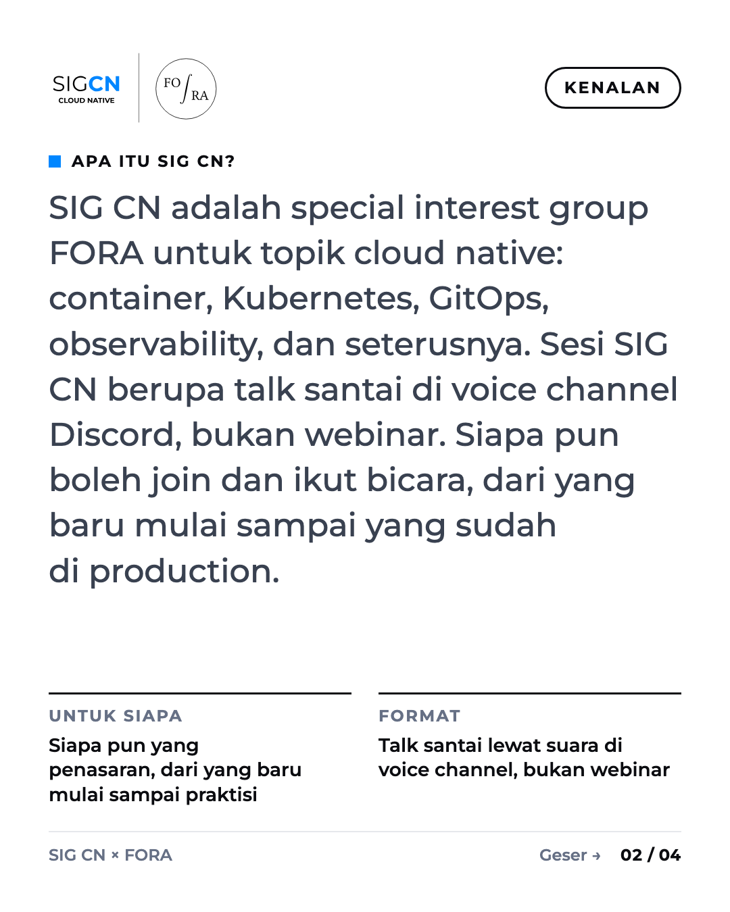   

**X**


**LinkedIn**

     [PDF](sigcn-kubernetes-pemula/li-doc/sig-intro.pdf)

<details>
<summary>Captions</summary>

**Instagram**

```text
🎙 Kenalan sama SIG CN di FORA: Ngobrol santai soal Kubernetes dan ekosistem cloud native.

SIG CN adalah special interest group FORA untuk topik cloud native: container, Kubernetes, GitOps, observability, dan seterusnya. Sesi SIG CN berupa talk santai di voice channel Discord, bukan webinar. Siapa pun boleh join dan ikut bicara, dari yang baru mulai sampai yang sudah di production.

Untuk siapa? Yang baru mulai, yang lagi belajar, dan yang sudah bekerja di bidang Cloud Native. Pemula sangat boleh, nggak ada pertanyaan yang terlalu dasar.

Sesi terdekat: Kubernetes untuk Pemula
📅 Sabtu, 12 Desember 2026, 19.30–21.00 WIB
Di voice channel sig-cn-voice Discord FORA. Ngobrol langsung lewat suara, bukan webinar.

Cara ikut:
1. Buka Discord FORA lewat link di bio, atau langsung ke discord.gg/rSepJu7Wb
2. Masuk ke voice channel sig-cn-voice
3. Siapa pun boleh ikut ngobrol dan bertanya, tinggal masuk.

💬 Ajak teman yang tertarik ikut ngobrol di SIG CN di FORA.

#FORA #KomunitasTech #SIGCN #CloudNative #Kubernetes #DevOps #Container
```

**X**

```text
Kenalan sama SIG CN di FORA: Ngobrol santai soal Kubernetes dan ekosistem cloud native.
Sesi terdekat: Kubernetes untuk Pemula, Sab, 12 Des.
Ngobrol santai di voice channel sig-cn-voice Discord FORA, pemula boleh banget ikut.
https://discord.gg/rSepJu7Wb
#SIGCN #FORA
```

**LinkedIn**

```text
Kenalan dengan SIG CN di FORA: Ngobrol santai soal Kubernetes dan ekosistem cloud native.

SIG CN adalah special interest group FORA untuk topik cloud native: container, Kubernetes, GitOps, observability, dan seterusnya. Sesi SIG CN berupa talk santai di voice channel Discord, bukan webinar. Siapa pun boleh join dan ikut bicara, dari yang baru mulai sampai yang sudah di production.

Untuk siapa? Yang baru mulai, yang lagi belajar, dan yang sudah bekerja di bidang Cloud Native.

Formatnya talk santai di voice channel sig-cn-voice Discord FORA, bukan webinar. Tidak perlu daftar: cukup masuk, dan siapa pun boleh bicara serta bertanya langsung. Sesi terdekat: Kubernetes untuk Pemula, Sabtu, 12 Desember 2026, 19.30–21.00 WIB.

Gabung lewat undangan Discord: https://discord.gg/rSepJu7Wb

#SIGCN #CloudNative #Kubernetes #DevOps #Container
```

</details>


## GitOps dengan Argo CD: dari commit di Git sampai deploy

SIG CN · Sabtu, 19 Desember 2026 · 19.30 WIB · `sigcn-gitops-argocd`

### Announce

**Instagram**

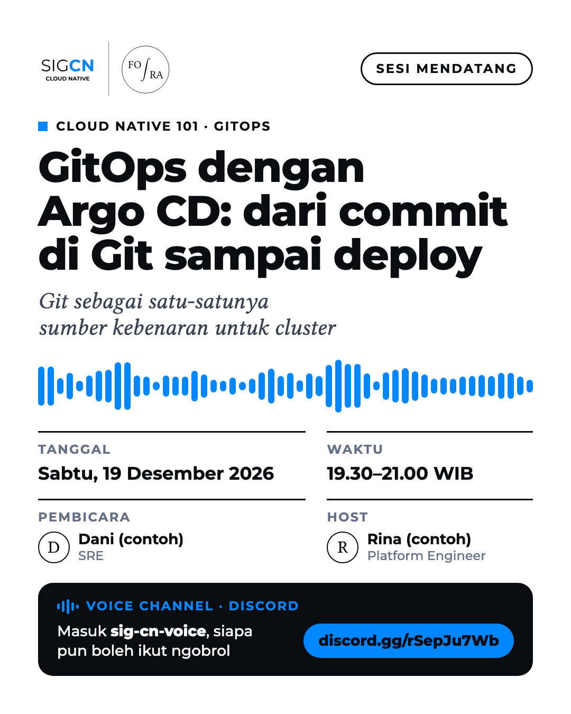   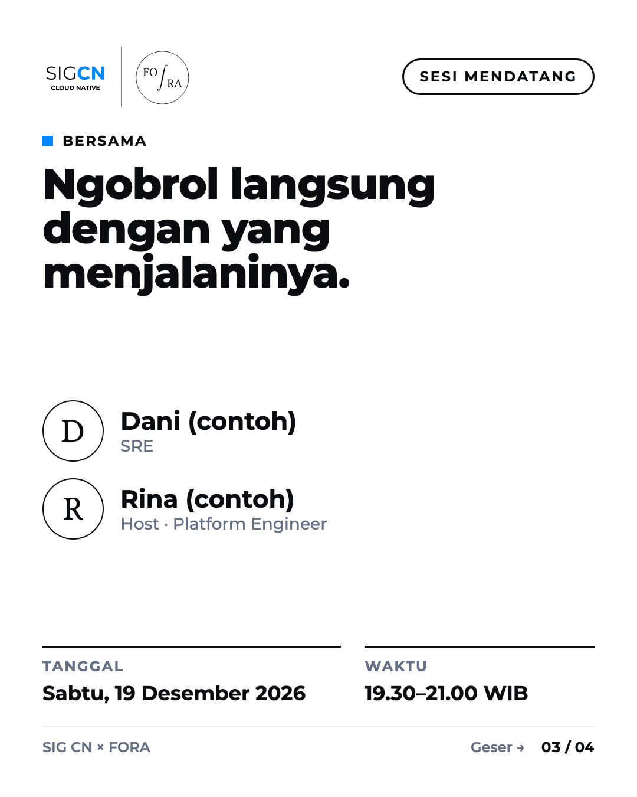  

**X**


**LinkedIn**

 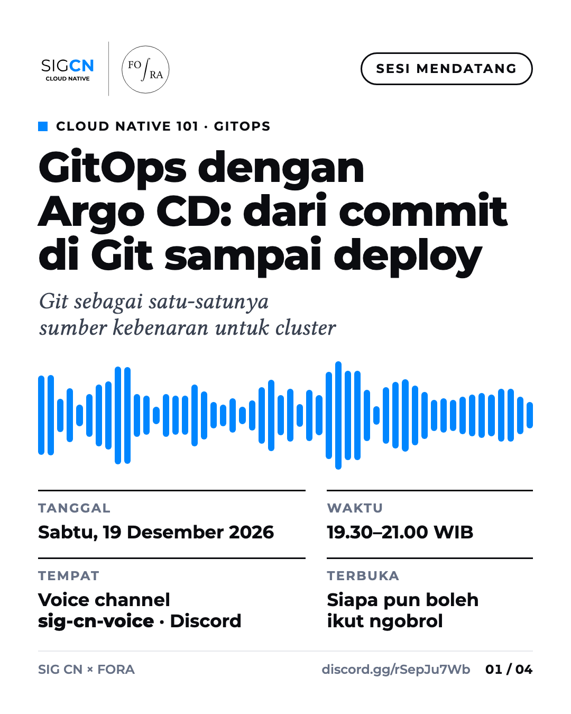 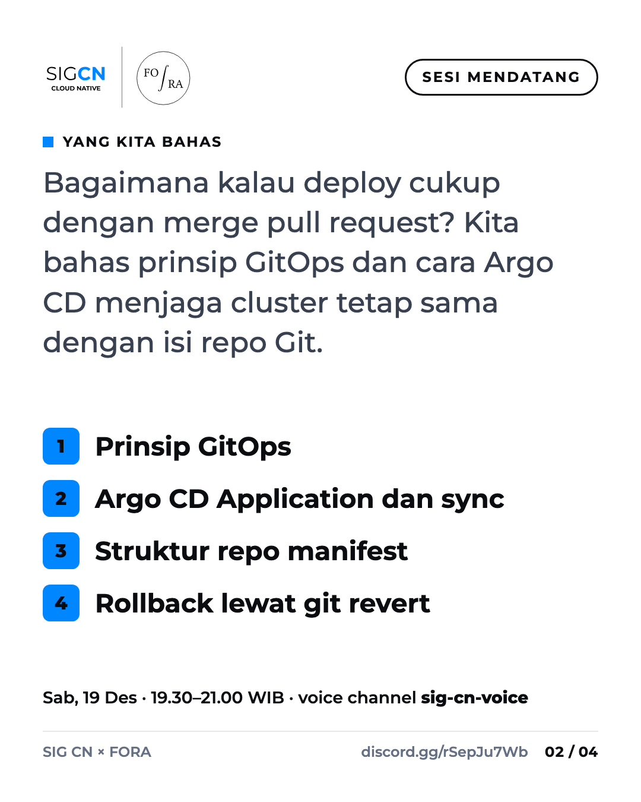   [PDF](sigcn-gitops-argocd/li-doc/announce.pdf)

<details>
<summary>Captions</summary>

**Instagram**

```text
🎙 GitOps dengan Argo CD: dari commit di Git sampai deploy
Sesi SIG CN × FORA

Bagaimana kalau deploy cukup dengan merge pull request? Kita bahas prinsip GitOps dan cara Argo CD menjaga cluster tetap sama dengan isi repo Git.

📅 Sabtu, 19 Desember 2026, 19.30–21.00 WIB
Di voice channel sig-cn-voice Discord FORA. Ngobrol langsung lewat suara, bukan webinar.
Bersama Dani (contoh), dipandu Rina (contoh).

Yang kita bahas:
• Prinsip GitOps
• Argo CD Application dan sync
• Struktur repo manifest
• Rollback lewat git revert

Cara ikut:
1. Buka Discord FORA lewat link di bio, atau langsung ke discord.gg/rSepJu7Wb
2. Masuk ke voice channel sig-cn-voice
3. Siapa pun boleh ikut ngobrol dan bertanya, tinggal masuk.

💬 Simpan postingan ini dan ajak teman yang mungkin tertarik.

#FORA #KomunitasTech #SIGCN #CloudNative #Kubernetes #DevOps #ArgoCD #GitOps
```

**X**

```text
🎙 GitOps dengan Argo CD: dari commit di Git sampai deploy
Sab, 19 Des, 19.30–21.00 WIB
Ngobrol santai di voice channel sig-cn-voice Discord FORA, siapa pun boleh ikut bicara dan bertanya.
https://discord.gg/rSepJu7Wb
#SIGCN #FORA
```

**LinkedIn**

```text
GitOps dengan Argo CD: dari commit di Git sampai deploy
Sesi SIG CN × FORA

Bagaimana kalau deploy cukup dengan merge pull request? Kita bahas prinsip GitOps dan cara Argo CD menjaga cluster tetap sama dengan isi repo Git.

Sabtu, 19 Desember 2026, 19.30–21.00 WIB, bersama Dani (contoh), dipandu Rina (contoh).

Yang akan kita bahas:
• Prinsip GitOps
• Argo CD Application dan sync
• Struktur repo manifest
• Rollback lewat git revert

Cocok untuk siapa pun yang tertarik pada topik ini, dari yang baru mulai sampai yang sudah berpengalaman.

Formatnya talk santai di voice channel sig-cn-voice Discord FORA, bukan webinar. Tidak perlu daftar: cukup masuk, dan siapa pun boleh bicara serta bertanya langsung.

Gabung lewat undangan Discord: https://discord.gg/rSepJu7Wb

#SIGCN #CloudNative #Kubernetes #DevOps #GitOps
```

</details>

### Reminder

**Instagram**

 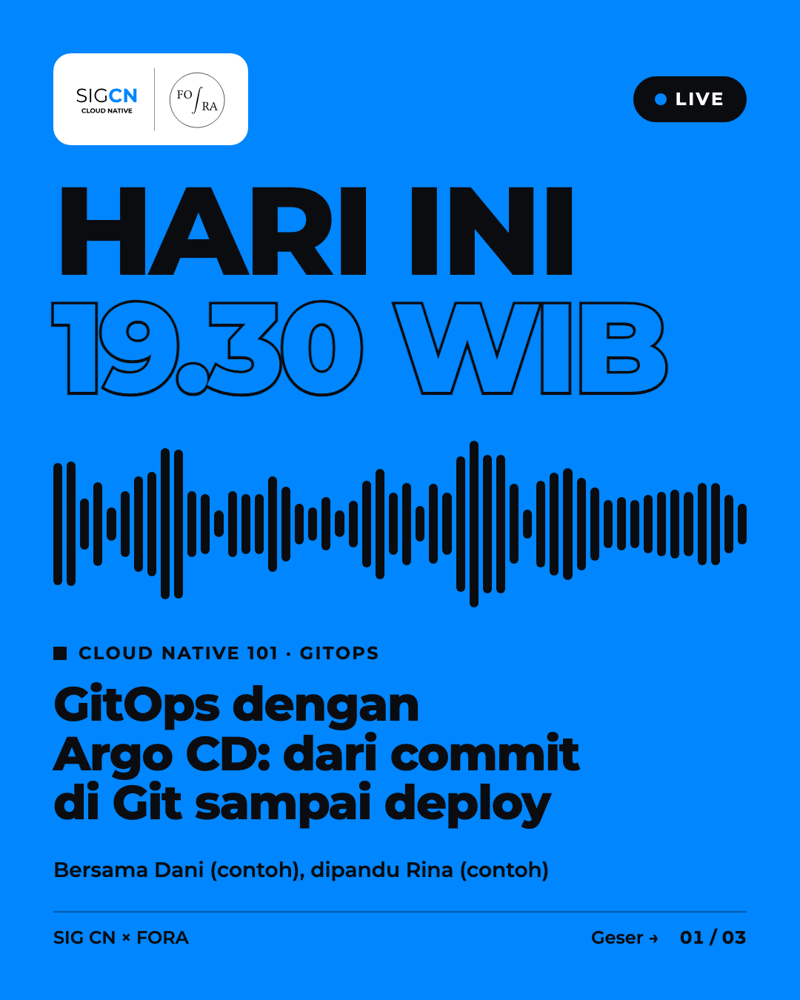   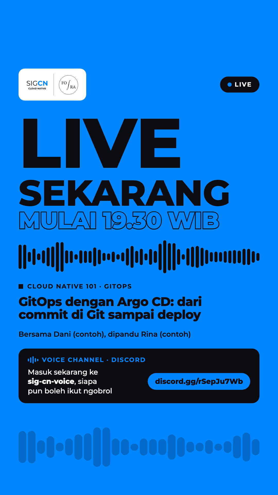

**X**


**LinkedIn**

  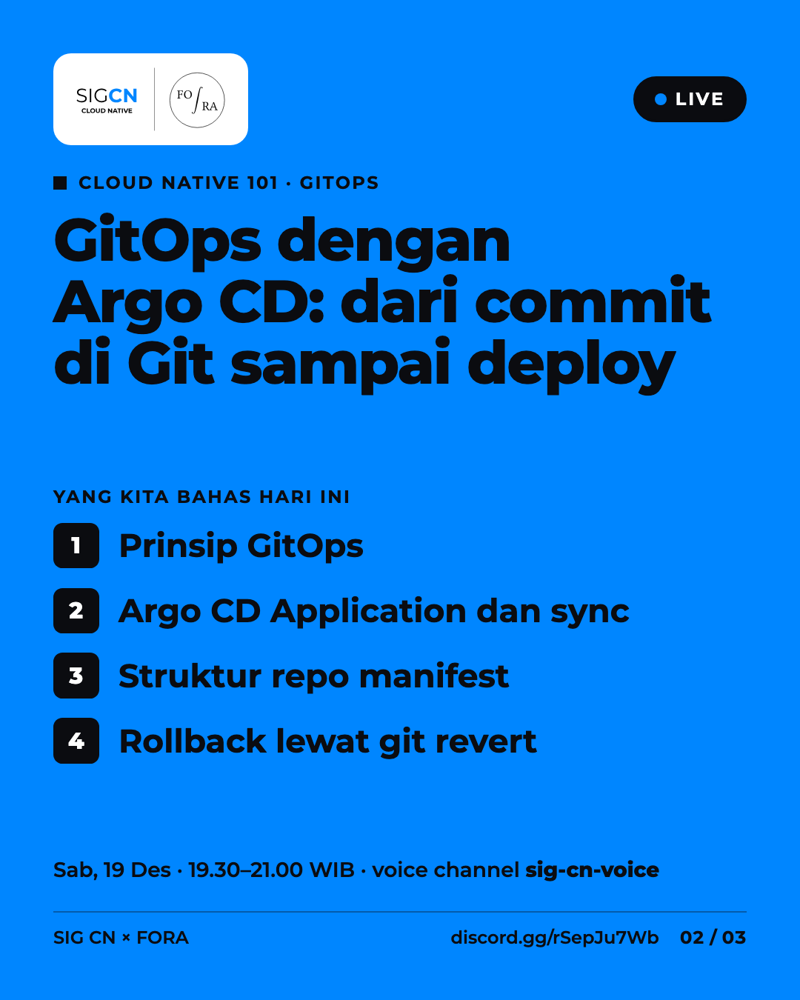 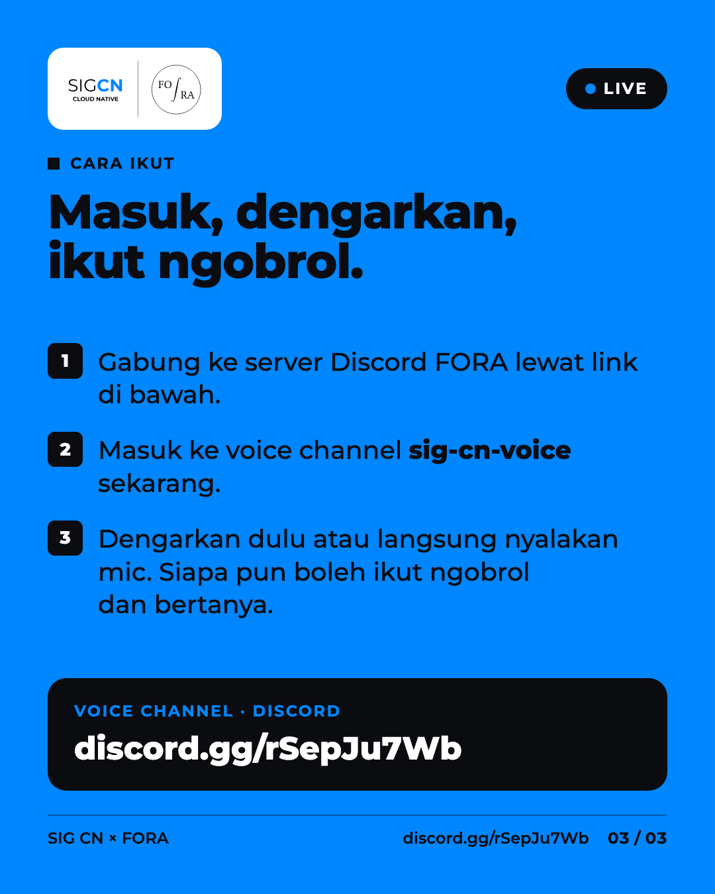 [PDF](sigcn-gitops-argocd/li-doc/reminder.pdf)

<details>
<summary>Captions</summary>

**Instagram**

```text
🔴 Hari ini, 19.30 WIB
GitOps dengan Argo CD: dari commit di Git sampai deploy

Sesi SIG CN × FORA mulai 19.30 WIB. Kalau sudah mulai, langsung join aja, boleh masuk kapan pun.

Di voice channel sig-cn-voice Discord FORA. Ngobrol langsung lewat suara, bukan webinar.
Bersama Dani (contoh), dipandu Rina (contoh).

Hari ini kita bahas:
• Prinsip GitOps
• Argo CD Application dan sync
• Struktur repo manifest
• Rollback lewat git revert

Cara ikut:
1. Buka Discord FORA lewat link di bio, atau langsung ke discord.gg/rSepJu7Wb
2. Masuk ke voice channel sig-cn-voice
3. Siapa pun boleh ikut ngobrol dan bertanya, tinggal masuk.

Kirim ke teman yang mau ikut, lalu ketemu di voice channel.

#FORA #KomunitasTech #SIGCN #CloudNative #Kubernetes #DevOps #ArgoCD #GitOps
```

**X**

```text
🔴 Hari ini 19.30 WIB
GitOps dengan Argo CD: dari commit di Git sampai deploy
Sudah mulai? Langsung join ke voice channel sig-cn-voice Discord FORA. Siapa pun boleh ngobrol dan bertanya.
https://discord.gg/rSepJu7Wb
#SIGCN #FORA
```

**LinkedIn**

```text
Hari ini, 19.30 WIB
GitOps dengan Argo CD: dari commit di Git sampai deploy

SIG CN × FORA berkumpul hari ini pukul 19.30–21.00 WIB, bersama Dani (contoh), dipandu Rina (contoh). Kalau sudah mulai, langsung join saja.

Yang akan kita bahas:
• Prinsip GitOps
• Argo CD Application dan sync
• Struktur repo manifest
• Rollback lewat git revert

Formatnya talk santai di voice channel sig-cn-voice Discord FORA, bukan webinar. Tidak perlu daftar: cukup masuk, dan siapa pun boleh bicara serta bertanya langsung.

Gabung lewat undangan Discord: https://discord.gg/rSepJu7Wb

#SIGCN #CloudNative #Kubernetes #DevOps #GitOps
```

</details>

### Recap

**Instagram**

 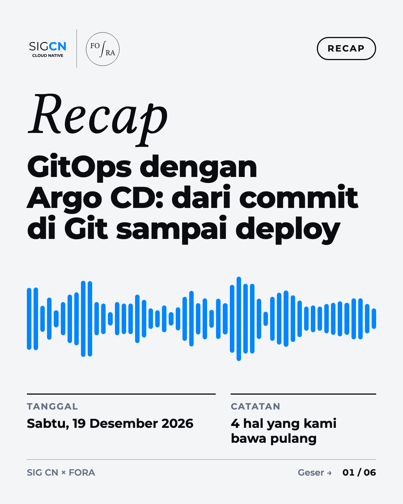    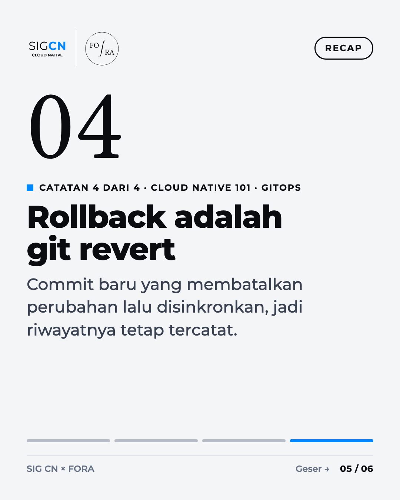  

**X**

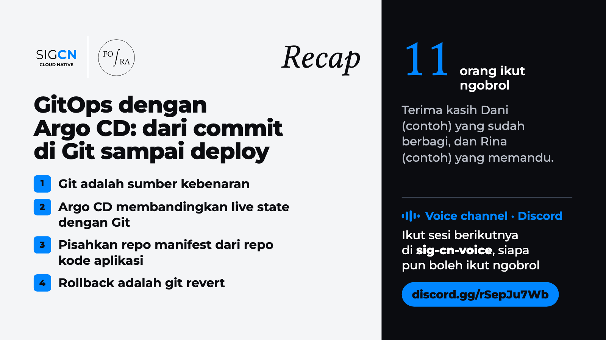

**LinkedIn**

   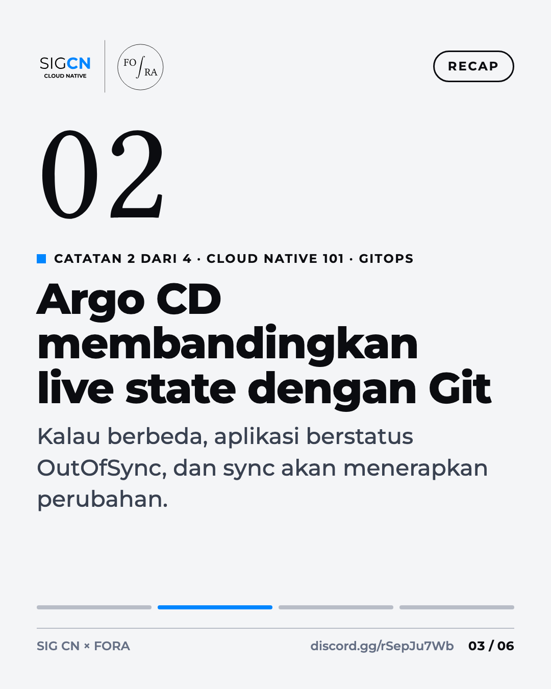   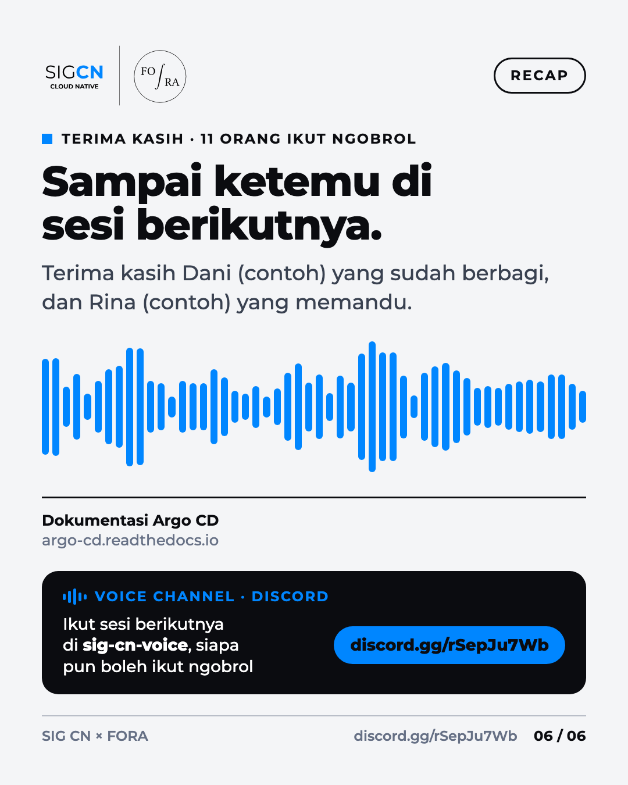 [PDF](sigcn-gitops-argocd/li-doc/recap.pdf)

<details>
<summary>Captions</summary>

**Instagram**

```text
✅ Rangkuman sesi
GitOps dengan Argo CD: dari commit di Git sampai deploy

Makasih Dani (contoh)! Ada 11 orang yang ikut ngobrol di voice channel.

Poin-poin yang kita bawa pulang:
1. Git adalah sumber kebenaran: Kondisi yang diinginkan ditulis di repo; controller yang menyamakan cluster dengan repo, bukan orang yang menjalankan kubectl apply.
2. Argo CD membandingkan live state dengan Git: Kalau berbeda, aplikasi berstatus OutOfSync, dan sync akan menerapkan perubahan.
3. Pisahkan repo manifest dari repo kode aplikasi: Dengan begitu perubahan konfigurasi tidak ikut memicu build, dan histori deploy lebih bersih.
4. Rollback adalah git revert: Commit baru yang membatalkan perubahan lalu disinkronkan, jadi riwayatnya tetap tercatat.

Bacaan lanjutan:
• Dokumentasi Argo CD: https://argo-cd.readthedocs.io/

Sesi berikutnya diumumkan di Discord FORA. Gabung dulu lewat link di bio atau discord.gg/rSepJu7Wb, biar nggak ketinggalan.

Simpan postingan ini buat dibaca ulang.

#FORA #KomunitasTech #SIGCN #CloudNative #Kubernetes #DevOps #ArgoCD #GitOps
```

**X 1/3**

```text
Rangkuman "GitOps dengan Argo CD: dari commit di Git sampai deploy". 11 orang ngobrol di voice channel. Makasih Dani (contoh)!
```

**X 2/3**

```text
Poin-poin utamanya:
1. Git adalah sumber kebenaran
2. Argo CD membandingkan live state dengan Git
3. Pisahkan repo manifest dari repo kode aplikasi
4. Rollback adalah git revert
```

**X 3/3**

```text
Bacaan: Dokumentasi Argo CD https://argo-cd.readthedocs.io/
Sesi berikutnya diumumkan di Discord FORA. Gabung dulu, siapa pun boleh ikut ngobrol dan bertanya:
https://discord.gg/rSepJu7Wb
#SIGCN #FORA
```

**LinkedIn**

```text
Rangkuman sesi SIG CN × FORA
GitOps dengan Argo CD: dari commit di Git sampai deploy

Terima kasih Dani (contoh). 11 orang ikut ngobrol di voice channel.

Beberapa poin yang kami bawa pulang:
1. Git adalah sumber kebenaran: Kondisi yang diinginkan ditulis di repo; controller yang menyamakan cluster dengan repo, bukan orang yang menjalankan kubectl apply.
2. Argo CD membandingkan live state dengan Git: Kalau berbeda, aplikasi berstatus OutOfSync, dan sync akan menerapkan perubahan.
3. Pisahkan repo manifest dari repo kode aplikasi: Dengan begitu perubahan konfigurasi tidak ikut memicu build, dan histori deploy lebih bersih.
4. Rollback adalah git revert: Commit baru yang membatalkan perubahan lalu disinkronkan, jadi riwayatnya tetap tercatat.

Bacaan lanjutan:
• Dokumentasi Argo CD: https://argo-cd.readthedocs.io/

Sesi berikutnya akan diumumkan di Discord FORA. Format tetap sama: talk santai di voice channel, terbuka untuk siapa pun. https://discord.gg/rSepJu7Wb

#SIGCN #CloudNative #Kubernetes #DevOps #GitOps
```

</details>

### Cover

**Instagram**

  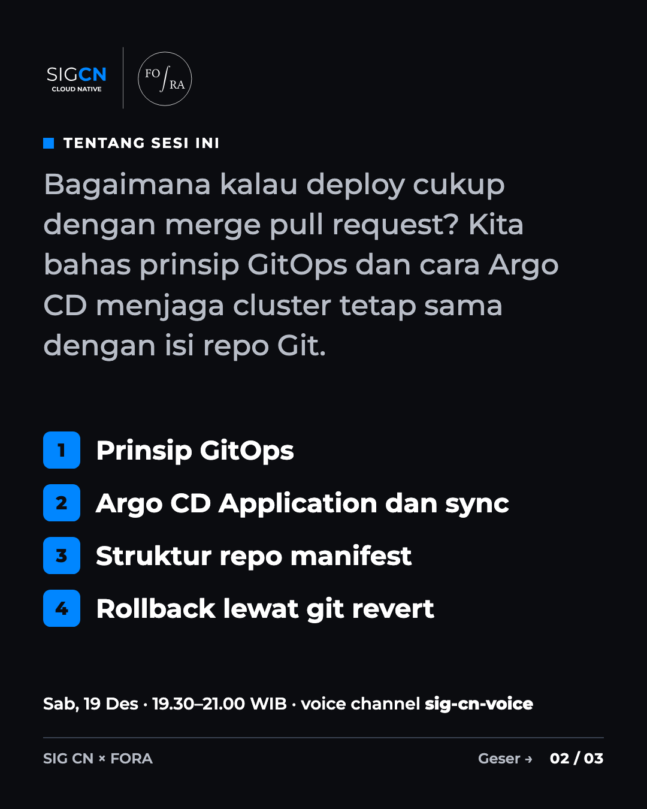  

**X**


**LinkedIn**

  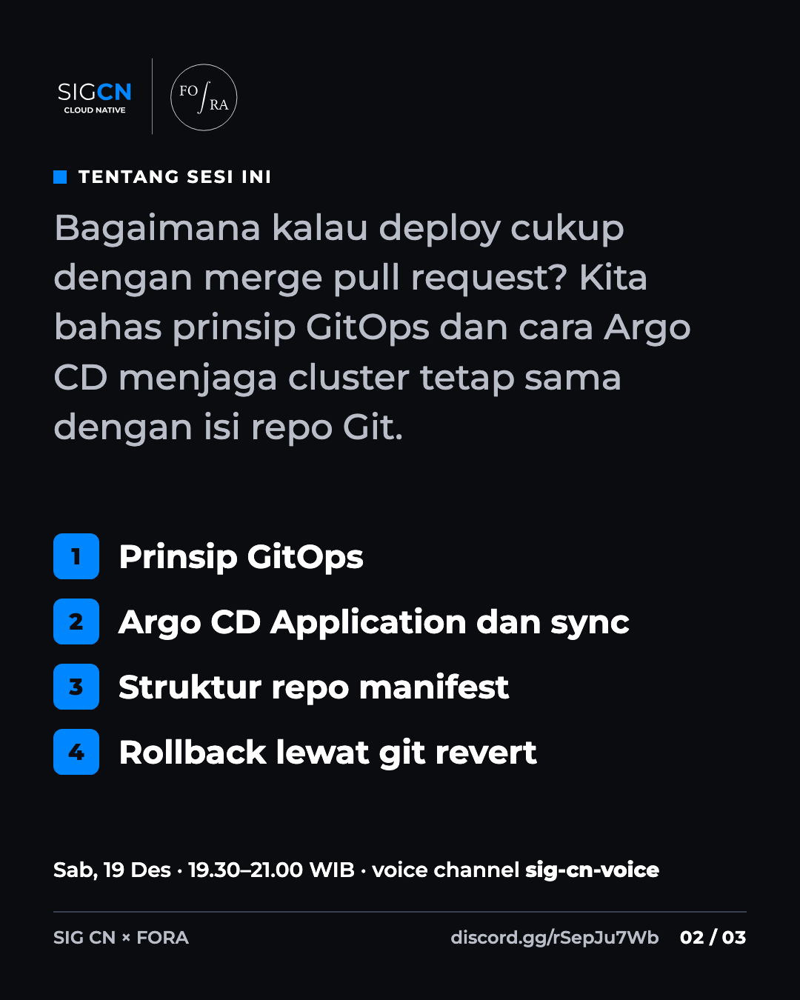  [PDF](sigcn-gitops-argocd/li-doc/cover.pdf)

<details>
<summary>Captions</summary>

**Instagram**

```text
🎙 Cloud Native 101 bareng SIG CN × FORA

Bagaimana kalau deploy cukup dengan merge pull request? Kita bahas prinsip GitOps dan cara Argo CD menjaga cluster tetap sama dengan isi repo Git.

Sesi: GitOps dengan Argo CD: dari commit di Git sampai deploy
📅 Sabtu, 19 Desember 2026, 19.30–21.00 WIB
Di voice channel sig-cn-voice Discord FORA. Ngobrol langsung lewat suara, bukan webinar.

Cara ikut:
1. Buka Discord FORA lewat link di bio, atau langsung ke discord.gg/rSepJu7Wb
2. Masuk ke voice channel sig-cn-voice
3. Siapa pun boleh ikut ngobrol dan bertanya, tinggal masuk.

💬 Ikuti akun ini supaya nggak ketinggalan sesi Cloud Native 101 berikutnya.

#FORA #KomunitasTech #SIGCN #CloudNative #Kubernetes #DevOps #ArgoCD #GitOps
```

**X**

```text
Cloud Native 101 bareng SIG CN × FORA
Sesi: GitOps dengan Argo CD: dari commit di Git sampai deploy
Sab, 19 Des, 19.30–21.00 WIB
Ngobrol santai di voice channel sig-cn-voice Discord FORA, siapa pun boleh ikut bicara dan bertanya.
https://discord.gg/rSepJu7Wb
#SIGCN #FORA
```

**LinkedIn**

```text
Cloud Native 101 bareng SIG CN × FORA

Bagaimana kalau deploy cukup dengan merge pull request? Kita bahas prinsip GitOps dan cara Argo CD menjaga cluster tetap sama dengan isi repo Git.

Sesi: GitOps dengan Argo CD: dari commit di Git sampai deploy, Sabtu, 19 Desember 2026, 19.30–21.00 WIB.

Cocok untuk siapa pun yang tertarik pada topik ini, dari yang baru mulai sampai yang sudah berpengalaman.

Formatnya talk santai di voice channel sig-cn-voice Discord FORA, bukan webinar. Tidak perlu daftar: cukup masuk, dan siapa pun boleh bicara serta bertanya langsung.

Gabung lewat undangan Discord: https://discord.gg/rSepJu7Wb

#SIGCN #CloudNative #Kubernetes #DevOps #GitOps
```

</details>

### SIG intro

**Instagram**

     

**X**


**LinkedIn**

     [PDF](sigcn-gitops-argocd/li-doc/sig-intro.pdf)

<details>
<summary>Captions</summary>

**Instagram**

```text
🎙 Kenalan sama SIG CN di FORA: Ngobrol santai soal Kubernetes dan ekosistem cloud native.

SIG CN adalah special interest group FORA untuk topik cloud native: container, Kubernetes, GitOps, observability, dan seterusnya. Sesi SIG CN berupa talk santai di voice channel Discord, bukan webinar. Siapa pun boleh join dan ikut bicara, dari yang baru mulai sampai yang sudah di production.

Untuk siapa? Yang baru mulai, yang lagi belajar, dan yang sudah bekerja di bidang Cloud Native. Pemula sangat boleh, nggak ada pertanyaan yang terlalu dasar.

Sesi terdekat: GitOps dengan Argo CD: dari commit di Git sampai deploy
📅 Sabtu, 19 Desember 2026, 19.30–21.00 WIB
Di voice channel sig-cn-voice Discord FORA. Ngobrol langsung lewat suara, bukan webinar.

Cara ikut:
1. Buka Discord FORA lewat link di bio, atau langsung ke discord.gg/rSepJu7Wb
2. Masuk ke voice channel sig-cn-voice
3. Siapa pun boleh ikut ngobrol dan bertanya, tinggal masuk.

💬 Ajak teman yang tertarik ikut ngobrol di SIG CN di FORA.

#FORA #KomunitasTech #SIGCN #CloudNative #Kubernetes #DevOps #ArgoCD #GitOps
```

**X 1/2**

```text
Kenalan sama SIG CN di FORA: Ngobrol santai soal Kubernetes dan ekosistem cloud native.
Sesi terdekat: GitOps dengan Argo CD: dari commit di Git sampai deploy, Sab, 19 Des.
```

**X 2/2**

```text
Ngobrol santai di voice channel sig-cn-voice Discord FORA, pemula boleh banget ikut.
https://discord.gg/rSepJu7Wb
#SIGCN #FORA
```

**LinkedIn**

```text
Kenalan dengan SIG CN di FORA: Ngobrol santai soal Kubernetes dan ekosistem cloud native.

SIG CN adalah special interest group FORA untuk topik cloud native: container, Kubernetes, GitOps, observability, dan seterusnya. Sesi SIG CN berupa talk santai di voice channel Discord, bukan webinar. Siapa pun boleh join dan ikut bicara, dari yang baru mulai sampai yang sudah di production.

Untuk siapa? Yang baru mulai, yang lagi belajar, dan yang sudah bekerja di bidang Cloud Native.

Formatnya talk santai di voice channel sig-cn-voice Discord FORA, bukan webinar. Tidak perlu daftar: cukup masuk, dan siapa pun boleh bicara serta bertanya langsung. Sesi terdekat: GitOps dengan Argo CD: dari commit di Git sampai deploy, Sabtu, 19 Desember 2026, 19.30–21.00 WIB.

Gabung lewat undangan Discord: https://discord.gg/rSepJu7Wb

#SIGCN #CloudNative #Kubernetes #DevOps #GitOps
```

</details>


## Observability: Logs, Metrics, Traces

SIG CN · Kamis, 14 Januari 2027 · 20.00 WIB · `sigcn-observability`

### Announce

**Instagram**

 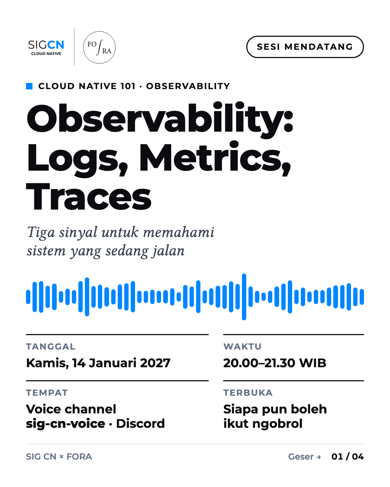    

**X**


**LinkedIn**

 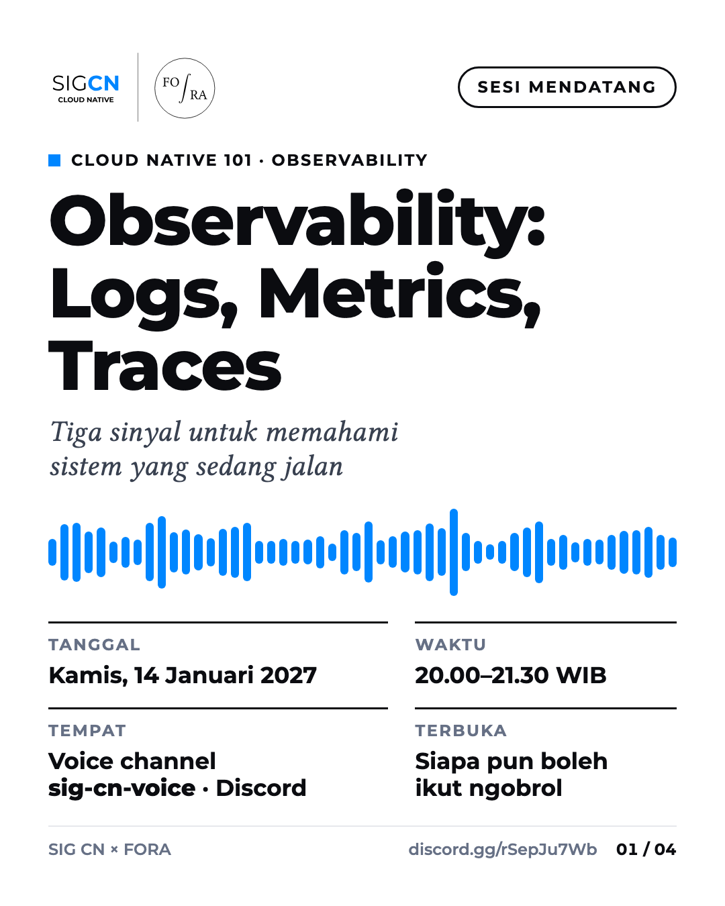    [PDF](sigcn-observability/li-doc/announce.pdf)

<details>
<summary>Captions</summary>

**Instagram**

```text
🎙 Observability: Logs, Metrics, Traces
Sesi SIG CN × FORA

Aplikasi jalan, tapi kenapa lambat? Kita kenalan dengan tiga sinyal observability, kapan memakai masing-masing, dan cara mulai tanpa harus memasang semuanya sekaligus.

📅 Kamis, 14 Januari 2027, 20.00–21.30 WIB
Di voice channel sig-cn-voice Discord FORA. Ngobrol langsung lewat suara, bukan webinar.
Bersama Eko (contoh), dipandu Rina (contoh).

Yang kita bahas:
• Monitoring vs observability
• Logs terstruktur
• Metrics dan Prometheus
• Distributed tracing
• OpenTelemetry sebagai standar
• Alert yang tidak bikin lelah

Cara ikut:
1. Buka Discord FORA lewat link di bio, atau langsung ke discord.gg/rSepJu7Wb
2. Masuk ke voice channel sig-cn-voice
3. Siapa pun boleh ikut ngobrol dan bertanya, tinggal masuk.

💬 Simpan postingan ini dan ajak teman yang mungkin tertarik.

#FORA #KomunitasTech #SIGCN #CloudNative #Kubernetes #DevOps #OpenTelemetry #Prometheus
```

**X**

```text
🎙 Observability: Logs, Metrics, Traces
Kam, 14 Jan, 20.00–21.30 WIB
Ngobrol santai di voice channel sig-cn-voice Discord FORA, siapa pun boleh ikut bicara dan bertanya.
https://discord.gg/rSepJu7Wb
#SIGCN #FORA
```

**LinkedIn**

```text
Observability: Logs, Metrics, Traces
Sesi SIG CN × FORA

Aplikasi jalan, tapi kenapa lambat? Kita kenalan dengan tiga sinyal observability, kapan memakai masing-masing, dan cara mulai tanpa harus memasang semuanya sekaligus.

Kamis, 14 Januari 2027, 20.00–21.30 WIB, bersama Eko (contoh), dipandu Rina (contoh).

Yang akan kita bahas:
• Monitoring vs observability
• Logs terstruktur
• Metrics dan Prometheus
• Distributed tracing
• OpenTelemetry sebagai standar
• Alert yang tidak bikin lelah

Cocok untuk siapa pun yang tertarik pada topik ini, dari yang baru mulai sampai yang sudah berpengalaman.

Formatnya talk santai di voice channel sig-cn-voice Discord FORA, bukan webinar. Tidak perlu daftar: cukup masuk, dan siapa pun boleh bicara serta bertanya langsung.

Gabung lewat undangan Discord: https://discord.gg/rSepJu7Wb

#SIGCN #CloudNative #Kubernetes #DevOps #Observability
```

</details>

### Reminder

**Instagram**

    

**X**


**LinkedIn**

    [PDF](sigcn-observability/li-doc/reminder.pdf)

<details>
<summary>Captions</summary>

**Instagram**

```text
🔴 Hari ini, 20.00 WIB
Observability: Logs, Metrics, Traces

Sesi SIG CN × FORA mulai 20.00 WIB. Kalau sudah mulai, langsung join aja, boleh masuk kapan pun.

Di voice channel sig-cn-voice Discord FORA. Ngobrol langsung lewat suara, bukan webinar.
Bersama Eko (contoh), dipandu Rina (contoh).

Hari ini kita bahas:
• Monitoring vs observability
• Logs terstruktur
• Metrics dan Prometheus
• Distributed tracing
• OpenTelemetry sebagai standar
• Alert yang tidak bikin lelah

Cara ikut:
1. Buka Discord FORA lewat link di bio, atau langsung ke discord.gg/rSepJu7Wb
2. Masuk ke voice channel sig-cn-voice
3. Siapa pun boleh ikut ngobrol dan bertanya, tinggal masuk.

Kirim ke teman yang mau ikut, lalu ketemu di voice channel.

#FORA #KomunitasTech #SIGCN #CloudNative #Kubernetes #DevOps #OpenTelemetry #Prometheus
```

**X**

```text
🔴 Hari ini 20.00 WIB
Observability: Logs, Metrics, Traces
Sudah mulai? Langsung join ke voice channel sig-cn-voice Discord FORA. Siapa pun boleh ngobrol dan bertanya.
https://discord.gg/rSepJu7Wb
#SIGCN #FORA
```

**LinkedIn**

```text
Hari ini, 20.00 WIB
Observability: Logs, Metrics, Traces

SIG CN × FORA berkumpul hari ini pukul 20.00–21.30 WIB, bersama Eko (contoh), dipandu Rina (contoh). Kalau sudah mulai, langsung join saja.

Yang akan kita bahas:
• Monitoring vs observability
• Logs terstruktur
• Metrics dan Prometheus
• Distributed tracing
• OpenTelemetry sebagai standar
• Alert yang tidak bikin lelah

Formatnya talk santai di voice channel sig-cn-voice Discord FORA, bukan webinar. Tidak perlu daftar: cukup masuk, dan siapa pun boleh bicara serta bertanya langsung.

Gabung lewat undangan Discord: https://discord.gg/rSepJu7Wb

#SIGCN #CloudNative #Kubernetes #DevOps #Observability
```

</details>

### Recap

**Instagram**

    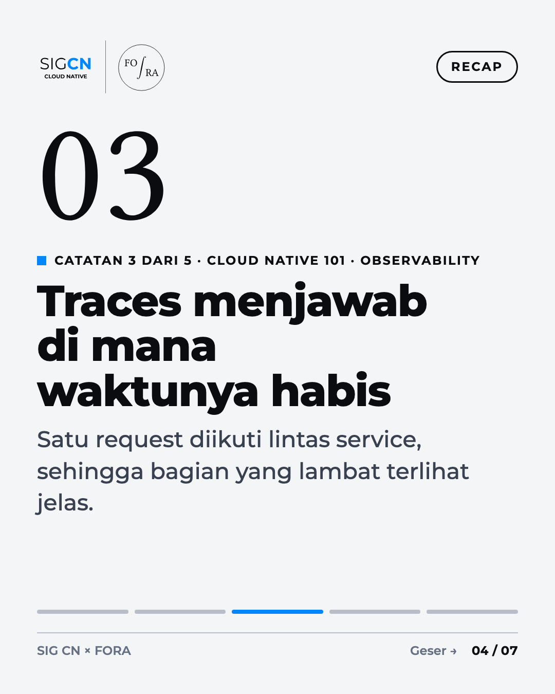    

**X**

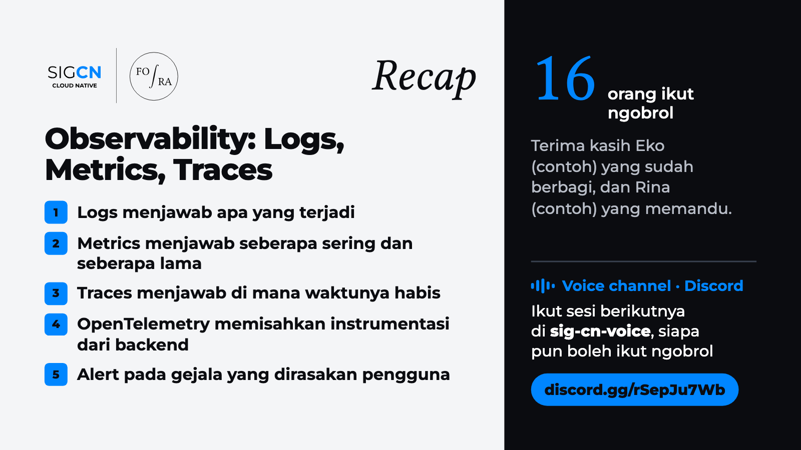

**LinkedIn**

  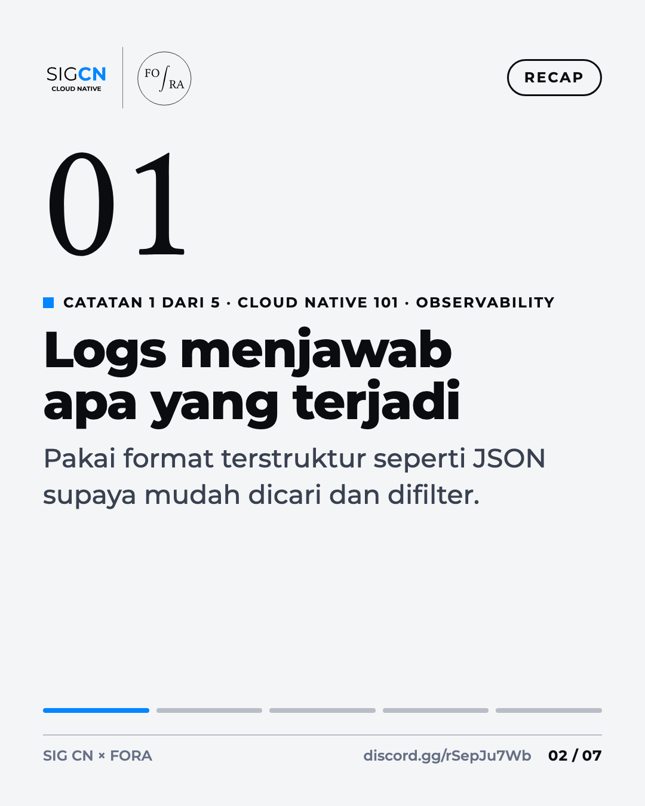   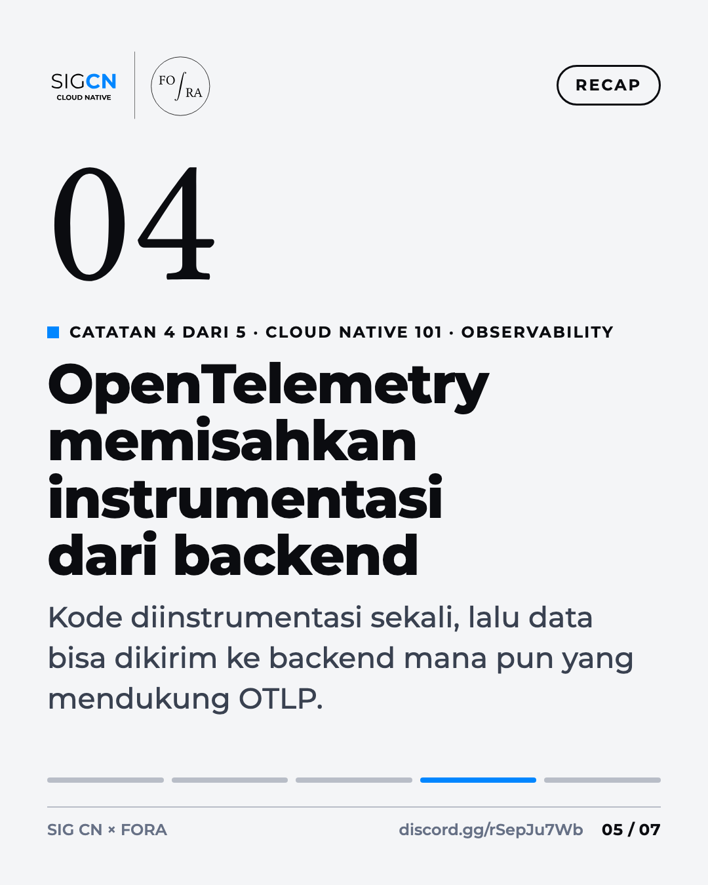   [PDF](sigcn-observability/li-doc/recap.pdf)

<details>
<summary>Captions</summary>

**Instagram**

```text
✅ Rangkuman sesi
Observability: Logs, Metrics, Traces

Makasih Eko (contoh)! Ada 16 orang yang ikut ngobrol di voice channel.

Poin-poin yang kita bawa pulang:
1. Logs menjawab apa yang terjadi: Pakai format terstruktur seperti JSON supaya mudah dicari dan difilter.
2. Metrics menjawab seberapa sering dan seberapa lama: Angka agregat yang murah disimpan dan cocok untuk dashboard dan alert.
3. Traces menjawab di mana waktunya habis: Satu request diikuti lintas service, sehingga bagian yang lambat terlihat jelas.
4. OpenTelemetry memisahkan instrumentasi dari backend: Kode diinstrumentasi sekali, lalu data bisa dikirim ke backend mana pun yang mendukung OTLP.
5. Alert pada gejala yang dirasakan pengguna: Contohnya error rate dan latency, bukan CPU yang kebetulan tinggi sebentar.

Bacaan lanjutan:
• Dokumentasi OpenTelemetry: https://opentelemetry.io/docs/
• Dokumentasi Prometheus: https://prometheus.io/docs/introduction/overview/

Sesi berikutnya diumumkan di Discord FORA. Gabung dulu lewat link di bio atau discord.gg/rSepJu7Wb, biar nggak ketinggalan.

Simpan postingan ini buat dibaca ulang.

#FORA #KomunitasTech #SIGCN #CloudNative #Kubernetes #DevOps #OpenTelemetry #Prometheus
```

**X 1/3**

```text
Rangkuman "Observability: Logs, Metrics, Traces". 16 orang ngobrol di voice channel. Makasih Eko (contoh)!
```

**X 2/3**

```text
Poin-poin utamanya:
1. Logs menjawab apa yang terjadi
2. Metrics menjawab seberapa sering dan seberapa lama
3. Traces menjawab di mana waktunya habis
4. OpenTelemetry memisahkan instrumentasi dari backend
5. Alert pada gejala yang dirasakan pengguna
```

**X 3/3**

```text
Bacaan: Dokumentasi OpenTelemetry https://opentelemetry.io/docs/
Sesi berikutnya diumumkan di Discord FORA. Gabung dulu, siapa pun boleh ikut ngobrol dan bertanya:
https://discord.gg/rSepJu7Wb
#SIGCN #FORA
```

**LinkedIn**

```text
Rangkuman sesi SIG CN × FORA
Observability: Logs, Metrics, Traces

Terima kasih Eko (contoh). 16 orang ikut ngobrol di voice channel.

Beberapa poin yang kami bawa pulang:
1. Logs menjawab apa yang terjadi: Pakai format terstruktur seperti JSON supaya mudah dicari dan difilter.
2. Metrics menjawab seberapa sering dan seberapa lama: Angka agregat yang murah disimpan dan cocok untuk dashboard dan alert.
3. Traces menjawab di mana waktunya habis: Satu request diikuti lintas service, sehingga bagian yang lambat terlihat jelas.
4. OpenTelemetry memisahkan instrumentasi dari backend: Kode diinstrumentasi sekali, lalu data bisa dikirim ke backend mana pun yang mendukung OTLP.
5. Alert pada gejala yang dirasakan pengguna: Contohnya error rate dan latency, bukan CPU yang kebetulan tinggi sebentar.

Bacaan lanjutan:
• Dokumentasi OpenTelemetry: https://opentelemetry.io/docs/
• Dokumentasi Prometheus: https://prometheus.io/docs/introduction/overview/

Sesi berikutnya akan diumumkan di Discord FORA. Format tetap sama: talk santai di voice channel, terbuka untuk siapa pun. https://discord.gg/rSepJu7Wb

#SIGCN #CloudNative #Kubernetes #DevOps #Observability
```

</details>

### Cover

**Instagram**

   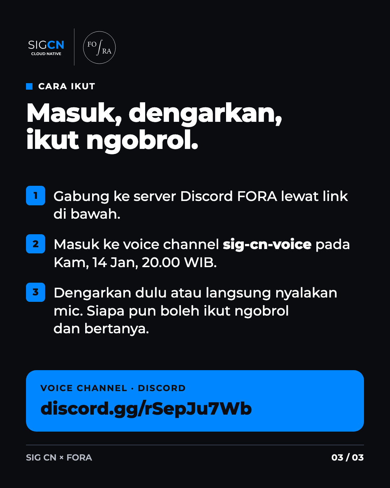 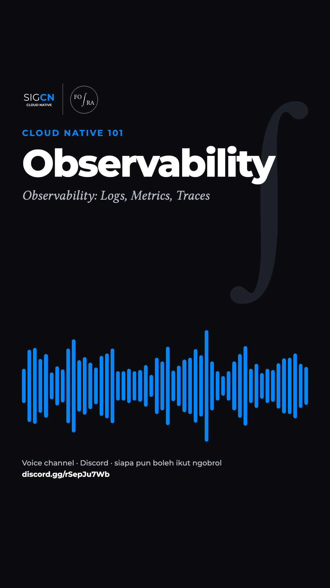

**X**


**LinkedIn**

    [PDF](sigcn-observability/li-doc/cover.pdf)

<details>
<summary>Captions</summary>

**Instagram**

```text
🎙 Cloud Native 101 bareng SIG CN × FORA

Aplikasi jalan, tapi kenapa lambat? Kita kenalan dengan tiga sinyal observability, kapan memakai masing-masing, dan cara mulai tanpa harus memasang semuanya sekaligus.

Sesi: Observability: Logs, Metrics, Traces
📅 Kamis, 14 Januari 2027, 20.00–21.30 WIB
Di voice channel sig-cn-voice Discord FORA. Ngobrol langsung lewat suara, bukan webinar.

Cara ikut:
1. Buka Discord FORA lewat link di bio, atau langsung ke discord.gg/rSepJu7Wb
2. Masuk ke voice channel sig-cn-voice
3. Siapa pun boleh ikut ngobrol dan bertanya, tinggal masuk.

💬 Ikuti akun ini supaya nggak ketinggalan sesi Cloud Native 101 berikutnya.

#FORA #KomunitasTech #SIGCN #CloudNative #Kubernetes #DevOps #OpenTelemetry #Prometheus
```

**X**

```text
Cloud Native 101 bareng SIG CN × FORA
Sesi: Observability: Logs, Metrics, Traces
Kam, 14 Jan, 20.00–21.30 WIB
Ngobrol santai di voice channel sig-cn-voice Discord FORA, siapa pun boleh ikut bicara dan bertanya.
https://discord.gg/rSepJu7Wb
#SIGCN #FORA
```

**LinkedIn**

```text
Cloud Native 101 bareng SIG CN × FORA

Aplikasi jalan, tapi kenapa lambat? Kita kenalan dengan tiga sinyal observability, kapan memakai masing-masing, dan cara mulai tanpa harus memasang semuanya sekaligus.

Sesi: Observability: Logs, Metrics, Traces, Kamis, 14 Januari 2027, 20.00–21.30 WIB.

Cocok untuk siapa pun yang tertarik pada topik ini, dari yang baru mulai sampai yang sudah berpengalaman.

Formatnya talk santai di voice channel sig-cn-voice Discord FORA, bukan webinar. Tidak perlu daftar: cukup masuk, dan siapa pun boleh bicara serta bertanya langsung.

Gabung lewat undangan Discord: https://discord.gg/rSepJu7Wb

#SIGCN #CloudNative #Kubernetes #DevOps #Observability
```

</details>

### SIG intro

**Instagram**

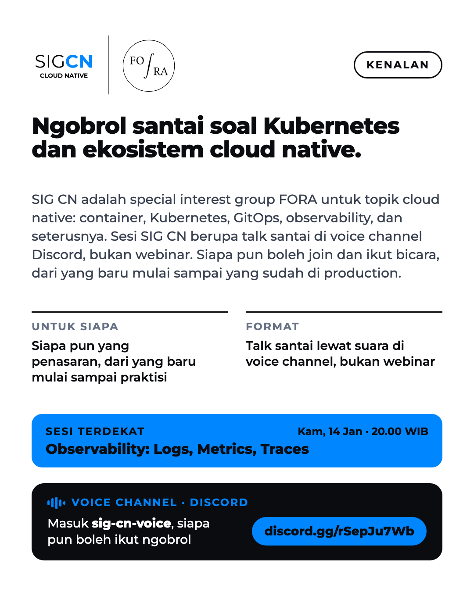 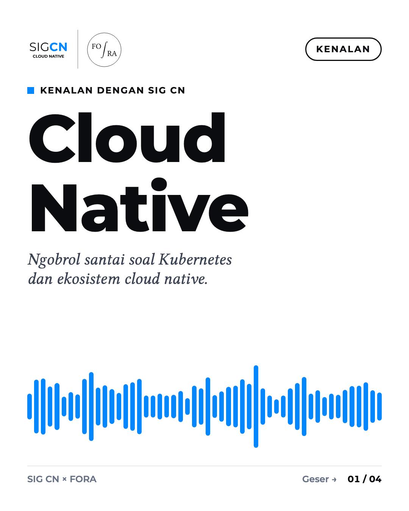   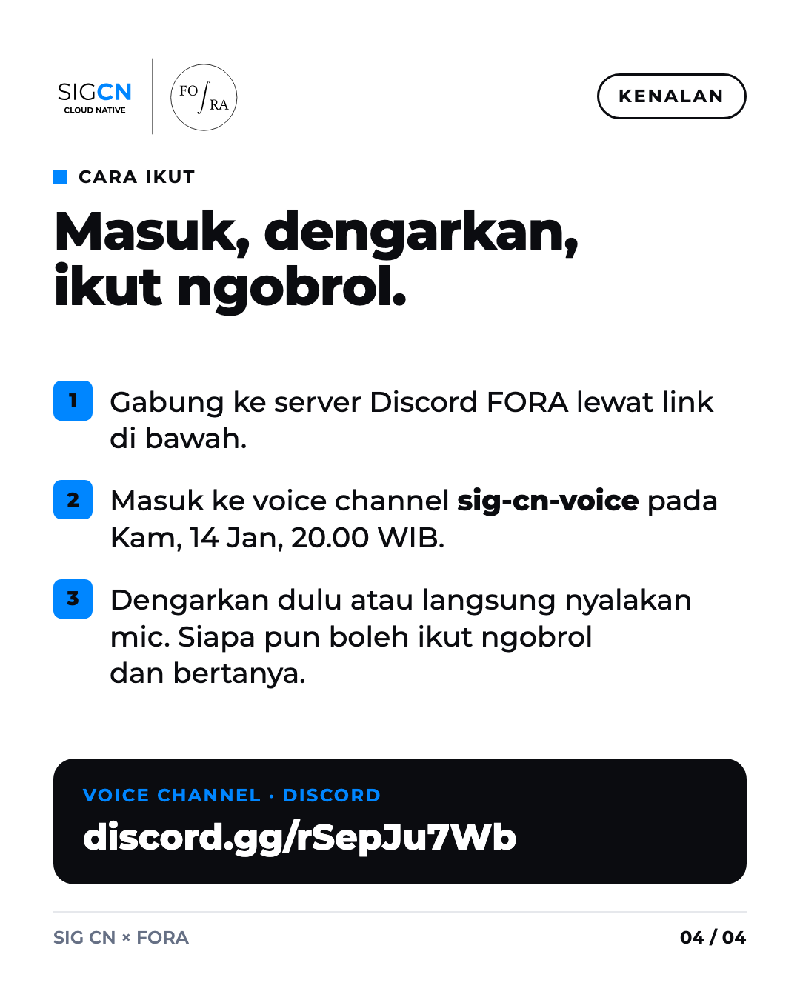 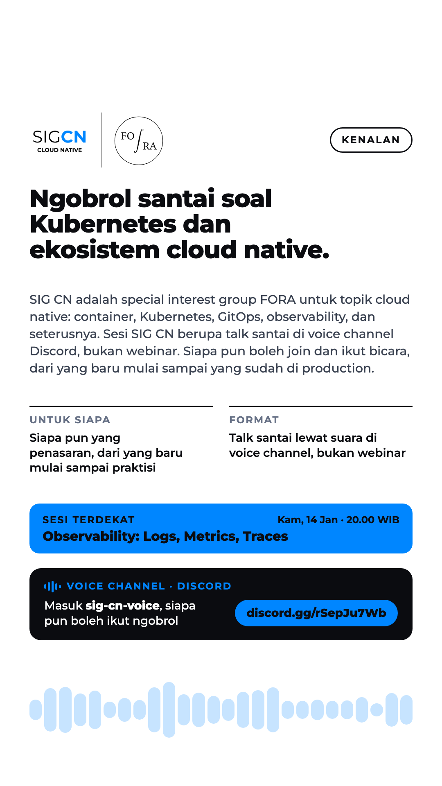

**X**


**LinkedIn**

 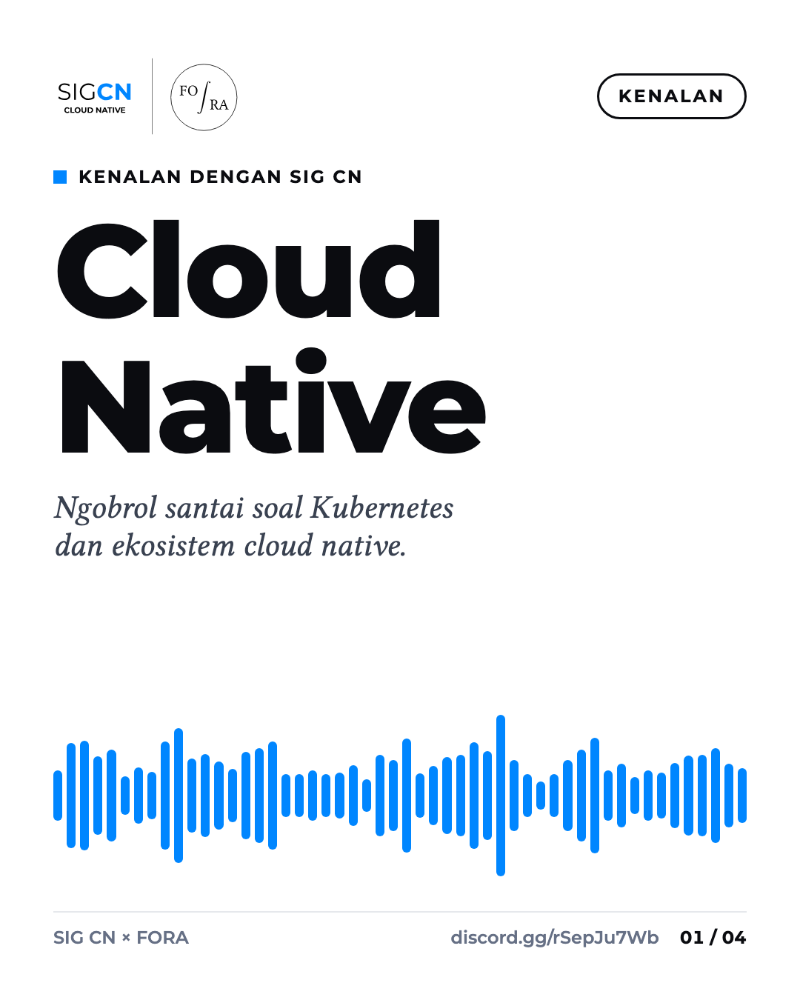    [PDF](sigcn-observability/li-doc/sig-intro.pdf)

<details>
<summary>Captions</summary>

**Instagram**

```text
🎙 Kenalan sama SIG CN di FORA: Ngobrol santai soal Kubernetes dan ekosistem cloud native.

SIG CN adalah special interest group FORA untuk topik cloud native: container, Kubernetes, GitOps, observability, dan seterusnya. Sesi SIG CN berupa talk santai di voice channel Discord, bukan webinar. Siapa pun boleh join dan ikut bicara, dari yang baru mulai sampai yang sudah di production.

Untuk siapa? Yang baru mulai, yang lagi belajar, dan yang sudah bekerja di bidang Cloud Native. Pemula sangat boleh, nggak ada pertanyaan yang terlalu dasar.

Sesi terdekat: Observability: Logs, Metrics, Traces
📅 Kamis, 14 Januari 2027, 20.00–21.30 WIB
Di voice channel sig-cn-voice Discord FORA. Ngobrol langsung lewat suara, bukan webinar.

Cara ikut:
1. Buka Discord FORA lewat link di bio, atau langsung ke discord.gg/rSepJu7Wb
2. Masuk ke voice channel sig-cn-voice
3. Siapa pun boleh ikut ngobrol dan bertanya, tinggal masuk.

💬 Ajak teman yang tertarik ikut ngobrol di SIG CN di FORA.

#FORA #KomunitasTech #SIGCN #CloudNative #Kubernetes #DevOps #OpenTelemetry #Prometheus
```

**X**

```text
Kenalan sama SIG CN di FORA: Ngobrol santai soal Kubernetes dan ekosistem cloud native.
Sesi terdekat: Observability: Logs, Metrics, Traces, Kam, 14 Jan.
Ngobrol santai di voice channel sig-cn-voice Discord FORA, pemula boleh banget ikut.
https://discord.gg/rSepJu7Wb
#SIGCN #FORA
```

**LinkedIn**

```text
Kenalan dengan SIG CN di FORA: Ngobrol santai soal Kubernetes dan ekosistem cloud native.

SIG CN adalah special interest group FORA untuk topik cloud native: container, Kubernetes, GitOps, observability, dan seterusnya. Sesi SIG CN berupa talk santai di voice channel Discord, bukan webinar. Siapa pun boleh join dan ikut bicara, dari yang baru mulai sampai yang sudah di production.

Untuk siapa? Yang baru mulai, yang lagi belajar, dan yang sudah bekerja di bidang Cloud Native.

Formatnya talk santai di voice channel sig-cn-voice Discord FORA, bukan webinar. Tidak perlu daftar: cukup masuk, dan siapa pun boleh bicara serta bertanya langsung. Sesi terdekat: Observability: Logs, Metrics, Traces, Kamis, 14 Januari 2027, 20.00–21.30 WIB.

Gabung lewat undangan Discord: https://discord.gg/rSepJu7Wb

#SIGCN #CloudNative #Kubernetes #DevOps #Observability
```

</details>

<!-- gallery:end -->
