# Examples

Sample renders of every post type and format, made by `pnpm examples` from `examples/sessions/`.

<!-- gallery:start -->

## Ngobrol Karier di Tech

FORA · Sabtu, 23 Januari 2027 · 19.30 WIB · `fora-ngobrol-karier`

### Announce

**Instagram**

  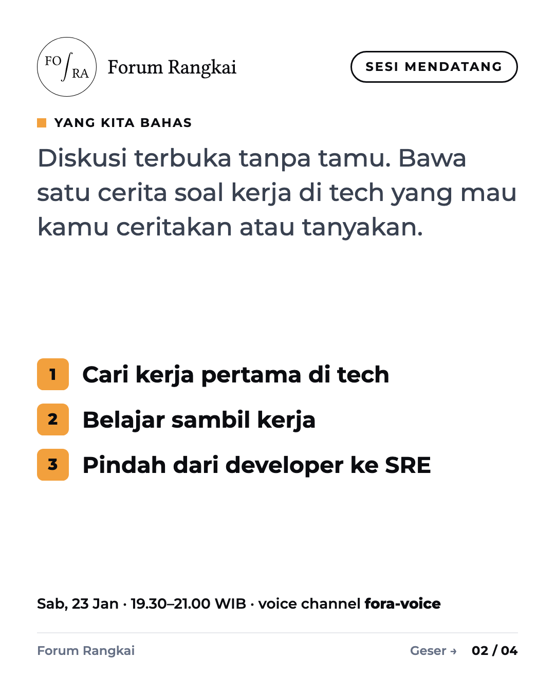  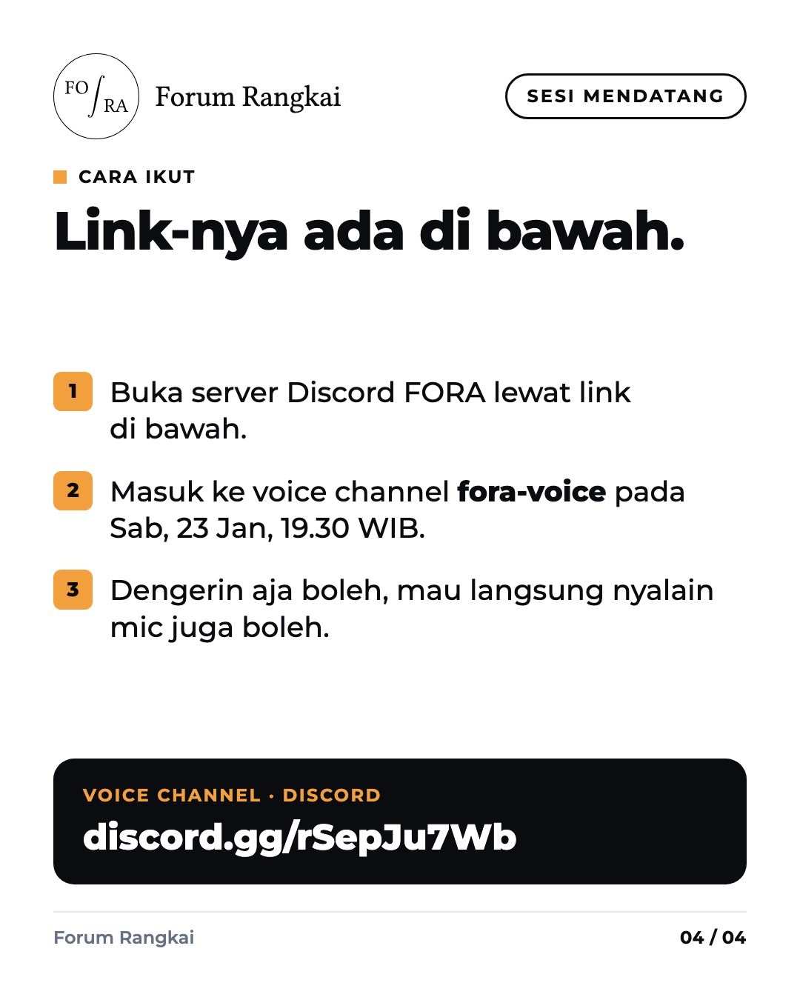 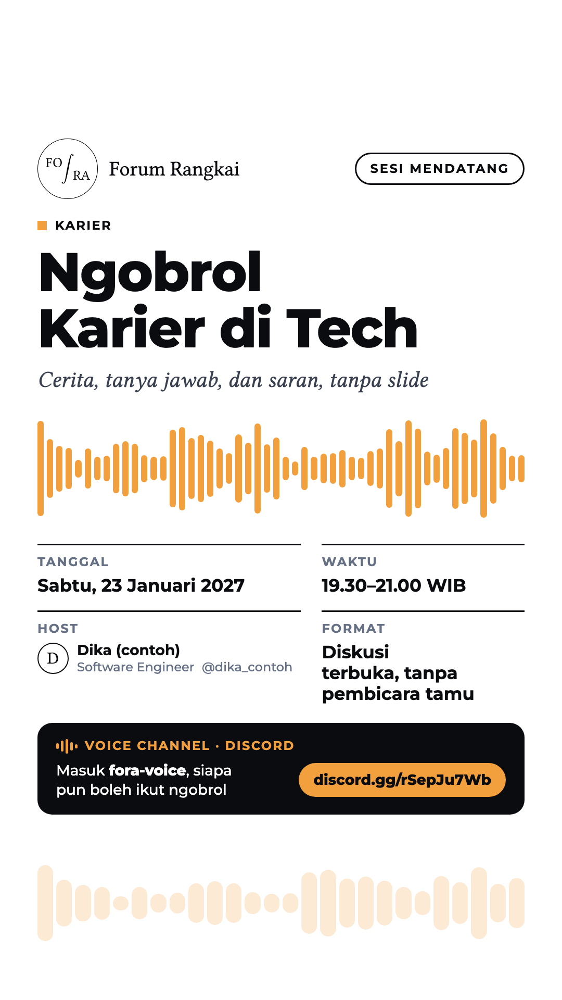

**X**

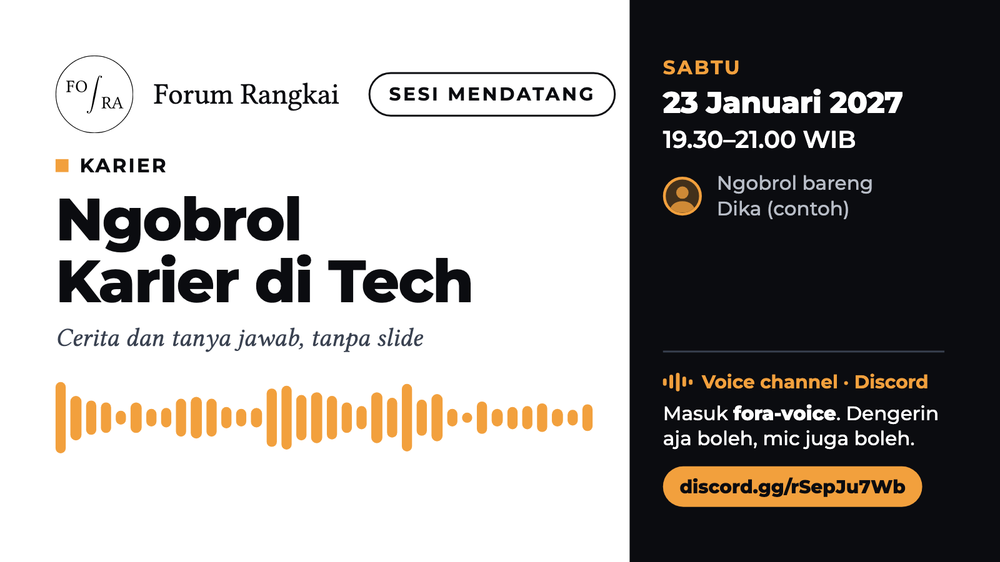

**LinkedIn**

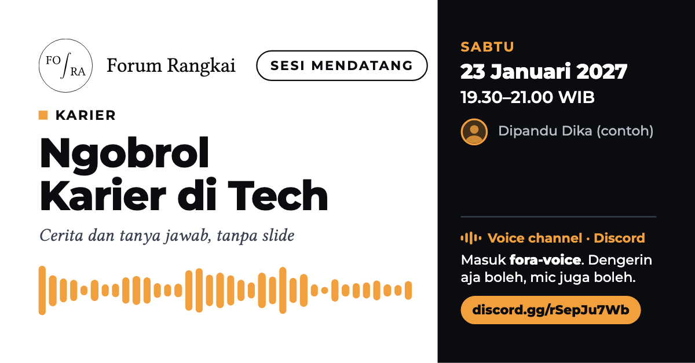  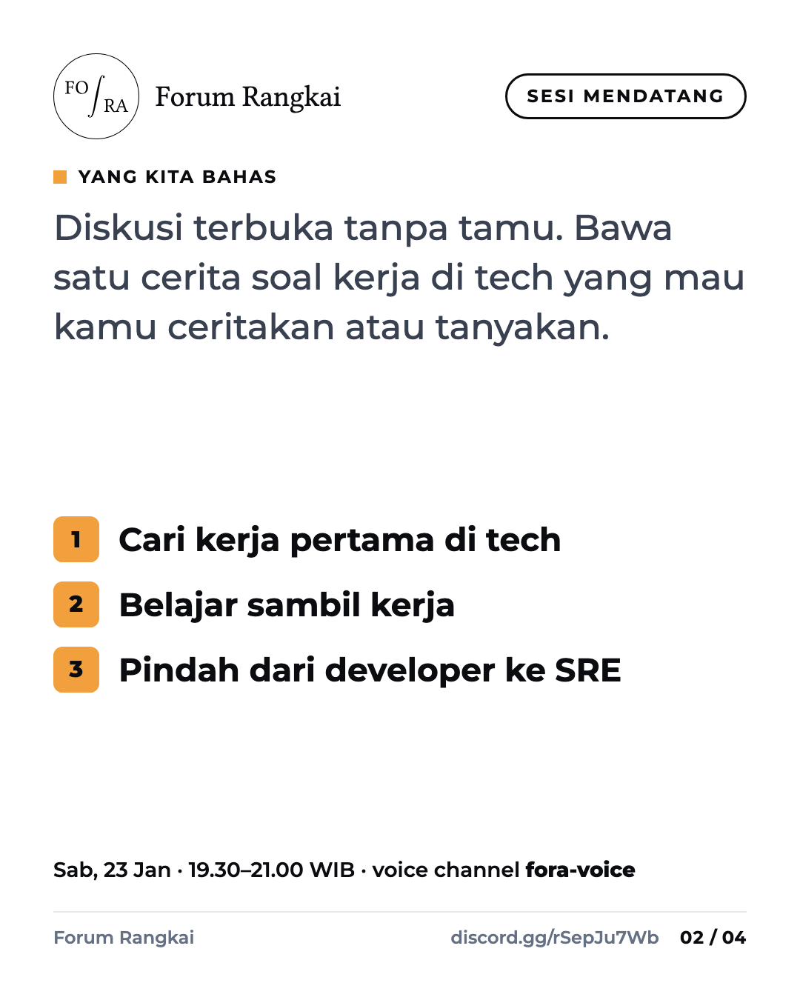   [PDF](fora-ngobrol-karier/li-doc/announce.pdf)

<details>
<summary>Captions</summary>

**Instagram**

```text
Ngobrol Karier di Tech

Waktu cari kerja pertama saya kirim 40 lamaran dan cuma dua yang dibalas. Saya mau dengar cara kalian.

Sab, 23 Jan, 19.30–21.00 WIB. Dipandu Dika (contoh) @dika_contoh.

- Cari kerja pertama di tech
- Belajar sambil kerja
- Pindah dari developer ke SRE

Mampir ke voice channel fora-voice di Discord FORA, link di bio atau discord.gg/rSepJu7Wb. Dengerin aja nggak apa-apa, ngomong juga silakan.

#FORA #Karier #KarierTech #KomunitasTech
```

**X**

```text
Waktu cari kerja pertama saya kirim 40 lamaran dan cuma dua yang dibalas. Saya mau dengar cara kalian.
Ngobrol Karier di Tech
Sab, 23 Jan, 19.30–21.00 WIB
Di voice channel fora-voice Discord FORA. Dengerin aja boleh, mic juga boleh.
https://discord.gg/rSepJu7Wb
#Karier
```

**LinkedIn**

```text
Ngobrol Karier di Tech, bareng FORA

Sab, 23 Jan, 19.30–21.00 WIB. Waktu cari kerja pertama saya kirim 40 lamaran dan cuma dua yang dibalas. Saya mau dengar cara kalian.

• Cari kerja pertama di tech
• Belajar sambil kerja
• Pindah dari developer ke SRE

Dipandu Dika (contoh) @dika_contoh.

Gabung lewat https://discord.gg/rSepJu7Wb, lalu masuk ke voice channel fora-voice. Boleh dengarkan saja, boleh juga ikut bicara.

#Karier #KomunitasTech #FORA
```

</details>

### Reminder

**Instagram**

    

**X**


**LinkedIn**

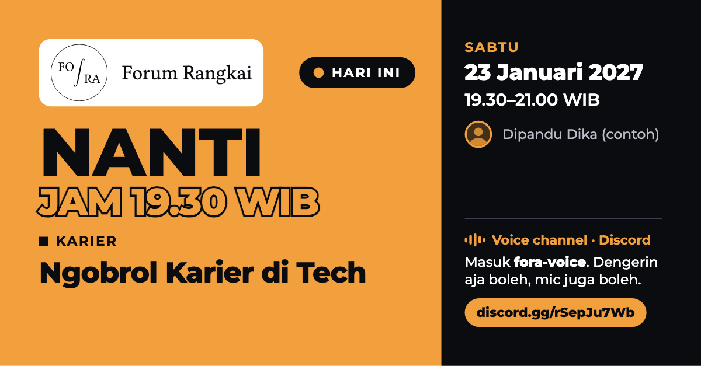    [PDF](fora-ngobrol-karier/li-doc/reminder.pdf)

<details>
<summary>Captions</summary>

**Instagram**

```text
Jam 19.30 WIB nanti kita ngobrol soal Karier.

Ngobrol Karier di Tech, dipandu Dika (contoh) @dika_contoh.

Mic boleh mati dulu sampai kamu siap ngomong. Langsung masuk voice channel fora-voice lewat discord.gg/rSepJu7Wb (ada juga di bio). Dengerin aja nggak apa-apa, ngomong juga silakan.

#FORA #Karier #KarierTech #KomunitasTech
```

**X**

```text
Nanti jam 19.30 WIB, Ngobrol Karier di Tech.
Di voice channel fora-voice Discord FORA. Dengerin aja boleh, mic juga boleh.
https://discord.gg/rSepJu7Wb
#Karier
```

**LinkedIn**

```text
Hari ini jam 19.30 WIB kita ngobrol soal Karier.

Ngobrol Karier di Tech, Sabtu, 23 Januari 2027. Dipandu Dika (contoh) @dika_contoh.

Mikrofon boleh dimatikan sampai kamu siap bicara. Gabung lewat https://discord.gg/rSepJu7Wb, lalu masuk ke voice channel fora-voice. Boleh dengarkan saja, boleh juga ikut bicara.

#Karier #KomunitasTech #FORA
```

</details>

### Live

**Instagram**

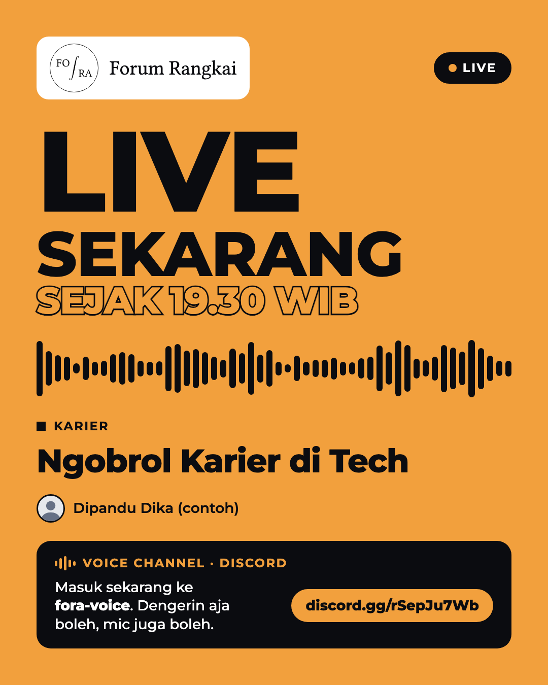 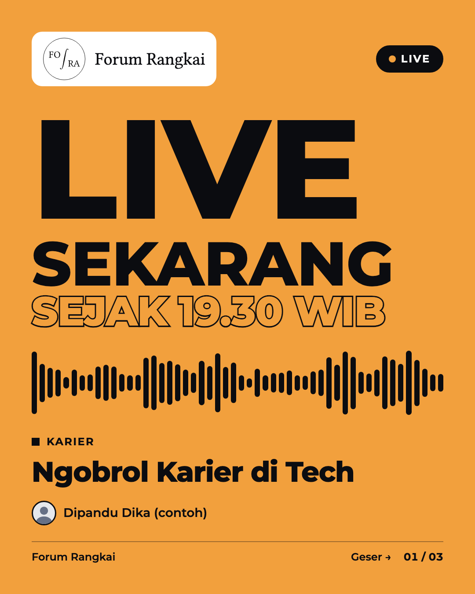  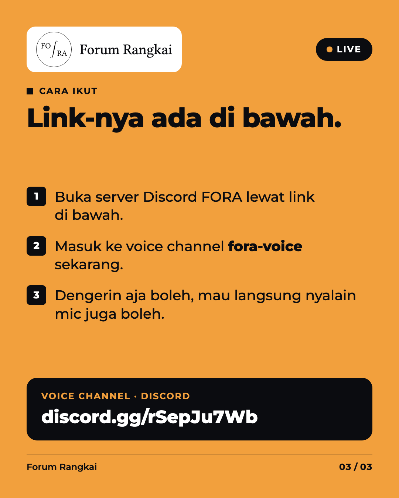 

**X**


**LinkedIn**

    [PDF](fora-ngobrol-karier/li-doc/live.pdf)

<details>
<summary>Captions</summary>

**Instagram**

```text
Live sekarang, dipandu Dika (contoh) @dika_contoh.

Ngobrol Karier di Tech

Buka discord.gg/rSepJu7Wb (juga ada di bio), lalu ke voice channel fora-voice. Dengerin aja boleh, mic juga boleh.

#FORA #Karier #KarierTech #KomunitasTech
```

**X**

```text
Ngobrol Karier di Tech lagi jalan sekarang.
Langsung masuk ke voice channel fora-voice di Discord FORA. Dengerin aja boleh, mic juga boleh.
https://discord.gg/rSepJu7Wb
#Karier
```

**LinkedIn**

```text
Live sekarang di voice channel fora-voice.

Ngobrol Karier di Tech, dipandu Dika (contoh) @dika_contoh.

Undangan Discord: https://discord.gg/rSepJu7Wb. Kita ada di voice channel fora-voice. Mau dengarkan saja atau ikut bicara, dua-duanya boleh.

#Karier #KomunitasTech #FORA
```

</details>

### Recap

**Instagram**

    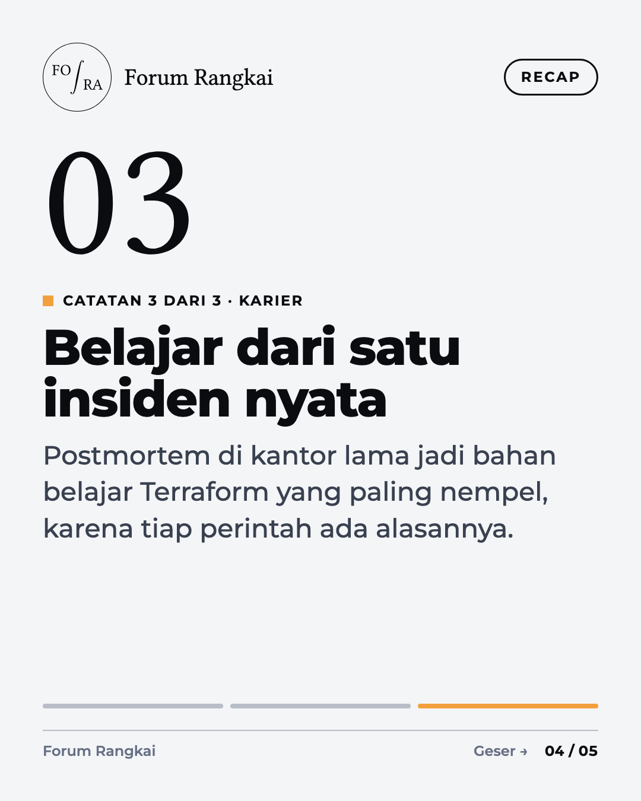  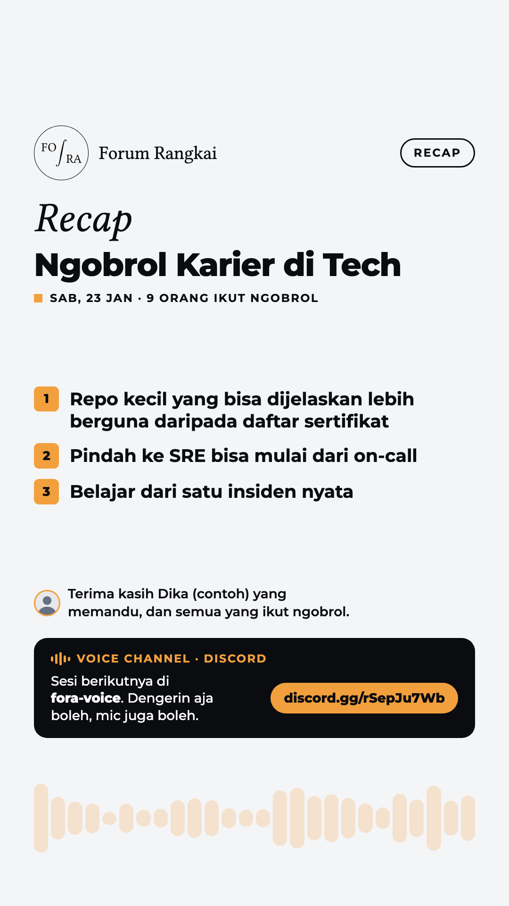

**X**

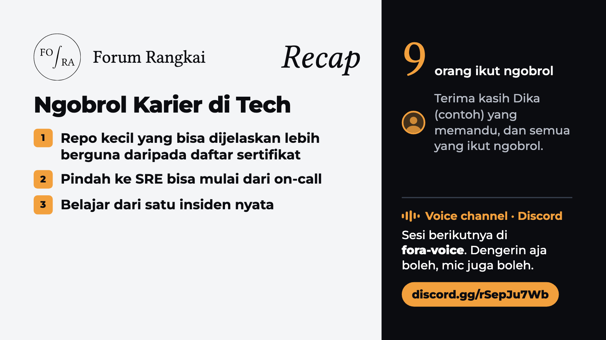

**LinkedIn**

 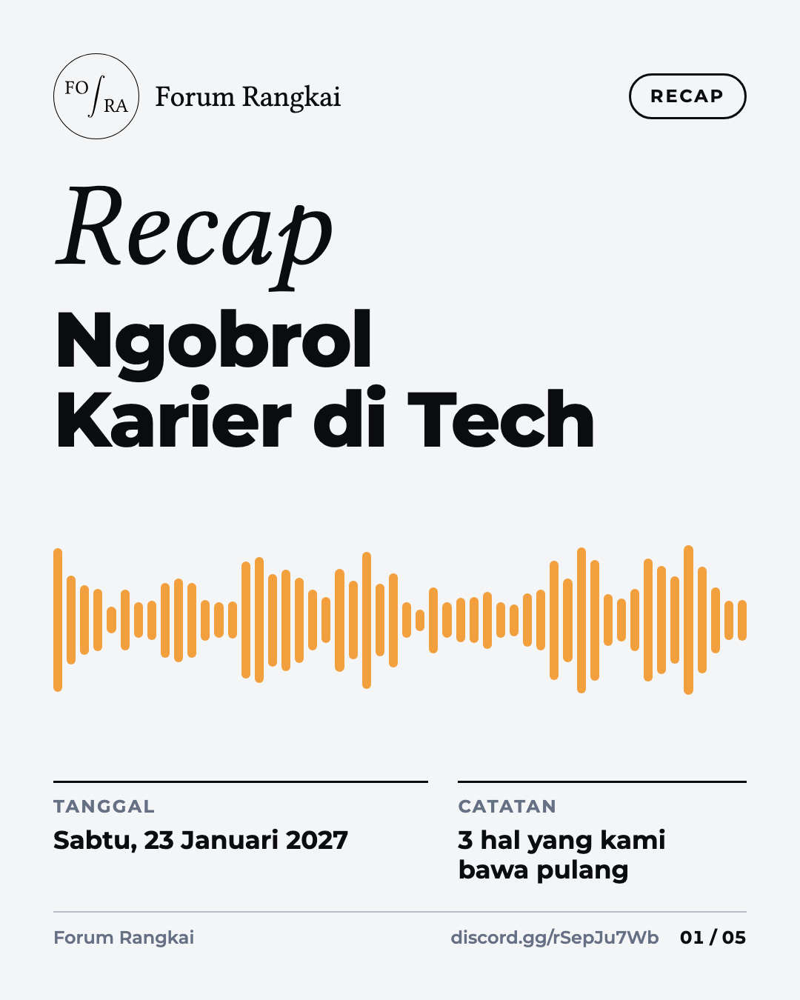  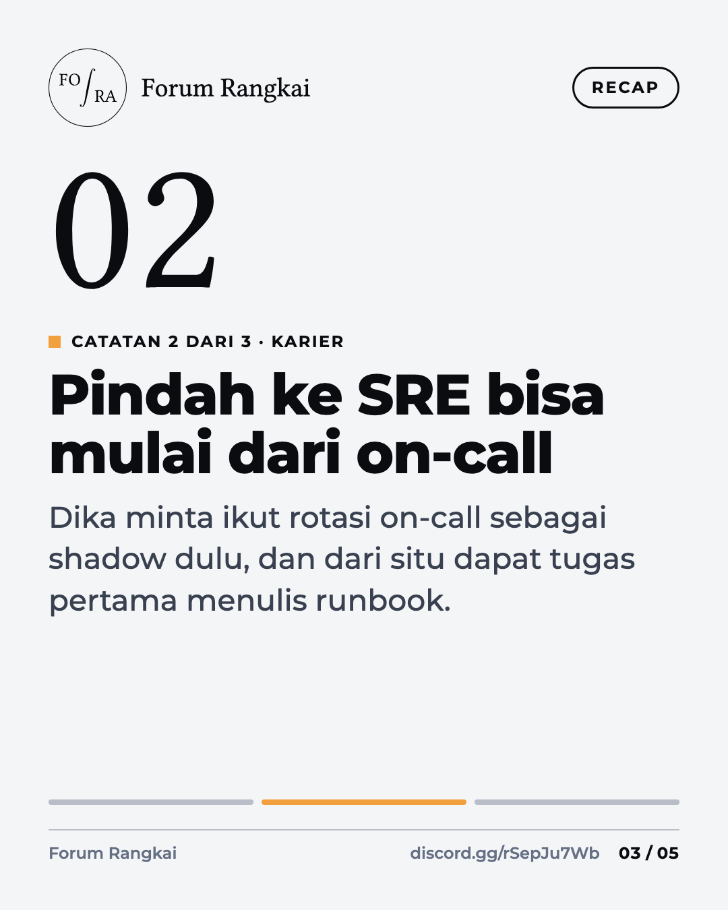   [PDF](fora-ngobrol-karier/li-doc/recap.pdf)

<details>
<summary>Captions</summary>

**Instagram**

```text
Ini yang tercatat dari "Ngobrol Karier di Tech" (Sab, 23 Jan).

- Repo kecil yang bisa dijelaskan lebih berguna daripada daftar sertifikat. Salah satu peserta cerita, pewawancaranya menghabiskan lima belas menit di satu repo buatannya dan nggak membuka sertifikat sama sekali.
- Pindah ke SRE bisa mulai dari on-call. Dika minta ikut rotasi on-call sebagai shadow dulu, dan dari situ dapat tugas pertama menulis runbook.
- Belajar dari satu insiden nyata. Postmortem di kantor lama jadi bahan belajar Terraform yang paling nempel, karena tiap perintah ada alasannya.

9 orang ikut ngobrol di voice channel. Makasih Dika (contoh) @dika_contoh, sampai ketemu lagi. Kamu setuju sama "Belajar dari satu insiden nyata"? Kalau di tempatmu beda, ceritain.

Sesi berikutnya kita umumkan di Discord FORA (link di bio atau discord.gg/rSepJu7Wb). Dengerin aja boleh, mic juga boleh.

#FORA #Karier #KarierTech #KomunitasTech
```

**X 1/3**

```text
9 orang ngobrol di voice channel buat "Ngobrol Karier di Tech". Makasih Dika (contoh) @dika_contoh, ini catatannya.
```

**X 2/3**

```text
Repo kecil yang bisa dijelaskan lebih berguna daripada daftar sertifikat. Salah satu peserta cerita, pewawancaranya menghabiskan lima belas menit di satu repo buatannya dan nggak membuka sertifikat sama sekali.
```

**X 3/3**

```text
Kamu setuju sama "Repo kecil yang bisa dijelaskan lebih berguna daripada daftar sertifikat"? Kalau di tempatmu beda, ceritain.
Sesi berikutnya diumumkan di Discord FORA. Dengerin aja boleh, mic juga boleh.
https://discord.gg/rSepJu7Wb
#Karier
```

**LinkedIn**

```text
Rekap "Ngobrol Karier di Tech" (Sab, 23 Jan).

Terima kasih Dika (contoh) @dika_contoh. 9 orang ikut ngobrol di voice channel.

1. Repo kecil yang bisa dijelaskan lebih berguna daripada daftar sertifikat. Salah satu peserta cerita, pewawancaranya menghabiskan lima belas menit di satu repo buatannya dan nggak membuka sertifikat sama sekali.
2. Pindah ke SRE bisa mulai dari on-call. Dika minta ikut rotasi on-call sebagai shadow dulu, dan dari situ dapat tugas pertama menulis runbook.
3. Belajar dari satu insiden nyata. Postmortem di kantor lama jadi bahan belajar Terraform yang paling nempel, karena tiap perintah ada alasannya.

Kamu setuju sama "Pindah ke SRE bisa mulai dari on-call"? Kalau di tempatmu beda, ceritain.

Sesi berikutnya akan kita umumkan di Discord FORA, di voice channel fora-voice. Mau dengarkan saja atau ikut bicara, dua-duanya boleh. https://discord.gg/rSepJu7Wb

#Karier #KomunitasTech #FORA
```

</details>

### Cover

**Instagram**

 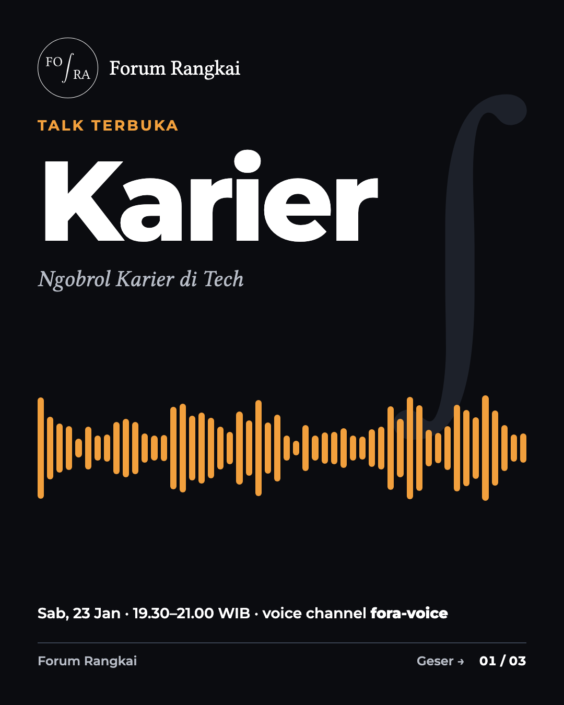   

**X**


**LinkedIn**

    [PDF](fora-ngobrol-karier/li-doc/cover.pdf)

<details>
<summary>Captions</summary>

**Instagram**

```text
Tema Karier bareng FORA.

Cerita dan tanya jawab, tanpa slide.

Sesinya "Ngobrol Karier di Tech", Sabtu, 23 Januari 2027, 19.30–21.00 WIB.

Link Discord ada di bio (discord.gg/rSepJu7Wb). Masuk ke voice channel fora-voice. Dengerin aja nggak apa-apa, ngomong juga silakan.

#FORA #Karier #KarierTech #KomunitasTech
```

**X**

```text
Tema Karier bareng FORA.
Ngobrol Karier di Tech
Sab, 23 Jan, 19.30–21.00 WIB
Di voice channel fora-voice Discord FORA. Dengerin aja boleh, mic juga boleh.
https://discord.gg/rSepJu7Wb
#Karier
```

**LinkedIn**

```text
Cerita dan tanya jawab, tanpa slide.

Tema Karier bareng FORA. Sesinya "Ngobrol Karier di Tech", Sab, 23 Jan, 19.30–21.00 WIB.

Gabung lewat https://discord.gg/rSepJu7Wb, lalu masuk ke voice channel fora-voice. Boleh dengarkan saja, boleh juga ikut bicara.

#Karier #KomunitasTech #FORA
```

</details>

### SIG intro

**Instagram**

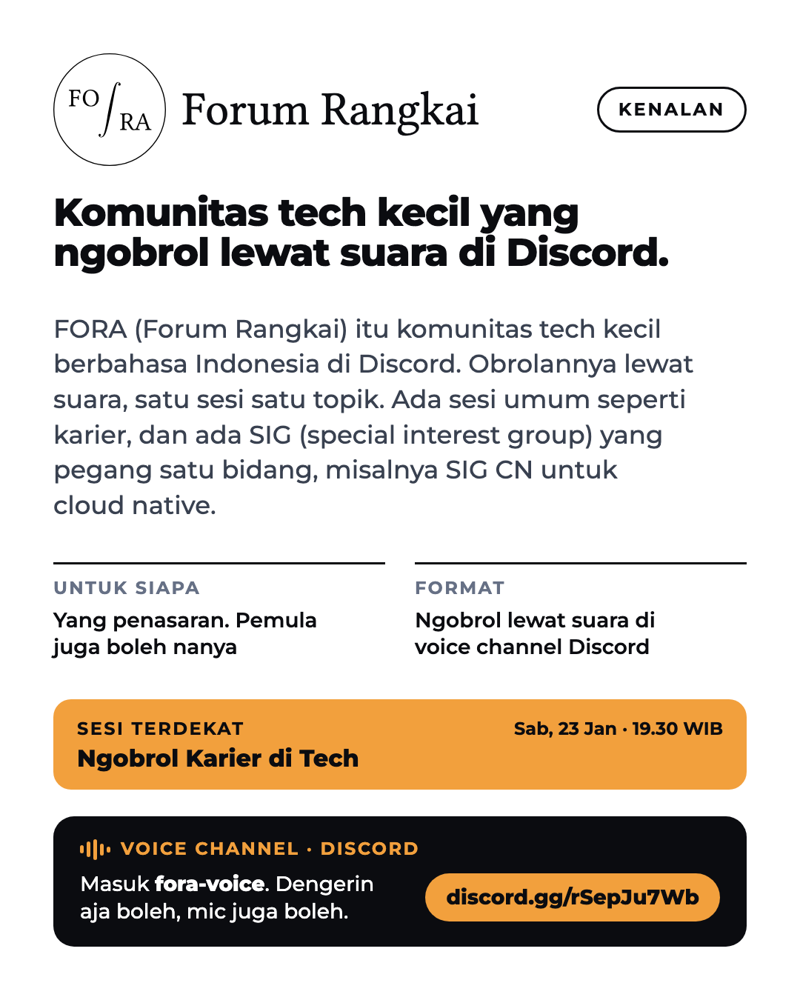 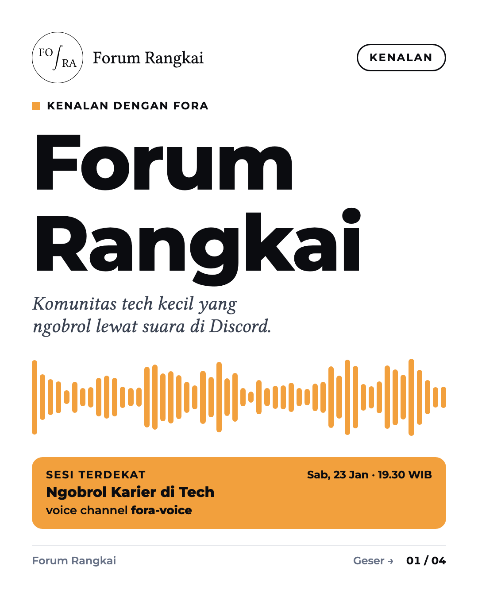    

**X**


**LinkedIn**

   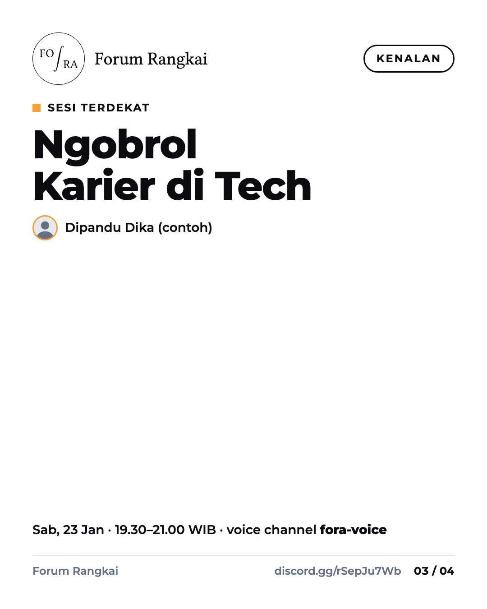  [PDF](fora-ngobrol-karier/li-doc/sig-intro.pdf)

<details>
<summary>Captions</summary>

**Instagram**

```text
FORA (Forum Rangkai) itu komunitas tech kecil berbahasa Indonesia di Discord. Obrolannya lewat suara, satu sesi satu topik. Ada sesi umum seperti karier, dan ada SIG (special interest group) yang pegang satu bidang, misalnya SIG CN untuk cloud native.

Yang terdekat "Ngobrol Karier di Tech", Sab, 23 Jan jam 19.30 WIB. Langsung masuk voice channel fora-voice lewat discord.gg/rSepJu7Wb (ada juga di bio). Dengerin aja nggak apa-apa, ngomong juga silakan.

#FORA #Karier #KarierTech #KomunitasTech
```

**X**

```text
FORA. Komunitas tech kecil yang ngobrol lewat suara di Discord.
Sesi terdekat soal "Ngobrol Karier di Tech", Sab, 23 Jan.
Di voice channel fora-voice Discord FORA. Dengerin aja boleh, mic juga boleh.
https://discord.gg/rSepJu7Wb
#Karier
```

**LinkedIn**

```text
FORA. Komunitas tech kecil yang ngobrol lewat suara di Discord.

Sesi terdekat soal "Ngobrol Karier di Tech", Sab, 23 Jan, 19.30–21.00 WIB.

Kita ngobrol di voice channel fora-voice Discord FORA. Boleh dengarkan saja, boleh juga ikut bicara. Undangan: https://discord.gg/rSepJu7Wb

#Karier #KomunitasTech #FORA
```

</details>

### Speakers

**Instagram**

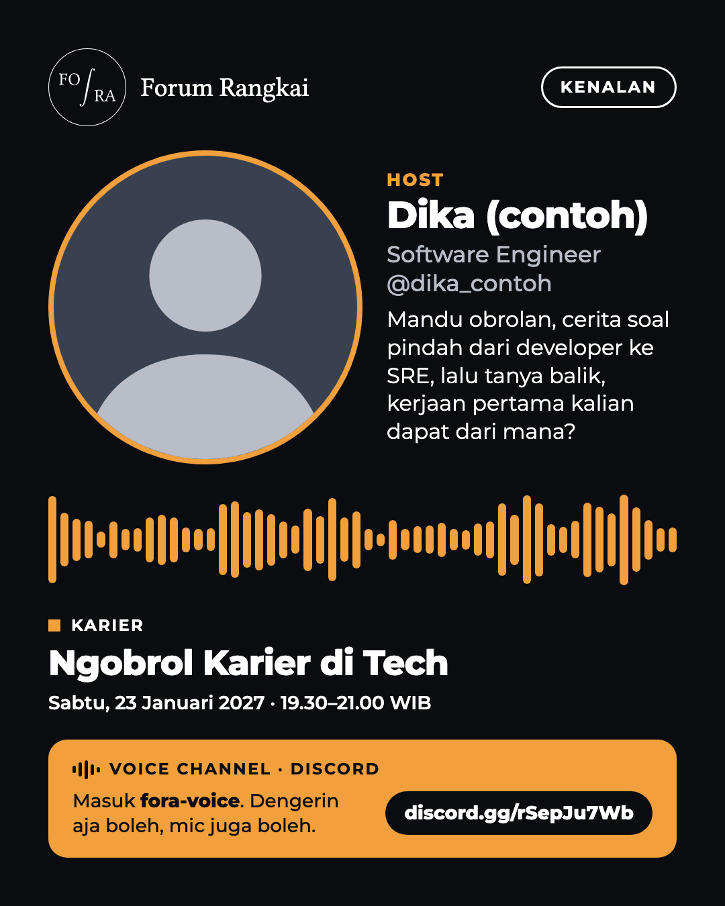 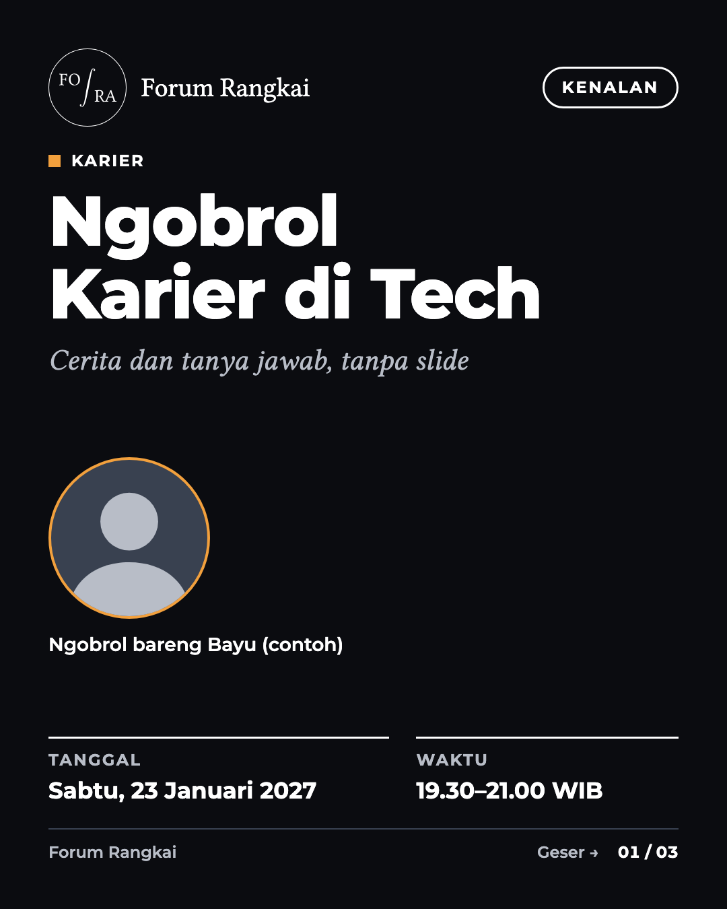   

**X**


**LinkedIn**

    [PDF](fora-ngobrol-karier/li-doc/speakers.pdf)

<details>
<summary>Captions</summary>

**Instagram**

```text
Dika (contoh) @dika_contoh, Software Engineer. Mandu obrolan, cerita soal pindah dari developer ke SRE, lalu tanya balik, kerjaan pertama kalian dapat dari mana?

Tanpa pembicara tamu, jadi yang cerita kita semua.

Sesinya "Ngobrol Karier di Tech", Sabtu, 23 Januari 2027, 19.30–21.00 WIB.

Langsung masuk voice channel fora-voice lewat discord.gg/rSepJu7Wb (ada juga di bio). Dengerin aja nggak apa-apa, ngomong juga silakan.

#FORA #Karier #KarierTech #KomunitasTech
```

**X 1/2**

```text
Dika (contoh) @dika_contoh, Software Engineer. Mandu obrolan, cerita soal pindah dari developer ke SRE, lalu tanya balik, kerjaan pertama kalian dapat dari mana?
```

**X 2/2**

```text
"Ngobrol Karier di Tech", mulai 19.30 WIB.
Masuk aja ke voice channel fora-voice di Discord FORA. Dengerin aja boleh, mic juga boleh.
https://discord.gg/rSepJu7Wb
#Karier
```

**LinkedIn**

```text
Ngobrol Karier di Tech (FORA)

Dika (contoh) @dika_contoh, Software Engineer. Mandu obrolan, cerita soal pindah dari developer ke SRE, lalu tanya balik, kerjaan pertama kalian dapat dari mana?

Tanpa pembicara tamu, jadi yang cerita kita semua.

Sabtu, 23 Januari 2027, 19.30–21.00 WIB.

Kita ngobrol di voice channel fora-voice Discord FORA. Boleh dengarkan saja, boleh juga ikut bicara. Undangan: https://discord.gg/rSepJu7Wb

#Karier #KomunitasTech #FORA
```

</details>


## Kubernetes untuk Pemula

SIG CN · Sabtu, 12 Desember 2026 · 19.30 WIB · `sigcn-kubernetes-pemula`

### Announce

**Instagram**

  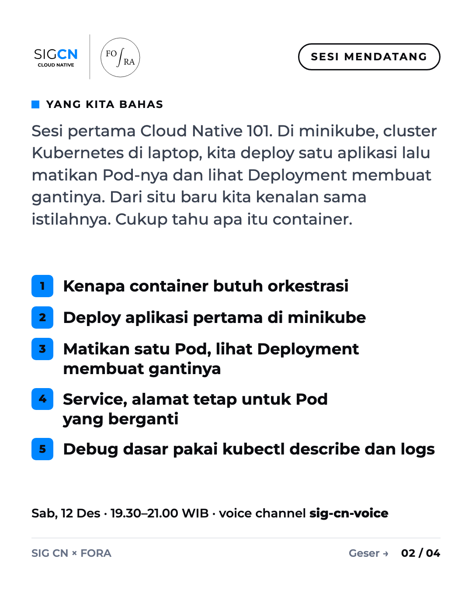 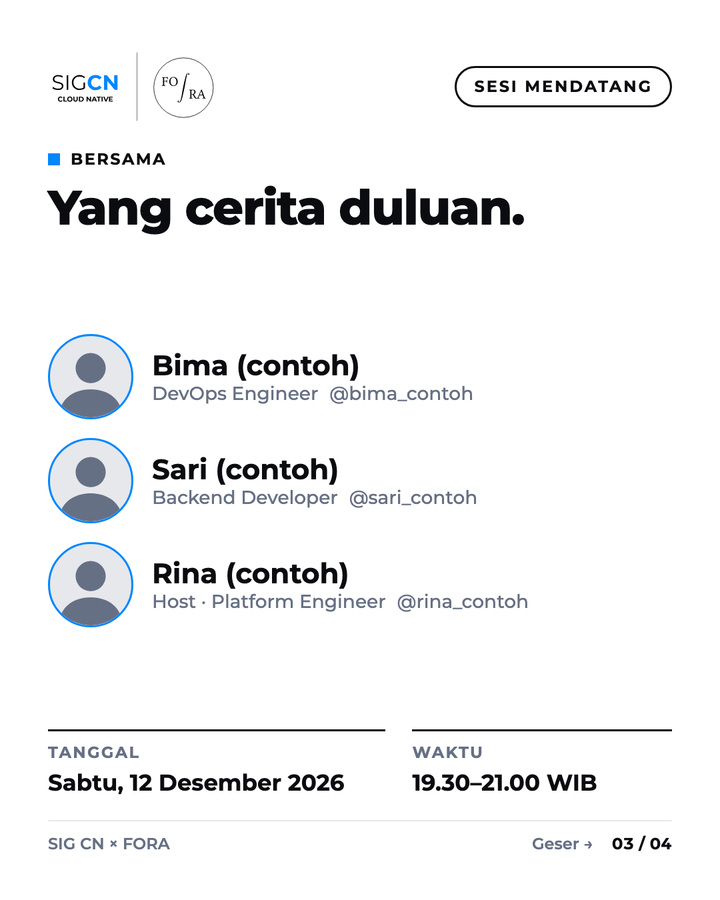  

**X**


**LinkedIn**

   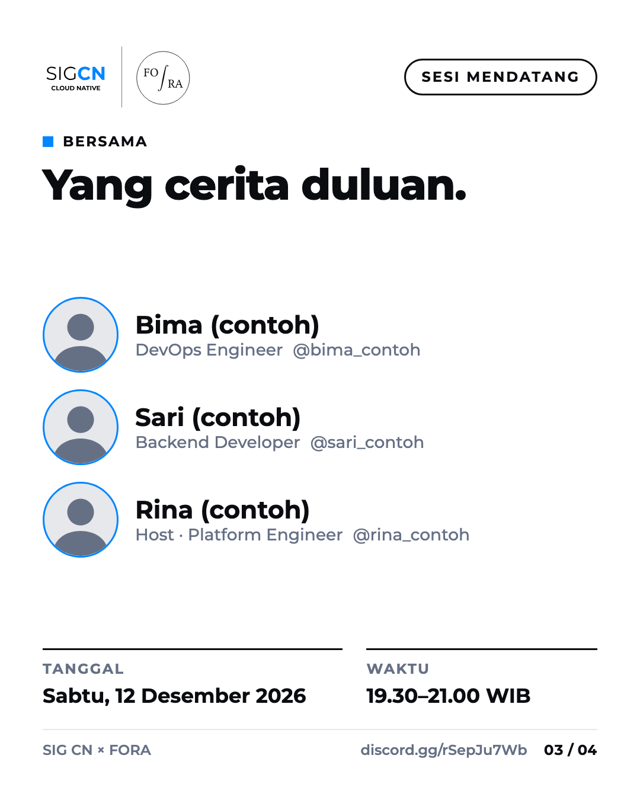  [PDF](sigcn-kubernetes-pemula/li-doc/announce.pdf)

<details>
<summary>Captions</summary>

**Instagram**

```text
Kubernetes untuk Pemula, Sab, 12 Des jam 19.30 WIB.

Dulu saya baru paham Pod setelah sengaja mematikan satu dan lihat Deployment membuat gantinya. Kita ulangi percobaan itu bareng-bareng.

Bersama Bima (contoh) @bima_contoh dan Sari (contoh) @sari_contoh, dipandu Rina (contoh) @rina_contoh. Langsung masuk voice channel sig-cn-voice lewat discord.gg/rSepJu7Wb (ada juga di bio). Dengerin aja boleh, mic juga boleh.

#FORA #SIGCN #Kubernetes #Container
```

**X**

```text
Sesi pertama Cloud Native 101.
Sab, 12 Des jam 19.30 WIB, kita kumpul di voice.
Kubernetes untuk Pemula
Di voice channel sig-cn-voice Discord FORA. Mau dengerin aja boleh, mau nyalain mic juga boleh.
https://discord.gg/rSepJu7Wb
#Kubernetes
```

**LinkedIn**

```text
Kubernetes untuk Pemula (SIG CN × FORA)

Dulu saya baru paham Pod setelah sengaja mematikan satu dan lihat Deployment membuat gantinya. Kita ulangi percobaan itu bareng-bareng.

Sabtu, 12 Desember 2026, 19.30–21.00 WIB, bersama Bima (contoh) @bima_contoh dan Sari (contoh) @sari_contoh, dipandu Rina (contoh) @rina_contoh.

• Kenapa container butuh orkestrasi
• Deploy aplikasi pertama di minikube
• Matikan satu Pod, lihat Deployment membuat gantinya
• Service, alamat tetap untuk Pod yang berganti
• Debug dasar pakai kubectl describe dan logs

Kita ngobrol di voice channel sig-cn-voice Discord FORA. Boleh dengarkan saja, boleh juga ikut bicara. Undangan: https://discord.gg/rSepJu7Wb

#Kubernetes #CloudNative #DevOpsIndonesia
```

</details>

### Reminder

**Instagram**

   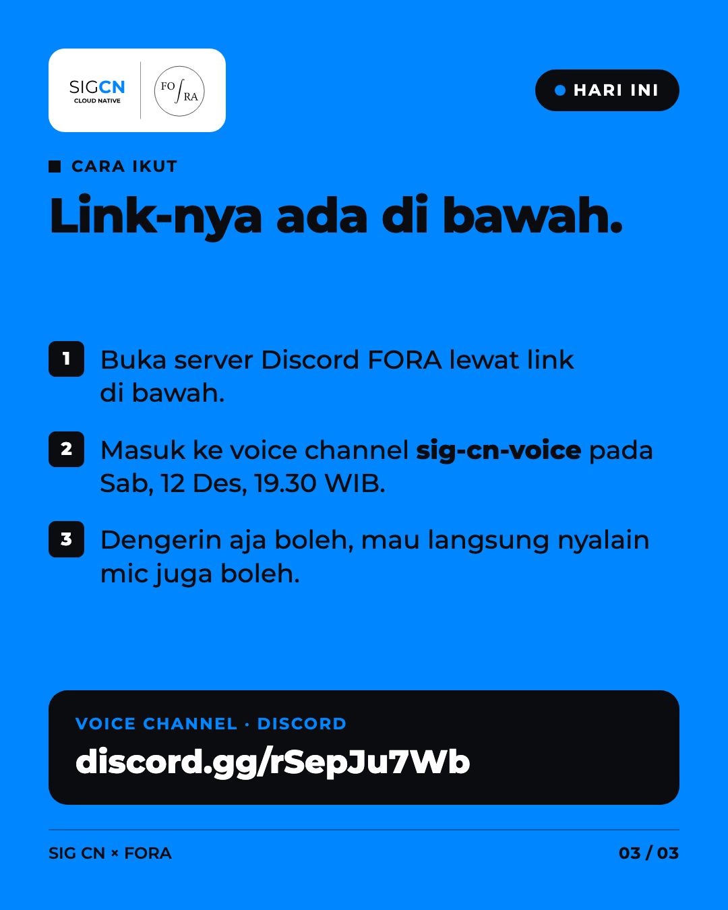 

**X**


**LinkedIn**

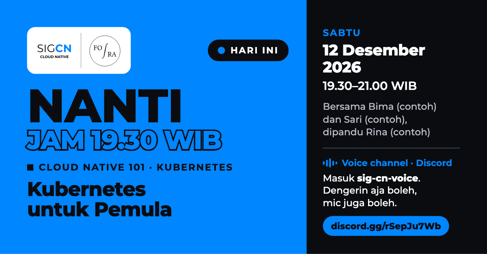  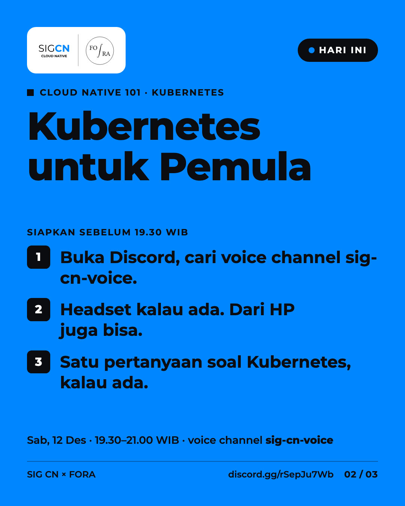  [PDF](sigcn-kubernetes-pemula/li-doc/reminder.pdf)

<details>
<summary>Captions</summary>

**Instagram**

```text
Kubernetes untuk Pemula

Sab, 12 Des, nanti jam 19.30 WIB. Buka Discord sepuluh menit lebih awal buat cek suara.

Bersama Bima (contoh) @bima_contoh dan Sari (contoh) @sari_contoh, dipandu Rina (contoh) @rina_contoh.

Mampir ke voice channel sig-cn-voice di Discord FORA, link di bio atau discord.gg/rSepJu7Wb. Dengerin aja boleh, mic juga boleh.

#FORA #SIGCN #Kubernetes #Container
```

**X**

```text
Nanti jam 19.30 WIB, Kubernetes untuk Pemula.
Di voice channel sig-cn-voice Discord FORA. Mau dengerin aja boleh, mau nyalain mic juga boleh.
https://discord.gg/rSepJu7Wb
#Kubernetes
```

**LinkedIn**

```text
Nanti jam 19.30 WIB
Kubernetes untuk Pemula

Bersama Bima (contoh) @bima_contoh dan Sari (contoh) @sari_contoh, dipandu Rina (contoh) @rina_contoh. Buka Discord sepuluh menit lebih awal untuk cek suara.

Kita ngobrol di voice channel sig-cn-voice Discord FORA. Boleh dengarkan saja, boleh juga ikut bicara. Undangan: https://discord.gg/rSepJu7Wb

#Kubernetes #CloudNative #DevOpsIndonesia
```

</details>

### Live

**Instagram**

    

**X**


**LinkedIn**

    [PDF](sigcn-kubernetes-pemula/li-doc/live.pdf)

<details>
<summary>Captions</summary>

**Instagram**

```text
Live sekarang, bersama Bima (contoh) @bima_contoh dan Sari (contoh) @sari_contoh, dipandu Rina (contoh) @rina_contoh.

Kubernetes untuk Pemula

Buka discord.gg/rSepJu7Wb (juga ada di bio), lalu ke voice channel sig-cn-voice. Mau dengerin aja boleh, mau nyalain mic juga boleh.

#FORA #SIGCN #Kubernetes #Container
```

**X**

```text
Live sekarang, Kubernetes untuk Pemula.
Masuk lewat link ini, ke voice channel sig-cn-voice. Mau dengerin aja boleh, mau nyalain mic juga boleh.
https://discord.gg/rSepJu7Wb
#Kubernetes
```

**LinkedIn**

```text
Live sekarang di voice channel sig-cn-voice.

Kubernetes untuk Pemula, bersama Bima (contoh) @bima_contoh dan Sari (contoh) @sari_contoh, dipandu Rina (contoh) @rina_contoh.

Undangan Discord: https://discord.gg/rSepJu7Wb. Kita ada di voice channel sig-cn-voice. Mau dengarkan saja atau ikut bicara, dua-duanya boleh.

#Kubernetes #CloudNative #DevOpsIndonesia
```

</details>

### Recap

**Instagram**

  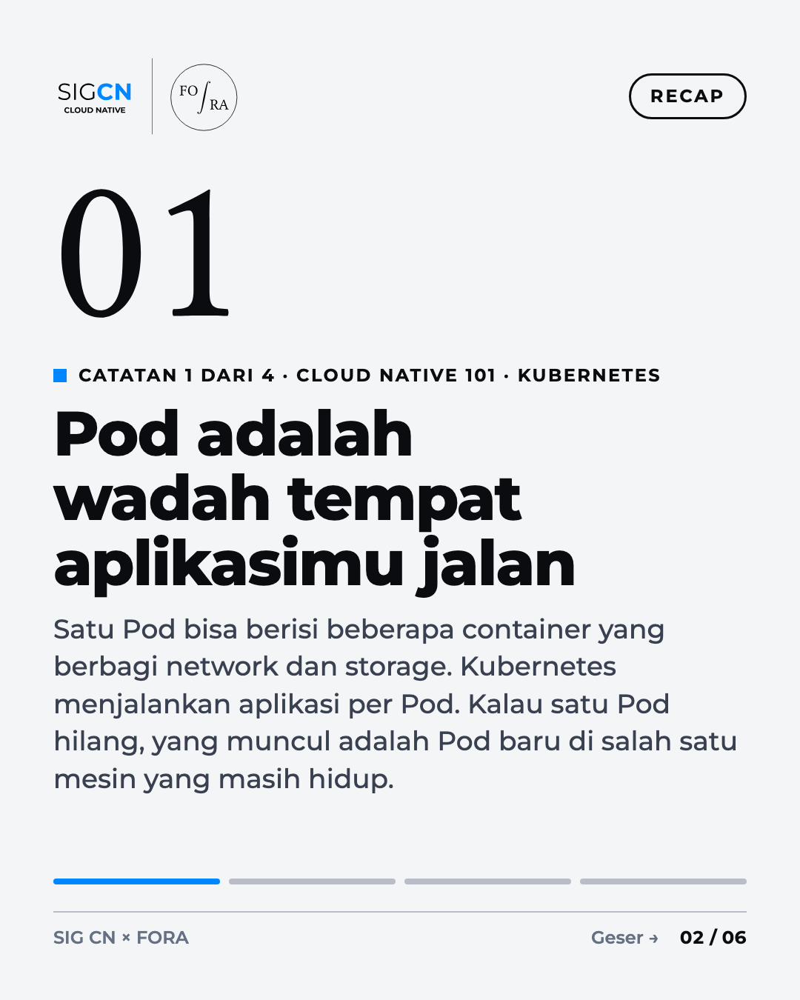 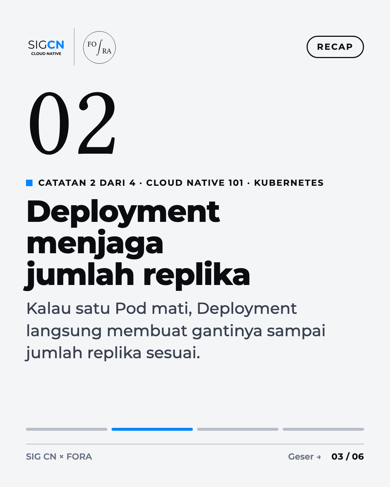    

**X**


**LinkedIn**

       [PDF](sigcn-kubernetes-pemula/li-doc/recap.pdf)

<details>
<summary>Captions</summary>

**Instagram**

```text
Ini yang tercatat dari "Kubernetes untuk Pemula" (Sab, 12 Des).

- Pod adalah unit terkecil yang dijadwalkan. Satu Pod bisa berisi beberapa container yang berbagi network dan storage.
- Deployment menjaga jumlah replika. Kalau satu Pod mati, Deployment langsung membuat gantinya sampai jumlah replika sesuai.
- Service memberi alamat yang stabil. IP Pod berubah tiap kali dibuat ulang, jadi akses aplikasi lewat Service. Jangan pakai IP Pod langsung.
- Mulai debug dari kubectl describe dan logs. Event di describe dan output logs biasanya sudah cukup untuk tahu kenapa Pod gagal jalan.

Dokumentasi Kubernetes: https://kubernetes.io/docs/home/
Tutorial minikube: https://minikube.sigs.k8s.io/docs/start/

14 orang ikut ngobrol di voice channel. Makasih Bima (contoh) @bima_contoh dan Sari (contoh) @sari_contoh, sampai ketemu lagi. Poin 3 ("Service memberi alamat yang stabil"), cocok nggak sama yang kamu temui di kerjaan?

Sesi berikutnya kita umumkan di Discord FORA (link di bio atau discord.gg/rSepJu7Wb). Mau dengerin aja boleh, mau nyalain mic juga boleh.

#FORA #SIGCN #Kubernetes #Container
```

**X 1/3**

```text
Rekap "Kubernetes untuk Pemula". 14 orang ngobrol di voice channel. Makasih Bima (contoh) @bima_contoh dan Sari (contoh) @sari_contoh.
```

**X 2/3**

```text
Service memberi alamat yang stabil. IP Pod berubah tiap kali dibuat ulang, jadi akses aplikasi lewat Service. Jangan pakai IP Pod langsung.
```

**X 3/3**

```text
Poin 3 ("Service memberi alamat yang stabil"), cocok nggak sama yang kamu temui di kerjaan?
Dokumentasi Kubernetes https://kubernetes.io/docs/home/
Sesi berikutnya diumumkan di Discord FORA. Mau dengerin aja boleh, mau nyalain mic juga boleh.
https://discord.gg/rSepJu7Wb
#Kubernetes
```

**LinkedIn**

```text
Rekap "Kubernetes untuk Pemula" (Sab, 12 Des).

Terima kasih Bima (contoh) @bima_contoh dan Sari (contoh) @sari_contoh. 14 orang ikut ngobrol di voice channel.

1. Pod adalah unit terkecil yang dijadwalkan. Satu Pod bisa berisi beberapa container yang berbagi network dan storage.
2. Deployment menjaga jumlah replika. Kalau satu Pod mati, Deployment langsung membuat gantinya sampai jumlah replika sesuai.
3. Service memberi alamat yang stabil. IP Pod berubah tiap kali dibuat ulang, jadi akses aplikasi lewat Service. Jangan pakai IP Pod langsung.
4. Mulai debug dari kubectl describe dan logs. Event di describe dan output logs biasanya sudah cukup untuk tahu kenapa Pod gagal jalan.

Kamu setuju sama "Service memberi alamat yang stabil"? Kalau di tempatmu beda, ceritain.

Dokumentasi Kubernetes: https://kubernetes.io/docs/home/
Tutorial minikube: https://minikube.sigs.k8s.io/docs/start/

Sesi berikutnya akan kita umumkan di Discord FORA, di voice channel sig-cn-voice. Boleh dengarkan saja, boleh juga ikut bicara. https://discord.gg/rSepJu7Wb

#Kubernetes #CloudNative #DevOpsIndonesia
```

</details>

### Cover

**Instagram**

    

**X**


**LinkedIn**

   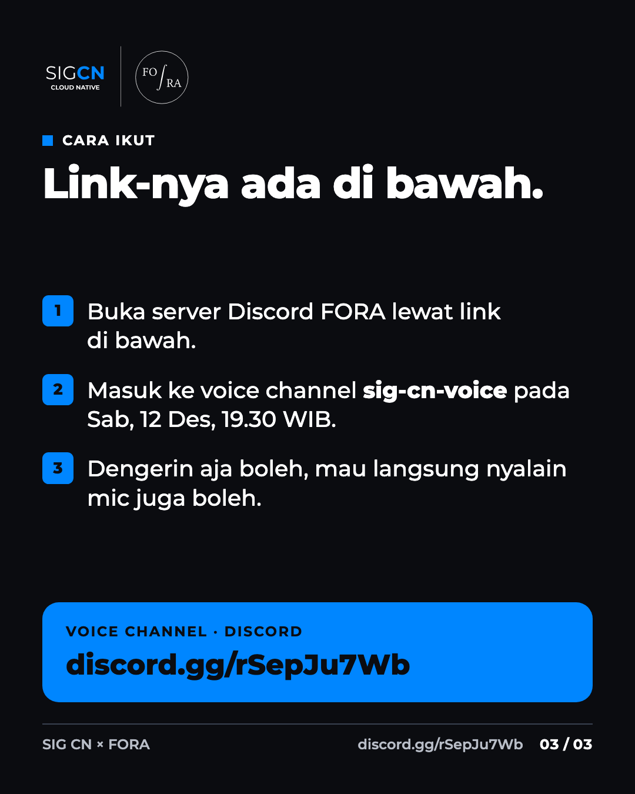 [PDF](sigcn-kubernetes-pemula/li-doc/cover.pdf)

<details>
<summary>Captions</summary>

**Instagram**

```text
Kubernetes untuk Pemula

Cloud Native 101 bareng SIG CN × FORA, kali ini soal Kubernetes. Satu cluster lokal, dari nol.

Sabtu, 12 Desember 2026, 19.30–21.00 WIB. Mampir ke voice channel sig-cn-voice di Discord FORA, link di bio atau discord.gg/rSepJu7Wb. Dengerin aja boleh, mic juga boleh.

#FORA #SIGCN #Kubernetes #Container
```

**X**

```text
Cloud Native 101 bareng SIG CN × FORA.
Kubernetes untuk Pemula
Sab, 12 Des, 19.30–21.00 WIB
Di voice channel sig-cn-voice Discord FORA. Mau dengerin aja boleh, mau nyalain mic juga boleh.
https://discord.gg/rSepJu7Wb
#Kubernetes
```

**LinkedIn**

```text
Satu cluster lokal, dari nol.

Cloud Native 101 bareng SIG CN × FORA, kali ini soal Kubernetes. Sesinya "Kubernetes untuk Pemula", Sab, 12 Des, 19.30–21.00 WIB.

Gabung lewat https://discord.gg/rSepJu7Wb, lalu masuk ke voice channel sig-cn-voice. Boleh dengarkan saja, boleh juga ikut bicara.

#Kubernetes #CloudNative #DevOpsIndonesia
```

</details>

### SIG intro

**Instagram**

     

**X**


**LinkedIn**

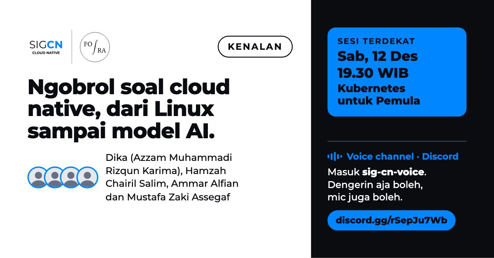    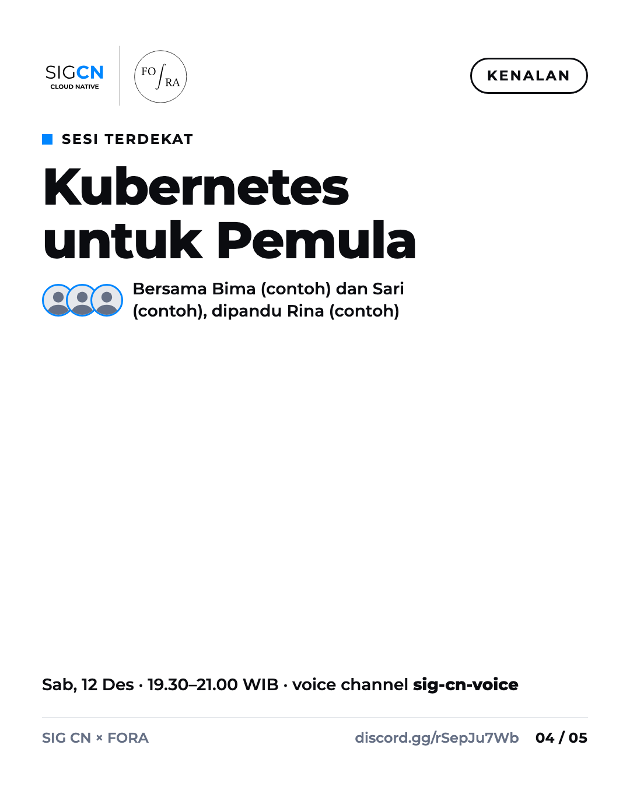 [PDF](sigcn-kubernetes-pemula/li-doc/sig-intro.pdf)

<details>
<summary>Captions</summary>

**Instagram**

```text
SIG CN di FORA. Ngobrol soal Kubernetes dan cloud native di voice channel.

Sesi terdekat soal "Kubernetes untuk Pemula", Sab, 12 Des jam 19.30 WIB.

Link Discord ada di bio (discord.gg/rSepJu7Wb). Masuk ke voice channel sig-cn-voice. Dengerin aja boleh, mic juga boleh.

#FORA #SIGCN #Kubernetes #Container
```

**X**

```text
SIG CN di FORA. Ngobrol soal Kubernetes dan cloud native di voice channel.
Sesi terdekat soal "Kubernetes untuk Pemula", Sab, 12 Des.
Di voice channel sig-cn-voice Discord FORA. Mau dengerin aja boleh, mau nyalain mic juga boleh.
https://discord.gg/rSepJu7Wb
#Kubernetes
```

**LinkedIn**

```text
SIG CN di FORA. Ngobrol soal Kubernetes dan cloud native di voice channel.

Sesi terdekat soal "Kubernetes untuk Pemula", Sab, 12 Des, 19.30–21.00 WIB.

Kita ngobrol di voice channel sig-cn-voice Discord FORA. Boleh dengarkan saja, boleh juga ikut bicara. Undangan: https://discord.gg/rSepJu7Wb

#Kubernetes #CloudNative #DevOpsIndonesia
```

</details>

### Speakers

**Instagram**

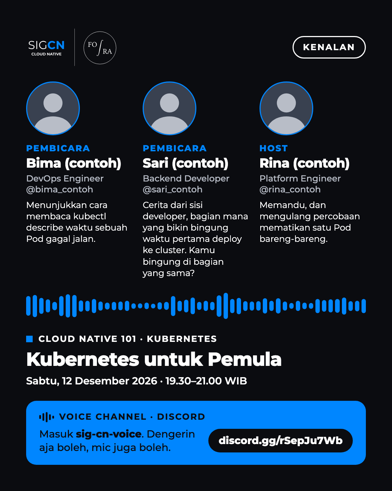    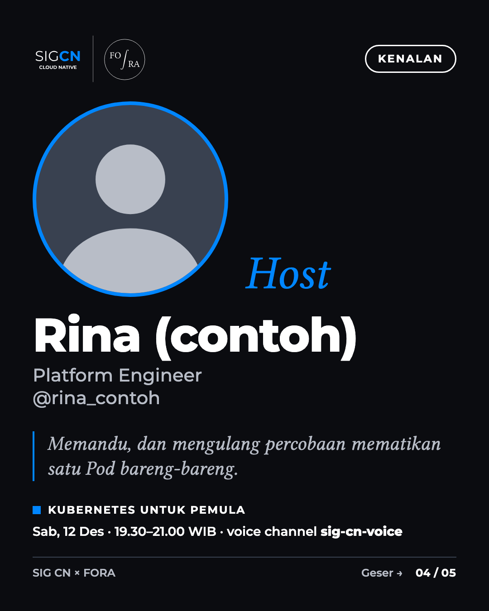  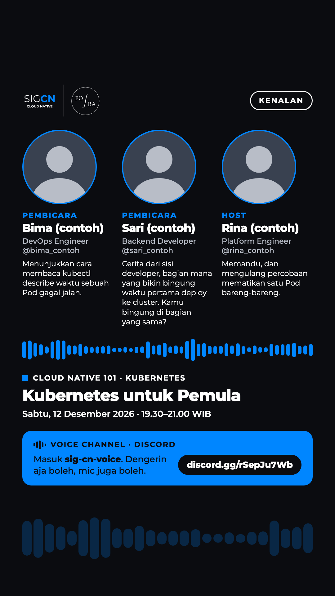

**X**

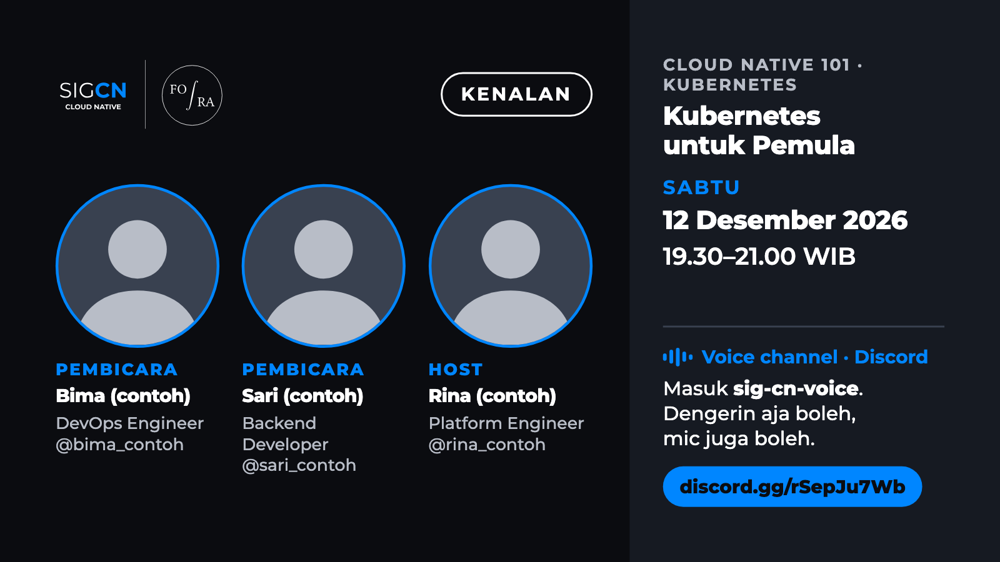

**LinkedIn**

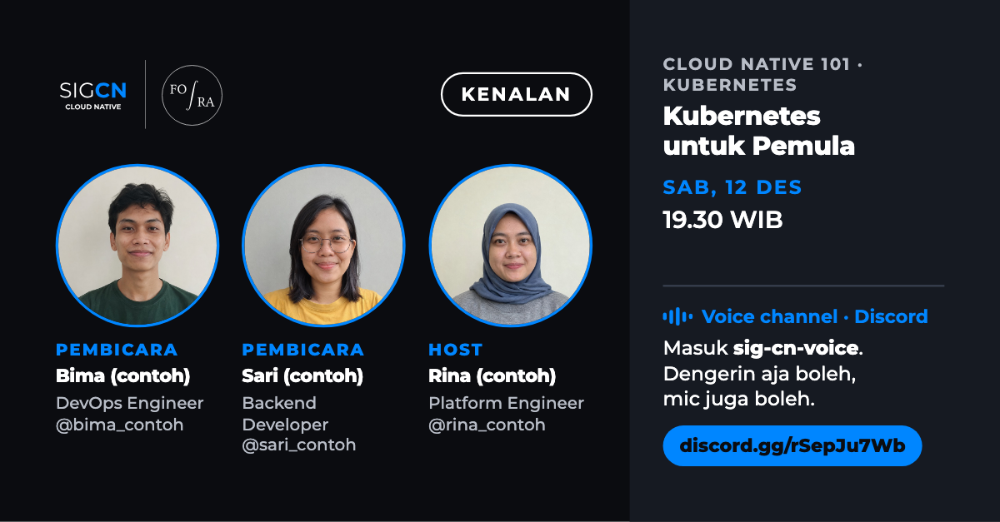  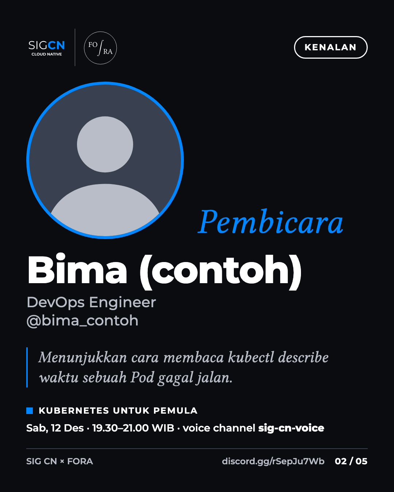    [PDF](sigcn-kubernetes-pemula/li-doc/speakers.pdf)

<details>
<summary>Captions</summary>

**Instagram**

```text
Bima (contoh) @bima_contoh, DevOps Engineer. Menunjukkan cara membaca kubectl describe waktu sebuah Pod gagal jalan.

Sari (contoh) @sari_contoh, Backend Developer. Cerita dari sisi developer, bagian mana yang bikin bingung waktu pertama deploy ke cluster. Kamu bingung di bagian yang sama?

Rina (contoh) @rina_contoh, Platform Engineer, host. Memandu, dan mengulang percobaan mematikan satu Pod bareng-bareng.

Sesinya "Kubernetes untuk Pemula", Sabtu, 12 Desember 2026, 19.30–21.00 WIB.

Langsung masuk voice channel sig-cn-voice lewat discord.gg/rSepJu7Wb (ada juga di bio). Dengerin aja boleh, mic juga boleh.

#FORA #SIGCN #Kubernetes #Container
```

**X 1/2**

```text
Bima (contoh) @bima_contoh, DevOps Engineer. Menunjukkan cara membaca kubectl describe waktu sebuah Pod gagal jalan.
```

**X 2/2**

```text
"Kubernetes untuk Pemula", mulai 19.30 WIB.
Masuk aja ke voice channel sig-cn-voice di Discord FORA. Mau dengerin aja boleh, mau nyalain mic juga boleh.
https://discord.gg/rSepJu7Wb
#Kubernetes
```

**LinkedIn**

```text
Kubernetes untuk Pemula (SIG CN × FORA)

Bima (contoh) @bima_contoh, DevOps Engineer. Menunjukkan cara membaca kubectl describe waktu sebuah Pod gagal jalan.

Sari (contoh) @sari_contoh, Backend Developer. Cerita dari sisi developer, bagian mana yang bikin bingung waktu pertama deploy ke cluster. Kamu bingung di bagian yang sama?

Rina (contoh) @rina_contoh, Platform Engineer, host. Memandu, dan mengulang percobaan mematikan satu Pod bareng-bareng.

Sabtu, 12 Desember 2026, 19.30–21.00 WIB.

Kita ngobrol di voice channel sig-cn-voice Discord FORA. Boleh dengarkan saja, boleh juga ikut bicara. Undangan: https://discord.gg/rSepJu7Wb

#Kubernetes #CloudNative #DevOpsIndonesia
```

</details>


## GitOps dengan Argo CD

SIG CN · Sabtu, 19 Desember 2026 · 19.30 WIB · `sigcn-gitops-argocd`

### Announce

**Instagram**

  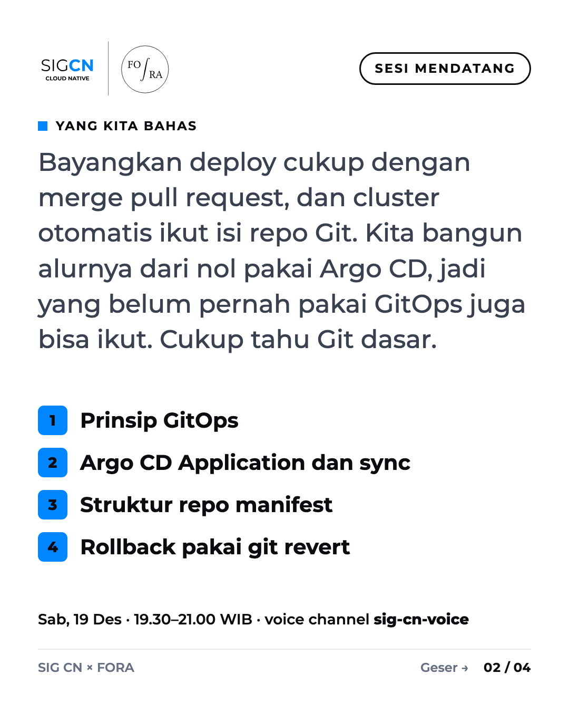   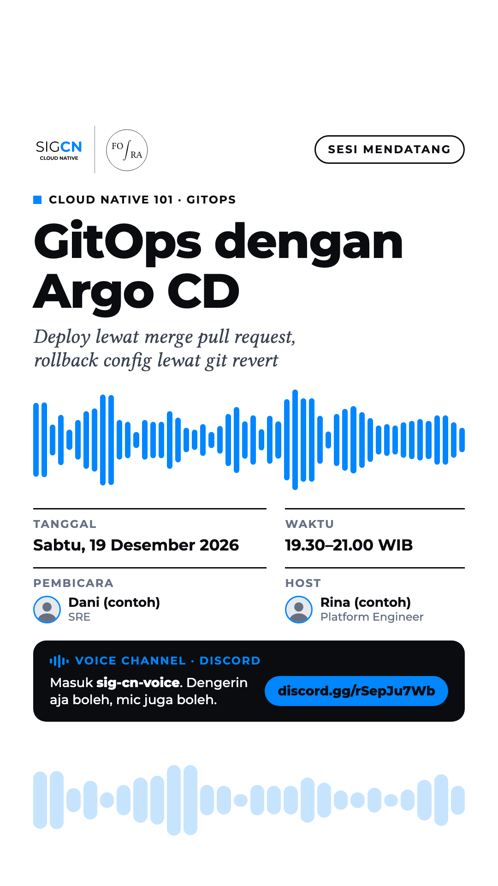

**X**


**LinkedIn**

   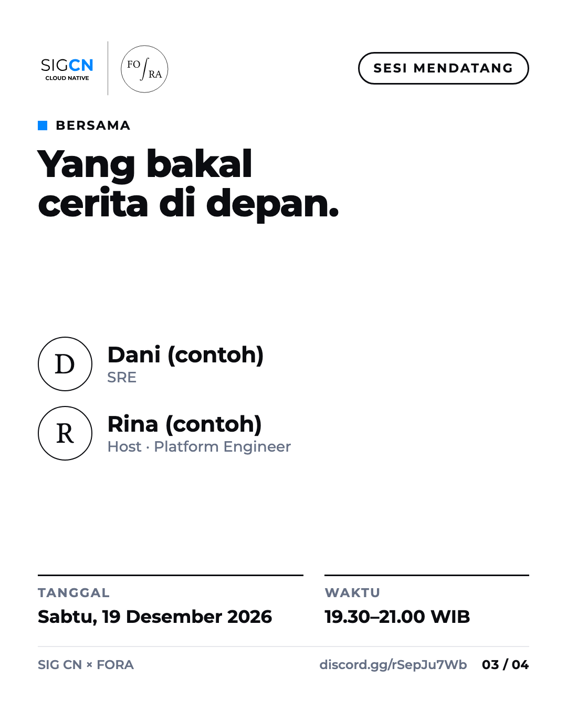  [PDF](sigcn-gitops-argocd/li-doc/announce.pdf)

<details>
<summary>Captions</summary>

**Instagram**

```text
GitOps dengan Argo CD

Pernah ada yang kubectl apply langsung ke prod jam 11 malam? Di tim saya pernah, dan dari situ saya pindah ke GitOps.

Sab, 19 Des, 19.30–21.00 WIB. Bersama Dani (contoh), dipandu Rina (contoh).

- Prinsip GitOps
- Argo CD Application dan sync
- Struktur repo manifest
- Rollback pakai git revert

Mampir ke voice channel sig-cn-voice di Discord FORA, link di bio atau discord.gg/rSepJu7Wb. Dengerin aja boleh, mic juga boleh.

#FORA #SIGCN #GitOps #ArgoCD
```

**X**

```text
Bayangkan deploy cukup dengan merge pull request, dan cluster otomatis ikut isi repo Git.
GitOps dengan Argo CD
Sab, 19 Des jam 19.30 WIB.
Masuk aja ke voice channel sig-cn-voice di Discord FORA. Dengerin aja boleh, mic juga boleh.
https://discord.gg/rSepJu7Wb
#GitOps
```

**LinkedIn**

```text
Pernah ada yang kubectl apply langsung ke prod jam 11 malam? Di tim saya pernah, dan dari situ saya pindah ke GitOps.

GitOps dengan Argo CD. Sabtu, 19 Desember 2026, 19.30–21.00 WIB. Bersama Dani (contoh), dipandu Rina (contoh).

Gabung lewat https://discord.gg/rSepJu7Wb, lalu masuk ke voice channel sig-cn-voice. Boleh dengarkan saja, boleh juga ikut bicara.

#GitOps #CloudNative #Kubernetes
```

</details>

### Reminder

**Instagram**

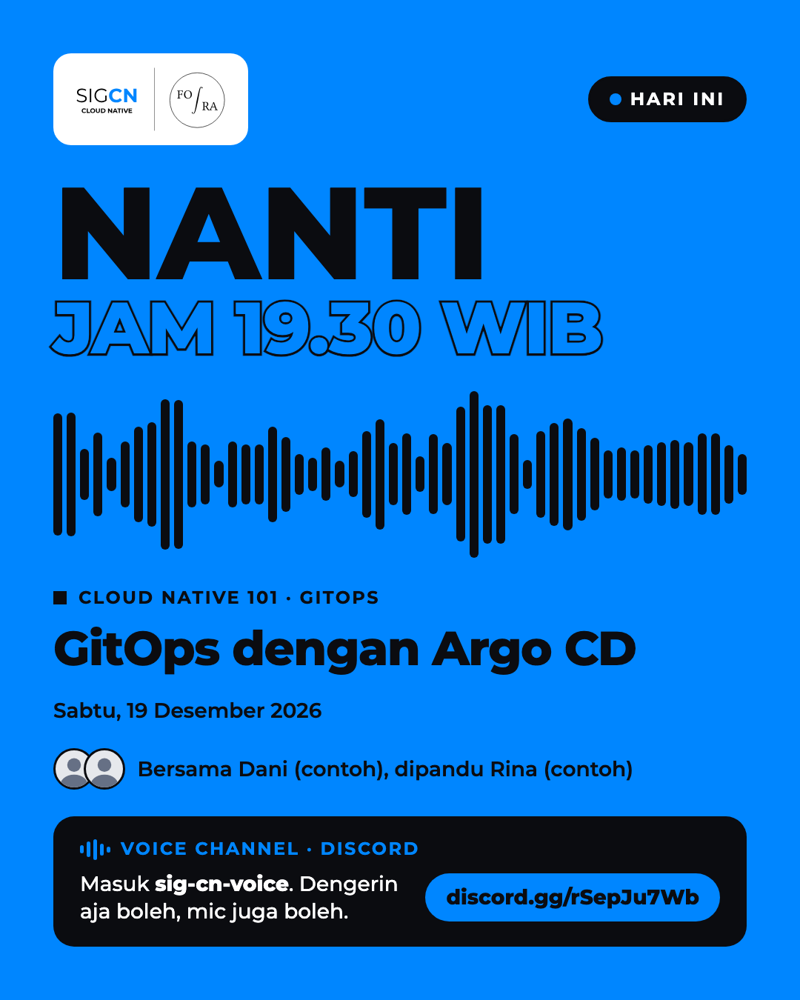  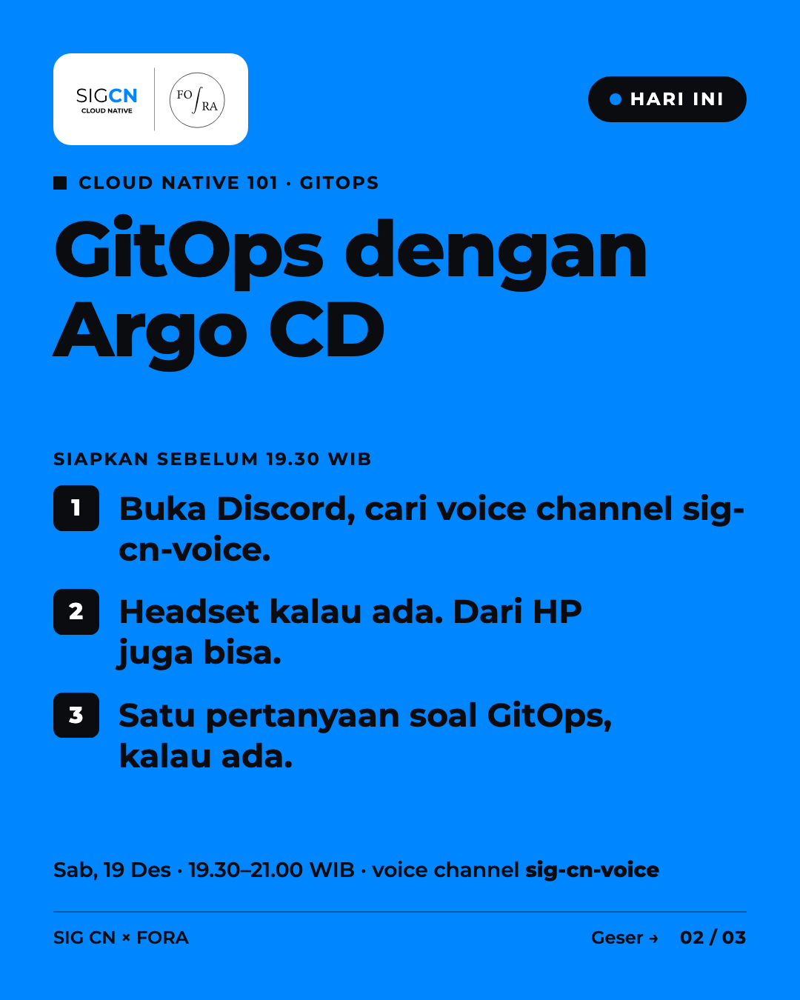  

**X**


**LinkedIn**

    [PDF](sigcn-gitops-argocd/li-doc/reminder.pdf)

<details>
<summary>Captions</summary>

**Instagram**

```text
GitOps dengan Argo CD

Sab, 19 Des, nanti jam 19.30 WIB. Buka Discord sepuluh menit lebih awal buat cek suara.

Bersama Dani (contoh), dipandu Rina (contoh).

Mampir ke voice channel sig-cn-voice di Discord FORA, link di bio atau discord.gg/rSepJu7Wb. Dengerin aja boleh, mic juga boleh.

#FORA #SIGCN #GitOps #ArgoCD
```

**X**

```text
GitOps dengan Argo CD, Sab, 19 Des, nanti jam 19.30 WIB.
Masuk aja ke voice channel sig-cn-voice di Discord FORA. Dengerin aja boleh, mic juga boleh.
https://discord.gg/rSepJu7Wb
#GitOps
```

**LinkedIn**

```text
Nanti jam 19.30 WIB
GitOps dengan Argo CD

Bersama Dani (contoh), dipandu Rina (contoh). Buka Discord sepuluh menit lebih awal untuk cek suara.

Kita ngobrol di voice channel sig-cn-voice Discord FORA. Boleh dengarkan saja, boleh juga ikut bicara. Undangan: https://discord.gg/rSepJu7Wb

#GitOps #CloudNative #Kubernetes
```

</details>

### Live

**Instagram**

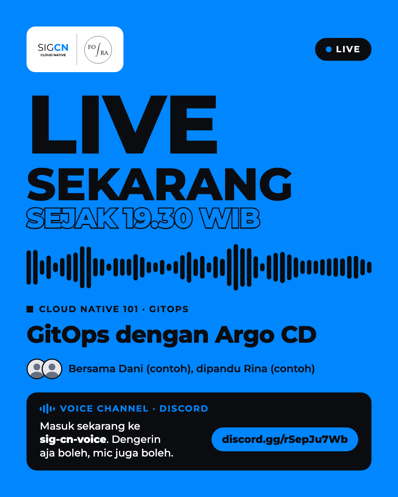  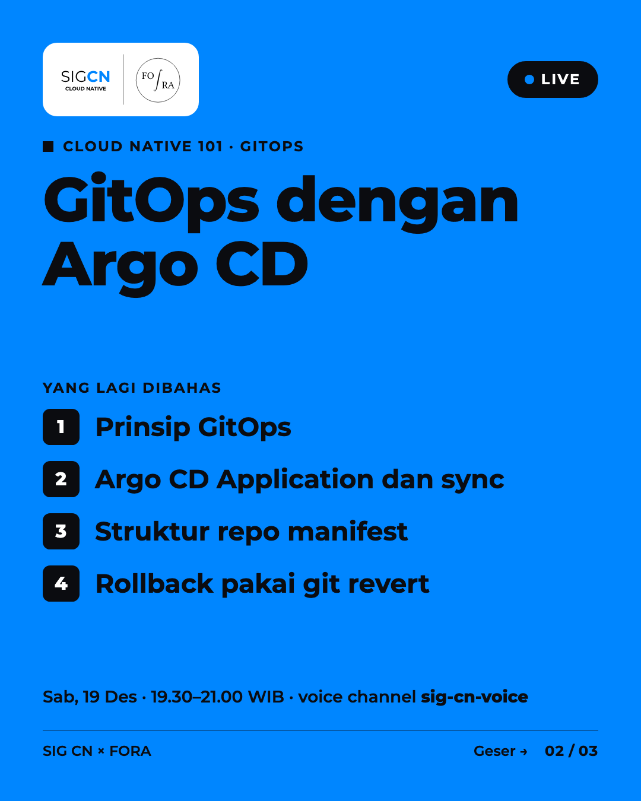  

**X**

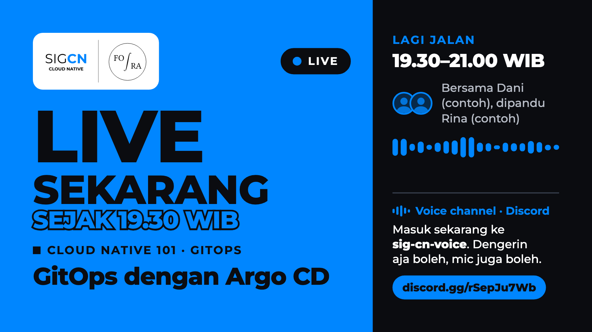

**LinkedIn**

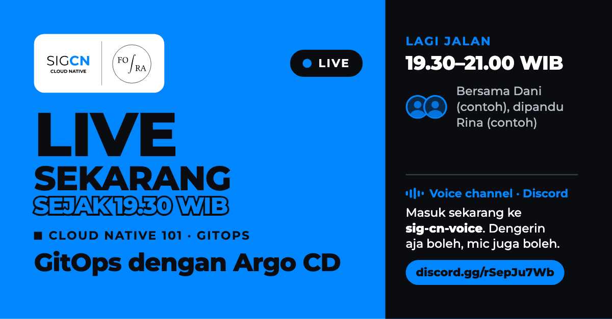  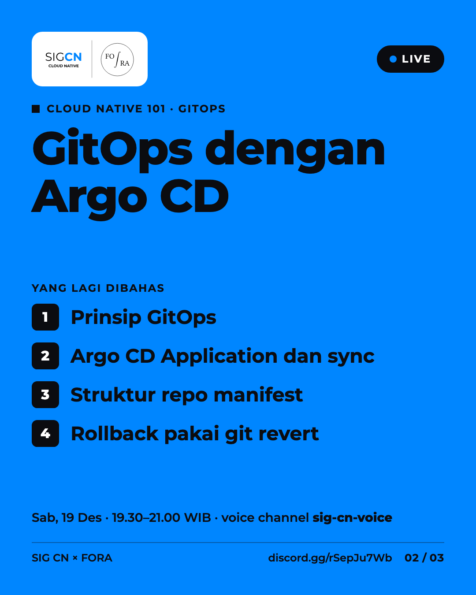  [PDF](sigcn-gitops-argocd/li-doc/live.pdf)

<details>
<summary>Captions</summary>

**Instagram**

```text
Sudah mulai jam 19.30 WIB. GitOps dengan Argo CD

Bayangkan deploy cukup dengan merge pull request, dan cluster otomatis ikut isi repo Git.

Link di bio, atau discord.gg/rSepJu7Wb. Masuknya ke voice channel sig-cn-voice. Mau dengerin aja boleh, mau nyalain mic juga boleh.

#FORA #SIGCN #GitOps #ArgoCD
```

**X**

```text
GitOps dengan Argo CD lagi jalan sekarang.
Langsung masuk ke voice channel sig-cn-voice di Discord FORA. Dengerin aja boleh, mic juga boleh.
https://discord.gg/rSepJu7Wb
#GitOps
```

**LinkedIn**

```text
Kita sudah mulai (19.30 WIB).

GitOps dengan Argo CD. Bayangkan deploy cukup dengan merge pull request, dan cluster otomatis ikut isi repo Git.

Undangan Discord: https://discord.gg/rSepJu7Wb. Kita ada di voice channel sig-cn-voice. Dengarkan saja boleh, ikut bicara juga boleh.

#GitOps #CloudNative #Kubernetes
```

</details>

### Recap

**Instagram**

    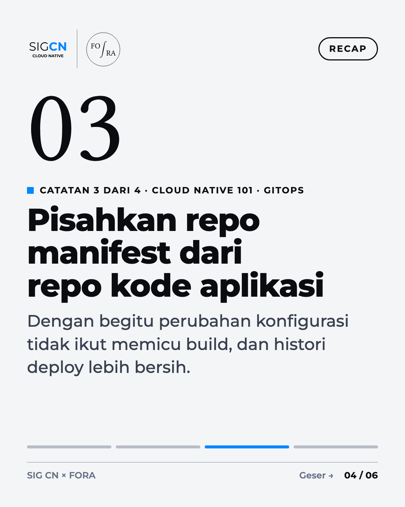   

**X**


**LinkedIn**

     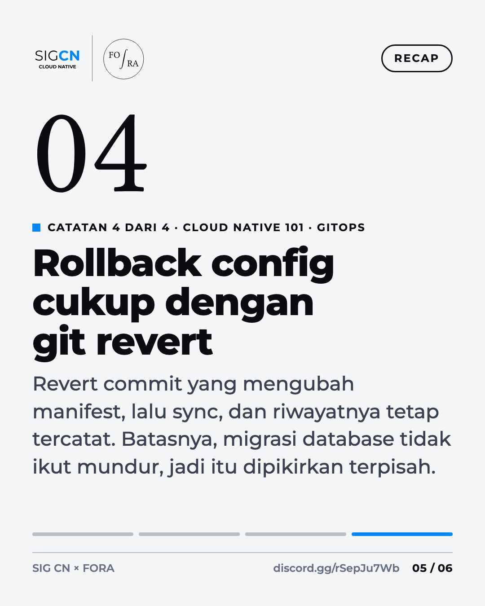  [PDF](sigcn-gitops-argocd/li-doc/recap.pdf)

<details>
<summary>Captions</summary>

**Instagram**

```text
Rekap "GitOps dengan Argo CD", Sab, 19 Des.

11 orang ikut ngobrol di voice channel. Makasih Dani (contoh).

1. Git jadi source of truth. Kondisi yang diinginkan ditulis di repo, dan controller yang menyamakan cluster dengan repo. Tidak ada kubectl apply manual.
2. Argo CD membandingkan live state dengan Git. Kalau beda, aplikasi berstatus OutOfSync, dan sync menerapkan perubahannya.
3. Pisahkan repo manifest dari repo kode aplikasi. Perubahan konfigurasi tidak ikut memicu build, dan histori deploy lebih rapi.
4. Rollback config cukup dengan git revert. Revert commit yang mengubah manifest, lalu sync, dan riwayatnya tetap tercatat. Batasnya, migrasi database tidak ikut mundur, jadi itu dipikirkan terpisah.

Poin 3 ("Pisahkan repo manifest dari repo kode aplikasi"), cocok nggak sama yang kamu temui di kerjaan?

Dokumentasi Argo CD: https://argo-cd.readthedocs.io/

Sesi berikutnya kita umumkan di Discord FORA (link di bio atau discord.gg/rSepJu7Wb). Mau dengerin aja boleh, mau nyalain mic juga boleh.

#FORA #SIGCN #GitOps #ArgoCD
```

**X 1/3**

```text
Rekap "GitOps dengan Argo CD". 11 orang ngobrol di voice channel. Makasih Dani (contoh).
```

**X 2/3**

```text
Pisahkan repo manifest dari repo kode aplikasi. Perubahan konfigurasi tidak ikut memicu build, dan histori deploy lebih rapi.
```

**X 3/3**

```text
Kamu setuju sama "Pisahkan repo manifest dari repo kode aplikasi"? Kalau di tempatmu beda, ceritain.
Dokumentasi Argo CD https://argo-cd.readthedocs.io/
Sesi berikutnya diumumkan di Discord FORA. Dengerin aja nggak apa-apa, ngomong juga silakan.
https://discord.gg/rSepJu7Wb
#GitOps
```

**LinkedIn**

```text
Rekap "GitOps dengan Argo CD" (Sab, 19 Des).

Terima kasih Dani (contoh). 11 orang ikut ngobrol di voice channel.

1. Git jadi source of truth. Kondisi yang diinginkan ditulis di repo, dan controller yang menyamakan cluster dengan repo. Tidak ada kubectl apply manual.
2. Argo CD membandingkan live state dengan Git. Kalau beda, aplikasi berstatus OutOfSync, dan sync menerapkan perubahannya.
3. Pisahkan repo manifest dari repo kode aplikasi. Perubahan konfigurasi tidak ikut memicu build, dan histori deploy lebih rapi.
4. Rollback config cukup dengan git revert. Revert commit yang mengubah manifest, lalu sync, dan riwayatnya tetap tercatat. Batasnya, migrasi database tidak ikut mundur, jadi itu dipikirkan terpisah.

Poin 3 ("Pisahkan repo manifest dari repo kode aplikasi"), cocok nggak sama yang kamu temui di kerjaan?

Dokumentasi Argo CD: https://argo-cd.readthedocs.io/

Sesi berikutnya akan kita umumkan di Discord FORA, di voice channel sig-cn-voice. Boleh dengarkan saja, boleh juga ikut bicara. https://discord.gg/rSepJu7Wb

#GitOps #CloudNative #Kubernetes
```

</details>

### Cover

**Instagram**

    

**X**


**LinkedIn**

    [PDF](sigcn-gitops-argocd/li-doc/cover.pdf)

<details>
<summary>Captions</summary>

**Instagram**

```text
GitOps dengan Argo CD

Cloud Native 101 bareng SIG CN × FORA, kali ini soal GitOps. Deploy lewat merge pull request, rollback config lewat git revert.

Sabtu, 19 Desember 2026, 19.30–21.00 WIB. Mampir ke voice channel sig-cn-voice di Discord FORA, link di bio atau discord.gg/rSepJu7Wb. Dengerin aja boleh, mic juga boleh.

#FORA #SIGCN #GitOps #ArgoCD
```

**X**

```text
Cloud Native 101 bareng SIG CN × FORA.
GitOps dengan Argo CD
Sab, 19 Des, 19.30–21.00 WIB
Di voice channel sig-cn-voice Discord FORA. Dengerin aja boleh, mic juga boleh.
https://discord.gg/rSepJu7Wb
#GitOps
```

**LinkedIn**

```text
Deploy lewat merge pull request, rollback config lewat git revert.

Cloud Native 101 bareng SIG CN × FORA, kali ini soal GitOps. Sesinya "GitOps dengan Argo CD", Sab, 19 Des, 19.30–21.00 WIB.

Gabung lewat https://discord.gg/rSepJu7Wb, lalu masuk ke voice channel sig-cn-voice. Boleh dengarkan saja, boleh juga ikut bicara.

#GitOps #CloudNative #Kubernetes
```

</details>

### SIG intro

**Instagram**

     

**X**


**LinkedIn**

     [PDF](sigcn-gitops-argocd/li-doc/sig-intro.pdf)

<details>
<summary>Captions</summary>

**Instagram**

```text
SIG CN itu grup FORA untuk ngobrol soal cloud native. Tiap sesi punya satu tema, misalnya Kubernetes atau GitOps, dan jalannya di voice channel Discord. Satu orang cerita, yang lain ikut nimbrung atau nanya.

Yang terdekat "GitOps dengan Argo CD", Sab, 19 Des jam 19.30 WIB. Langsung masuk voice channel sig-cn-voice lewat discord.gg/rSepJu7Wb (ada juga di bio). Dengerin aja boleh, mic juga boleh.

#FORA #SIGCN #GitOps #ArgoCD
```

**X**

```text
SIG CN di FORA. Ngobrol soal Kubernetes dan cloud native di voice channel.
Sesi terdekat soal "GitOps dengan Argo CD", Sab, 19 Des.
Di voice channel sig-cn-voice Discord FORA. Dengerin aja boleh, mic juga boleh.
https://discord.gg/rSepJu7Wb
#GitOps
```

**LinkedIn**

```text
SIG CN di FORA. Ngobrol soal Kubernetes dan cloud native di voice channel.

Sesi terdekat soal "GitOps dengan Argo CD", Sab, 19 Des, 19.30–21.00 WIB.

Kita ngobrol di voice channel sig-cn-voice Discord FORA. Boleh dengarkan saja, boleh juga ikut bicara. Undangan: https://discord.gg/rSepJu7Wb

#GitOps #CloudNative #Kubernetes
```

</details>

### Speakers

**Instagram**

     

**X**


**LinkedIn**

     [PDF](sigcn-gitops-argocd/li-doc/speakers.pdf)

<details>
<summary>Captions</summary>

**Instagram**

```text
Dani (contoh), SRE. Cerita kenapa timnya pindah ke GitOps, lalu tanya balik, "siapa di sini yang masih kubectl apply ke prod?"

Rina (contoh), Platform Engineer, host. Menyiapkan repo kosong dan Argo CD, jadi alurnya bisa diikuti dari nol.

Sesinya "GitOps dengan Argo CD", Sabtu, 19 Desember 2026, 19.30–21.00 WIB.

Langsung masuk voice channel sig-cn-voice lewat discord.gg/rSepJu7Wb (ada juga di bio). Dengerin aja boleh, mic juga boleh.

#FORA #SIGCN #GitOps #ArgoCD
```

**X 1/2**

```text
Dani (contoh), SRE. Cerita kenapa timnya pindah ke GitOps, lalu tanya balik, "siapa di sini yang masih kubectl apply ke prod?"
Rina (contoh), Platform Engineer, host. Menyiapkan repo kosong dan Argo CD, jadi alurnya bisa diikuti dari nol.
```

**X 2/2**

```text
"GitOps dengan Argo CD", mulai 19.30 WIB.
Di voice channel sig-cn-voice Discord FORA. Dengerin aja boleh, mic juga boleh.
https://discord.gg/rSepJu7Wb
#GitOps
```

**LinkedIn**

```text
GitOps dengan Argo CD (SIG CN × FORA)

Dani (contoh), SRE. Cerita kenapa timnya pindah ke GitOps, lalu tanya balik, "siapa di sini yang masih kubectl apply ke prod?"

Rina (contoh), Platform Engineer, host. Menyiapkan repo kosong dan Argo CD, jadi alurnya bisa diikuti dari nol.

Sabtu, 19 Desember 2026, 19.30–21.00 WIB.

Kita ngobrol di voice channel sig-cn-voice Discord FORA. Boleh dengarkan saja, boleh juga ikut bicara. Undangan: https://discord.gg/rSepJu7Wb

#GitOps #CloudNative #Kubernetes
```

</details>


## Observability: Logs, Metrics, Traces

SIG CN · Kamis, 14 Januari 2027 · 20.00 WIB · `sigcn-observability`

### Announce

**Instagram**

     

**X**


**LinkedIn**

     [PDF](sigcn-observability/li-doc/announce.pdf)

<details>
<summary>Captions</summary>

**Instagram**

```text
Observability: Logs, Metrics, Traces

Pernah aplikasi lambat, dashboard hijau semua, dan nggak ada yang tahu mulai cari dari mana? Sesi ini mulai dari situ.

Kam, 14 Jan, 20.00–21.30 WIB. Bersama Eko (contoh), dipandu Rina (contoh).

- Monitoring vs observability
- Logs terstruktur
- Metrics dan Prometheus, alat pengumpul metrics
- Distributed tracing
- OpenTelemetry, satu kode untuk banyak backend
- Alert yang nggak bikin capek

Mampir ke voice channel sig-cn-voice di Discord FORA, link di bio atau discord.gg/rSepJu7Wb. Dengerin aja nggak apa-apa, ngomong juga silakan.

#FORA #SIGCN #Observability #OpenTelemetry
```

**X**

```text
Aplikasi jalan tapi lambat, dan kita nggak tahu kenapa.
Observability: Logs, Metrics, Traces
Kam, 14 Jan jam 20.00 WIB.
Masuk aja ke voice channel sig-cn-voice di Discord FORA. Dengerin aja boleh, mic juga boleh.
https://discord.gg/rSepJu7Wb
#Observability
```

**LinkedIn**

```text
Observability: Logs, Metrics, Traces (SIG CN × FORA)

Pernah aplikasi lambat, dashboard hijau semua, dan nggak ada yang tahu mulai cari dari mana? Sesi ini mulai dari situ.

Kamis, 14 Januari 2027, 20.00–21.30 WIB, bersama Eko (contoh), dipandu Rina (contoh).

• Monitoring vs observability
• Logs terstruktur
• Metrics dan Prometheus, alat pengumpul metrics
• Distributed tracing
• OpenTelemetry, satu kode untuk banyak backend
• Alert yang nggak bikin capek

Kita ngobrol di voice channel sig-cn-voice Discord FORA. Dengarkan saja boleh, ikut bicara juga boleh. Undangan: https://discord.gg/rSepJu7Wb

#Observability #CloudNative #Kubernetes
```

</details>

### Reminder

**Instagram**

    

**X**


**LinkedIn**

    [PDF](sigcn-observability/li-doc/reminder.pdf)

<details>
<summary>Captions</summary>

**Instagram**

```text
Nanti jam 20.00 WIB, Observability: Logs, Metrics, Traces.

Bersama Eko (contoh), dipandu Rina (contoh). Buka Discord sepuluh menit lebih awal buat cek suara.

Link Discord ada di bio (discord.gg/rSepJu7Wb). Masuk ke voice channel sig-cn-voice. Dengerin aja nggak apa-apa, ngomong juga silakan.

#FORA #SIGCN #Observability #OpenTelemetry
```

**X**

```text
Jam 20.00 WIB nanti, Observability: Logs, Metrics, Traces.
Bersama Eko (contoh), dipandu Rina (contoh).
Di voice channel sig-cn-voice Discord FORA. Dengerin aja boleh, mic juga boleh.
https://discord.gg/rSepJu7Wb
#Observability
```

**LinkedIn**

```text
Nanti jam 20.00 WIB
Observability: Logs, Metrics, Traces

Bersama Eko (contoh), dipandu Rina (contoh). Buka Discord sepuluh menit lebih awal untuk cek suara.

Kita ngobrol di voice channel sig-cn-voice Discord FORA. Dengarkan saja boleh, ikut bicara juga boleh. Undangan: https://discord.gg/rSepJu7Wb

#Observability #CloudNative #Kubernetes
```

</details>

### Live

**Instagram**

    

**X**


**LinkedIn**

    [PDF](sigcn-observability/li-doc/live.pdf)

<details>
<summary>Captions</summary>

**Instagram**

```text
Observability: Logs, Metrics, Traces lagi jalan sekarang.

Aplikasi jalan tapi lambat, dan kita nggak tahu kenapa.

Langsung masuk voice channel sig-cn-voice, link Discord di bio (discord.gg/rSepJu7Wb). Dengerin aja boleh, mic juga boleh.

#FORA #SIGCN #Observability #OpenTelemetry
```

**X**

```text
Observability: Logs, Metrics, Traces lagi jalan sekarang.
Langsung masuk ke voice channel sig-cn-voice di Discord FORA. Dengerin aja boleh, mic juga boleh.
https://discord.gg/rSepJu7Wb
#Observability
```

**LinkedIn**

```text
Live sekarang di voice channel sig-cn-voice.

Observability: Logs, Metrics, Traces, bersama Eko (contoh), dipandu Rina (contoh).

Undangan Discord: https://discord.gg/rSepJu7Wb. Kita ada di voice channel sig-cn-voice. Boleh dengarkan saja, boleh juga ikut bicara.

#Observability #CloudNative #Kubernetes
```

</details>

### Recap

**Instagram**

        

**X**


**LinkedIn**

        [PDF](sigcn-observability/li-doc/recap.pdf)

<details>
<summary>Captions</summary>

**Instagram**

```text
Rekap "Observability: Logs, Metrics, Traces", Kam, 14 Jan.

16 orang ikut ngobrol di voice channel. Makasih Eko (contoh).

1. Log yang terstruktur bisa dicari. Dengan format seperti JSON, satu field duration_ms cukup untuk menemukan request yang menggantung di aplikasi lambat tadi.
2. Metrics itu angka murah yang tahan lama. Jumlah request dan lama respons ringan disimpan berbulan-bulan, jadi cocok untuk dashboard dan alert.
3. Trace menunjuk service mana yang menghabiskan waktu. Satu request diikuti dari service ke service, lalu bagian yang lambat kelihatan.
4. OpenTelemetry, pasang instrumentasi sekali. Datanya bisa dikirim ke backend apa pun yang bisa menerima OTLP.
5. Alert dari yang dirasakan pengguna. Error rate dan latency yang jadi patokan. CPU tinggi sebentar belum tentu masalah.

Soal "Log yang terstruktur bisa dicari", gimana di tempat kamu?

Dokumentasi OpenTelemetry: https://opentelemetry.io/docs/
Dokumentasi Prometheus: https://prometheus.io/docs/introduction/overview/

Sesi berikutnya kita umumkan di Discord FORA (link di bio atau discord.gg/rSepJu7Wb). Dengerin aja nggak apa-apa, ngomong juga silakan.

#FORA #SIGCN #Observability #OpenTelemetry
```

**X 1/3**

```text
Rekap "Observability: Logs, Metrics, Traces". 16 orang ngobrol di voice channel. Makasih Eko (contoh).
```

**X 2/3**

```text
OpenTelemetry, pasang instrumentasi sekali. Datanya bisa dikirim ke backend apa pun yang bisa menerima OTLP.
```

**X 3/3**

```text
Kamu setuju sama "OpenTelemetry, pasang instrumentasi sekali"? Kalau di tempatmu beda, ceritain.
Dokumentasi OpenTelemetry https://opentelemetry.io/docs/
Sesi berikutnya diumumkan di Discord FORA. Mau dengerin aja boleh, mau nyalain mic juga boleh.
https://discord.gg/rSepJu7Wb
#Observability
```

**LinkedIn**

```text
16 orang ikut ngobrol di voice channel. Terima kasih Eko (contoh).

Catatan dari "Observability: Logs, Metrics, Traces":

1. Log yang terstruktur bisa dicari. Dengan format seperti JSON, satu field duration_ms cukup untuk menemukan request yang menggantung di aplikasi lambat tadi.
2. Metrics itu angka murah yang tahan lama. Jumlah request dan lama respons ringan disimpan berbulan-bulan, jadi cocok untuk dashboard dan alert.
3. Trace menunjuk service mana yang menghabiskan waktu. Satu request diikuti dari service ke service, lalu bagian yang lambat kelihatan.
4. OpenTelemetry, pasang instrumentasi sekali. Datanya bisa dikirim ke backend apa pun yang bisa menerima OTLP.
5. Alert dari yang dirasakan pengguna. Error rate dan latency yang jadi patokan. CPU tinggi sebentar belum tentu masalah.

Dokumentasi OpenTelemetry: https://opentelemetry.io/docs/
Dokumentasi Prometheus: https://prometheus.io/docs/introduction/overview/

Soal "Metrics itu angka murah yang tahan lama", gimana di tempat kamu?

Sesi berikutnya akan kita umumkan di Discord FORA, di voice channel sig-cn-voice. Mau dengarkan saja atau ikut bicara, dua-duanya boleh. https://discord.gg/rSepJu7Wb

#Observability #CloudNative #Kubernetes
```

</details>

### Cover

**Instagram**

    

**X**


**LinkedIn**

    [PDF](sigcn-observability/li-doc/cover.pdf)

<details>
<summary>Captions</summary>

**Instagram**

```text
Observability: Logs, Metrics, Traces

Cloud Native 101 bareng SIG CN × FORA, kali ini soal Observability. Aplikasinya lambat, dan ke mana kita cari jawabannya.

Kamis, 14 Januari 2027, 20.00–21.30 WIB. Mampir ke voice channel sig-cn-voice di Discord FORA, link di bio atau discord.gg/rSepJu7Wb. Dengerin aja nggak apa-apa, ngomong juga silakan.

#FORA #SIGCN #Observability #OpenTelemetry
```

**X**

```text
Cloud Native 101 bareng SIG CN × FORA.
Observability: Logs, Metrics, Traces
Kam, 14 Jan, 20.00–21.30 WIB
Di voice channel sig-cn-voice Discord FORA. Dengerin aja boleh, mic juga boleh.
https://discord.gg/rSepJu7Wb
#Observability
```

**LinkedIn**

```text
Aplikasinya lambat, dan ke mana kita cari jawabannya.

Cloud Native 101 bareng SIG CN × FORA, kali ini soal Observability. Sesinya "Observability: Logs, Metrics, Traces", Kam, 14 Jan, 20.00–21.30 WIB.

Gabung lewat https://discord.gg/rSepJu7Wb, lalu masuk ke voice channel sig-cn-voice. Dengarkan saja boleh, ikut bicara juga boleh.

#Observability #CloudNative #Kubernetes
```

</details>

### SIG intro

**Instagram**

     

**X**


**LinkedIn**

     [PDF](sigcn-observability/li-doc/sig-intro.pdf)

<details>
<summary>Captions</summary>

**Instagram**

```text
SIG CN itu grup FORA untuk ngobrol soal cloud native. Tiap sesi punya satu tema, misalnya Kubernetes atau GitOps, dan jalannya di voice channel Discord. Satu orang cerita, yang lain ikut nimbrung atau nanya.

Yang terdekat "Observability: Logs, Metrics, Traces", Kam, 14 Jan jam 20.00 WIB. Langsung masuk voice channel sig-cn-voice lewat discord.gg/rSepJu7Wb (ada juga di bio). Dengerin aja nggak apa-apa, ngomong juga silakan.

#FORA #SIGCN #Observability #OpenTelemetry
```

**X**

```text
SIG CN di FORA. Ngobrol soal Kubernetes dan cloud native di voice channel.
Sesi terdekat soal "Observability: Logs, Metrics, Traces", Kam, 14 Jan.
Di voice channel sig-cn-voice Discord FORA. Dengerin aja boleh, mic juga boleh.
https://discord.gg/rSepJu7Wb
#Observability
```

**LinkedIn**

```text
SIG CN itu grup FORA untuk ngobrol soal cloud native. Tiap sesi punya satu tema, misalnya Kubernetes atau GitOps, dan jalannya di voice channel Discord. Satu orang cerita, yang lain ikut nimbrung atau nanya.

Sesi terdekat soal "Observability: Logs, Metrics, Traces", Kamis, 14 Januari 2027, 20.00–21.30 WIB.

Gabung lewat https://discord.gg/rSepJu7Wb, lalu masuk ke voice channel sig-cn-voice. Dengarkan saja boleh, ikut bicara juga boleh.

#Observability #CloudNative #Kubernetes
```

</details>

### Speakers

**Instagram**

     

**X**


**LinkedIn**

     [PDF](sigcn-observability/li-doc/speakers.pdf)

<details>
<summary>Captions</summary>

**Instagram**

```text
Yang ngisi "Observability: Logs, Metrics, Traces" (Kam, 14 Jan, 20.00 WIB).

Eko (contoh), SRE. Membedah satu kasus aplikasi lambat dan menunjukkan dari mana dia mulai mencari.

Rina (contoh), Platform Engineer, host. Memandu, dan nanya duluan, terakhir kali aplikasimu lambat, kamu mulai cari dari mana?

Link Discord ada di bio (discord.gg/rSepJu7Wb). Masuk ke voice channel sig-cn-voice. Dengerin aja nggak apa-apa, ngomong juga silakan.

#FORA #SIGCN #Observability #OpenTelemetry
```

**X 1/2**

```text
Eko (contoh), SRE. Membedah satu kasus aplikasi lambat dan menunjukkan dari mana dia mulai mencari.
Rina (contoh), Platform Engineer, host. Memandu, dan nanya duluan, terakhir kali aplikasimu lambat, kamu mulai cari dari mana?
```

**X 2/2**

```text
"Observability: Logs, Metrics, Traces", mulai 20.00 WIB.
Di voice channel sig-cn-voice Discord FORA. Dengerin aja boleh, mic juga boleh.
https://discord.gg/rSepJu7Wb
#Observability
```

**LinkedIn**

```text
Observability: Logs, Metrics, Traces (SIG CN × FORA)

Eko (contoh), SRE. Membedah satu kasus aplikasi lambat dan menunjukkan dari mana dia mulai mencari.

Rina (contoh), Platform Engineer, host. Memandu, dan nanya duluan, terakhir kali aplikasimu lambat, kamu mulai cari dari mana?

Kamis, 14 Januari 2027, 20.00–21.30 WIB.

Kita ngobrol di voice channel sig-cn-voice Discord FORA. Dengarkan saja boleh, ikut bicara juga boleh. Undangan: https://discord.gg/rSepJu7Wb

#Observability #CloudNative #Kubernetes
```

</details>

<!-- gallery:end -->
