# Examples

Sample renders of every post type and format, made by `pnpm examples` from `examples/sessions/`.

<!-- gallery:start -->

## Ngobrol Karier di Tech

FORA · Sabtu, 23 Januari 2027 · 19.30 WIB · `fora-ngobrol-karier`

### Announce

**Instagram**

     

**X**


**LinkedIn**

    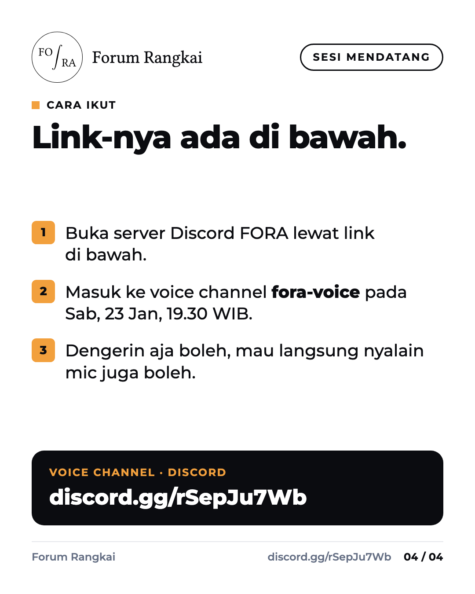 [PDF](fora-ngobrol-karier/li-doc/announce.pdf)

<details>
<summary>Captions</summary>

**Instagram**

```text
Ngobrol Karier di Tech

Diskusi terbuka tanpa tamu. Bawa cerita dan pertanyaan soal kerja di tech.

Sab, 23 Jan, 19.30–21.00 WIB. Dipandu Dika (contoh) @dika_contoh.

- Cari kerja pertama di tech
- Belajar sambil kerja
- Pindah dari developer ke SRE

Mampir ke voice channel fora-voice di Discord FORA, link di bio atau discord.gg/rSepJu7Wb. Dengerin aja nggak apa-apa, ngomong juga silakan.

#FORA #Karier #KarierTech #KomunitasTech
```

**X**

```text
Ngobrol Karier di Tech
Sab, 23 Jan, 19.30–21.00 WIB
Di voice channel fora-voice Discord FORA. Dengerin aja boleh, mic juga boleh.
https://discord.gg/rSepJu7Wb
#Karier
```

**LinkedIn**

```text
Ngobrol Karier di Tech, bareng FORA

Sab, 23 Jan, 19.30–21.00 WIB. Diskusi terbuka tanpa tamu. Bawa cerita dan pertanyaan soal kerja di tech.

• Cari kerja pertama di tech
• Belajar sambil kerja
• Pindah dari developer ke SRE

Dipandu Dika (contoh) @dika_contoh.

Gabung lewat https://discord.gg/rSepJu7Wb, lalu masuk ke voice channel fora-voice. Boleh dengarkan saja, boleh juga ikut bicara.

#Karier #KomunitasTech #FORA
```

</details>

### Reminder

**Instagram**

   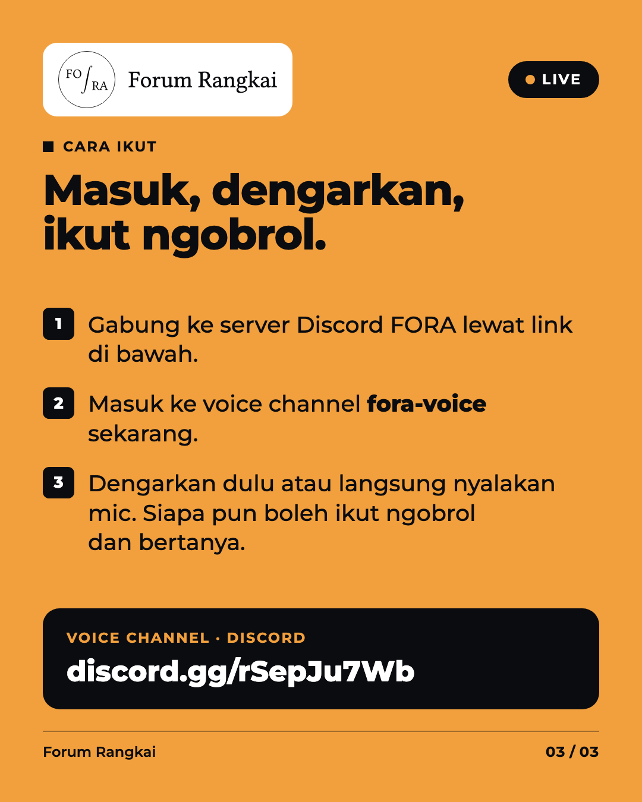 

**X**


**LinkedIn**

   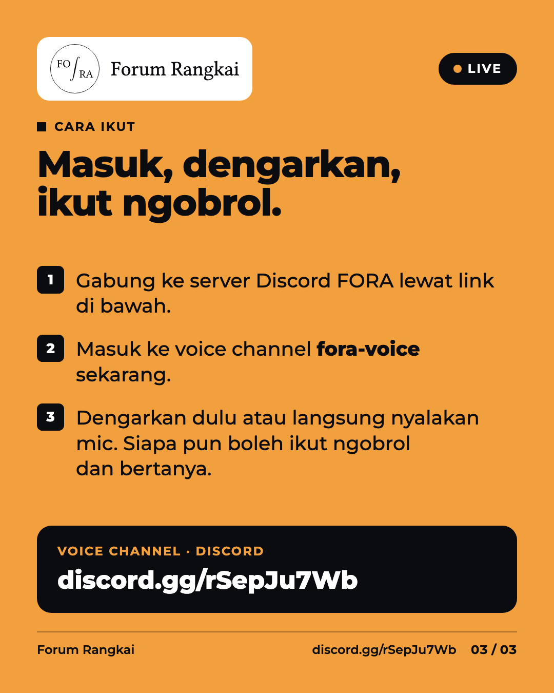 [PDF](fora-ngobrol-karier/li-doc/reminder.pdf)

<details>
<summary>Captions</summary>

**Instagram**

```text
Ngobrol Karier di Tech, hari ini jam 19.30 WIB.

Langsung masuk voice channel fora-voice lewat discord.gg/rSepJu7Wb (ada juga di bio). Dengerin aja nggak apa-apa, ngomong juga silakan.

#FORA #Karier #KarierTech #KomunitasTech
```

**X**

```text
Hari ini jam 19.30 WIB, Ngobrol Karier di Tech.
Di voice channel fora-voice Discord FORA. Dengerin aja boleh, mic juga boleh.
https://discord.gg/rSepJu7Wb
#Karier
```

**LinkedIn**

```text
Hari ini jam 19.30 WIB kita ngobrol soal Karier.

Ngobrol Karier di Tech, 19.30–21.00 WIB. Dipandu Dika (contoh) @dika_contoh.

Gabung lewat https://discord.gg/rSepJu7Wb, lalu masuk ke voice channel fora-voice. Boleh dengarkan saja, boleh juga ikut bicara.

#Karier #KomunitasTech #FORA
```

</details>

### Recap

**Instagram**

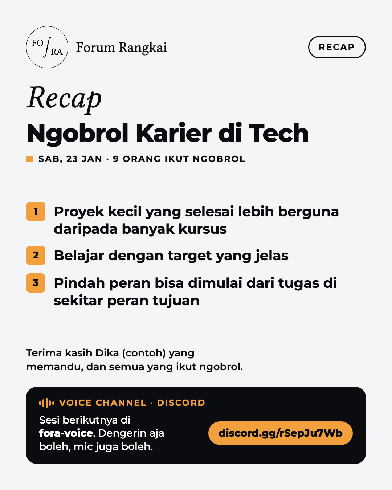   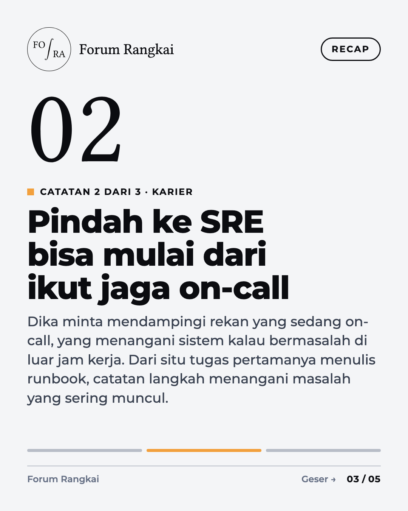  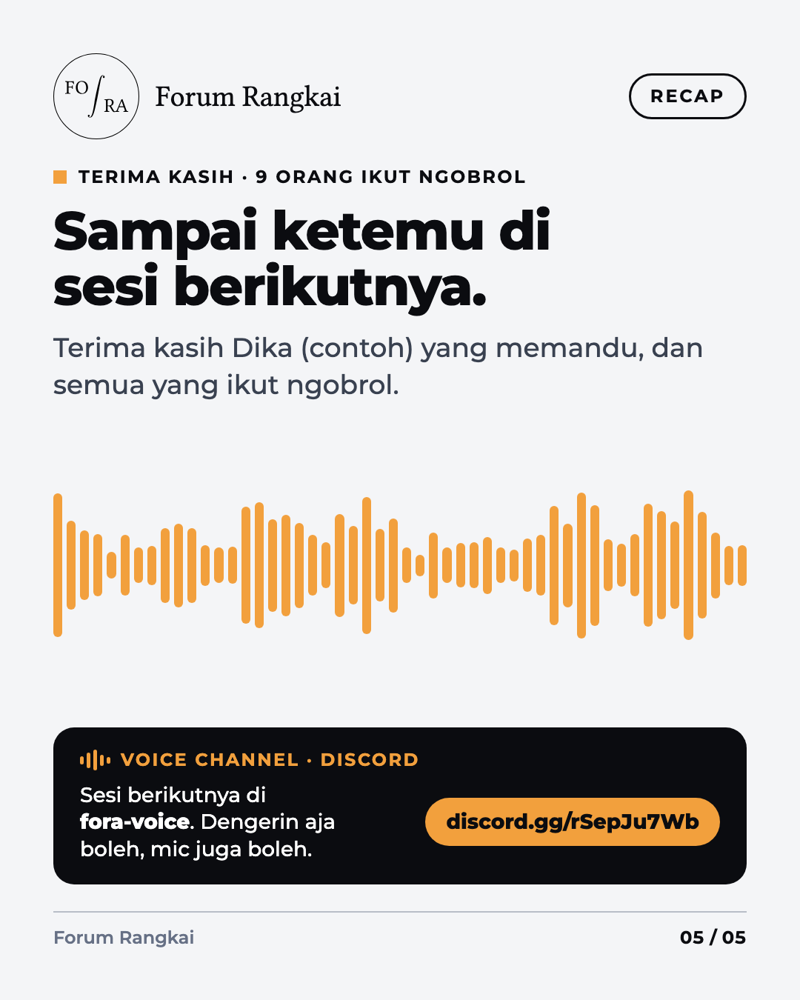 

**X**


**LinkedIn**

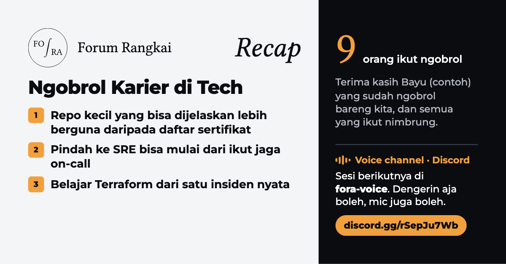     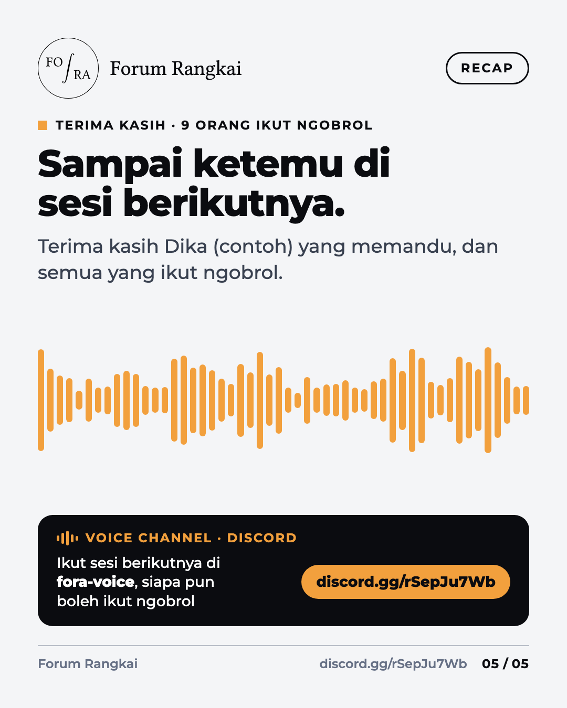 [PDF](fora-ngobrol-karier/li-doc/recap.pdf)

<details>
<summary>Captions</summary>

**Instagram**

```text
Ini yang tercatat dari "Ngobrol Karier di Tech" (Sab, 23 Jan).

- Proyek kecil yang selesai lebih berguna daripada banyak kursus. Satu proyek yang bisa dijelaskan tuntas lebih gampang dinilai daripada daftar sertifikat.
- Belajar dengan target yang jelas. Pilih satu masalah nyata di kerjaan atau proyek, lalu pelajari apa yang dibutuhkan untuk menyelesaikannya.
- Pindah peran bisa dimulai dari tugas di sekitar peran tujuan. Ambil kerjaan yang beririsan, misalnya on-call atau pipeline CI, sebelum pindah penuh.

9 orang ikut ngobrol di voice channel. Makasih Dika (contoh) @dika_contoh, sampai ketemu lagi. Sesi berikutnya kita umumkan di Discord FORA (link di bio atau discord.gg/rSepJu7Wb). Dengerin aja boleh, mic juga boleh.

#FORA #Karier #KarierTech #KomunitasTech
```

**X 1/3**

```text
9 orang ngobrol di voice channel buat "Ngobrol Karier di Tech". Makasih Dika (contoh) @dika_contoh, ini catatannya.
```

**X 2/3**

```text
- Proyek kecil yang selesai lebih berguna daripada banyak kursus
- Belajar dengan target yang jelas
- Pindah peran bisa dimulai dari tugas di sekitar peran tujuan
```

**X 3/3**

```text
Sesi berikutnya kita umumkan di Discord FORA. Dengerin aja boleh, mic juga boleh.
https://discord.gg/rSepJu7Wb
#Karier
```

**LinkedIn**

```text
Rekap "Ngobrol Karier di Tech" (Sab, 23 Jan).

Terima kasih Dika (contoh) @dika_contoh. 9 orang ikut ngobrol di voice channel.

1. Proyek kecil yang selesai lebih berguna daripada banyak kursus. Satu proyek yang bisa dijelaskan tuntas lebih gampang dinilai daripada daftar sertifikat.
2. Belajar dengan target yang jelas. Pilih satu masalah nyata di kerjaan atau proyek, lalu pelajari apa yang dibutuhkan untuk menyelesaikannya.
3. Pindah peran bisa dimulai dari tugas di sekitar peran tujuan. Ambil kerjaan yang beririsan, misalnya on-call atau pipeline CI, sebelum pindah penuh.

Sesi berikutnya akan kita umumkan di Discord FORA, di voice channel fora-voice. Mau dengarkan saja atau ikut bicara, dua-duanya boleh. https://discord.gg/rSepJu7Wb

#Karier #KomunitasTech #FORA
```

</details>

### Cover

**Instagram**

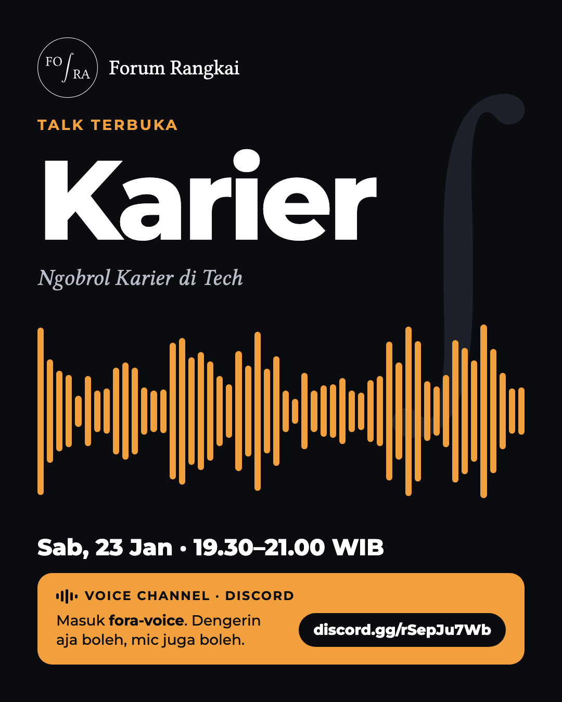  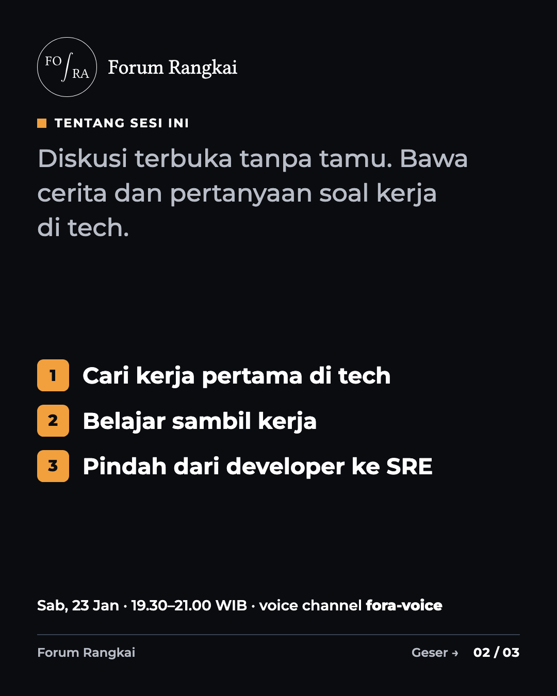 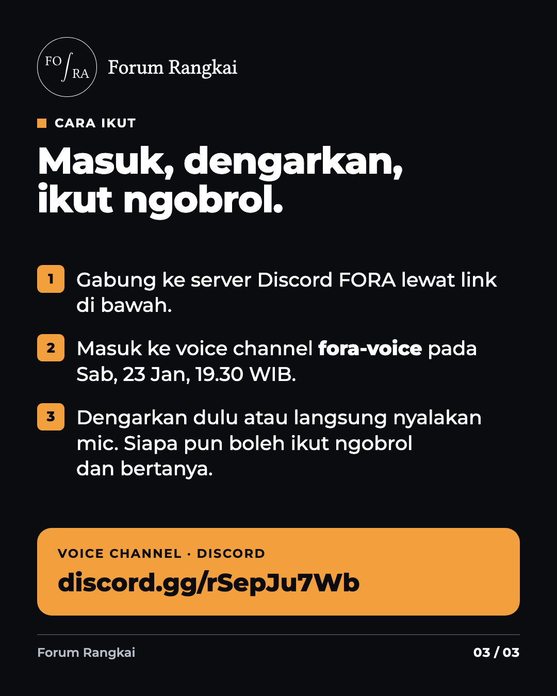 

**X**

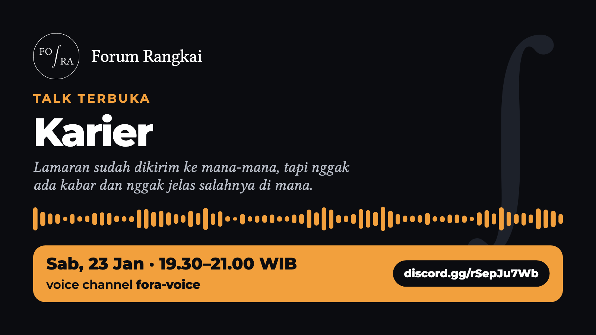

**LinkedIn**

  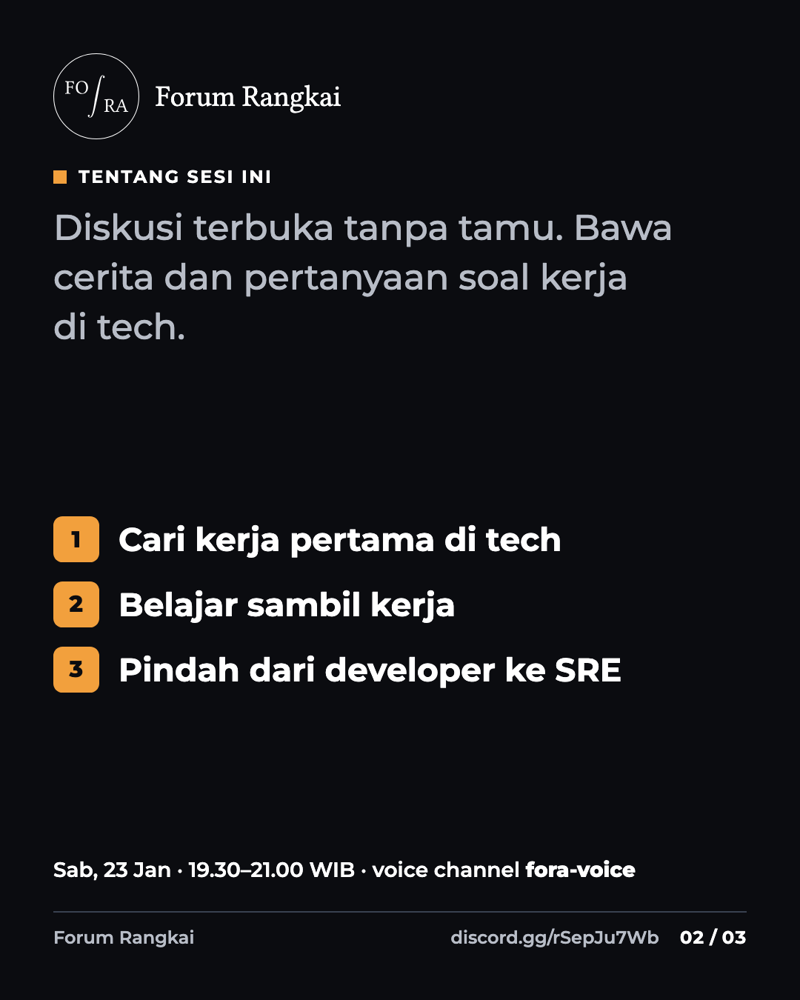  [PDF](fora-ngobrol-karier/li-doc/cover.pdf)

<details>
<summary>Captions</summary>

**Instagram**

```text
Karier bareng FORA.

Diskusi terbuka tanpa tamu. Bawa cerita dan pertanyaan soal kerja di tech.

Sesinya "Ngobrol Karier di Tech", Sabtu, 23 Januari 2027, 19.30–21.00 WIB.

Link Discord ada di bio (discord.gg/rSepJu7Wb). Masuk ke voice channel fora-voice. Dengerin aja nggak apa-apa, ngomong juga silakan.

#FORA #Karier #KarierTech #KomunitasTech
```

**X**

```text
Karier bareng FORA.
Ngobrol Karier di Tech
Sab, 23 Jan, 19.30–21.00 WIB
Di voice channel fora-voice Discord FORA. Dengerin aja boleh, mic juga boleh.
https://discord.gg/rSepJu7Wb
#Karier
```

**LinkedIn**

```text
Diskusi terbuka tanpa tamu. Bawa cerita dan pertanyaan soal kerja di tech.

Karier di FORA. Sesinya "Ngobrol Karier di Tech", Sab, 23 Jan, 19.30–21.00 WIB.

Gabung lewat https://discord.gg/rSepJu7Wb, lalu masuk ke voice channel fora-voice. Boleh dengarkan saja, boleh juga ikut bicara.

#Karier #KomunitasTech #FORA
```

</details>

### SIG intro

**Instagram**

     

**X**


**LinkedIn**

     [PDF](fora-ngobrol-karier/li-doc/sig-intro.pdf)

<details>
<summary>Captions</summary>

**Instagram**

```text
FORA (Forum Rangkai) itu komunitas tech kecil berbahasa Indonesia di Discord. Kita ngobrol di voice channel. Topiknya dibagi ke beberapa SIG (special interest group), dan tiap SIG pegang satu bidang.

Yang terdekat "Ngobrol Karier di Tech", Sab, 23 Jan jam 19.30 WIB. Langsung masuk voice channel fora-voice lewat discord.gg/rSepJu7Wb (ada juga di bio). Dengerin aja nggak apa-apa, ngomong juga silakan.

#FORA #Karier #KarierTech #KomunitasTech
```

**X**

```text
FORA. Komunitas tech kecil yang ngobrol lewat suara di Discord.
Sesi terdekat soal "Ngobrol Karier di Tech", Sab, 23 Jan.
Di voice channel fora-voice Discord FORA. Dengerin aja boleh, mic juga boleh.
https://discord.gg/rSepJu7Wb
#Karier
```

**LinkedIn**

```text
FORA. Komunitas tech kecil yang ngobrol lewat suara di Discord.

Sesi terdekat soal "Ngobrol Karier di Tech", Sab, 23 Jan, 19.30–21.00 WIB.

Kita ngobrol di voice channel fora-voice Discord FORA. Boleh dengarkan saja, boleh juga ikut bicara. Undangan: https://discord.gg/rSepJu7Wb

#Karier #KomunitasTech #FORA
```

</details>


## Kubernetes untuk Pemula

SIG CN · Sabtu, 12 Desember 2026 · 19.30 WIB · `sigcn-kubernetes-pemula`

### Announce

**Instagram**

 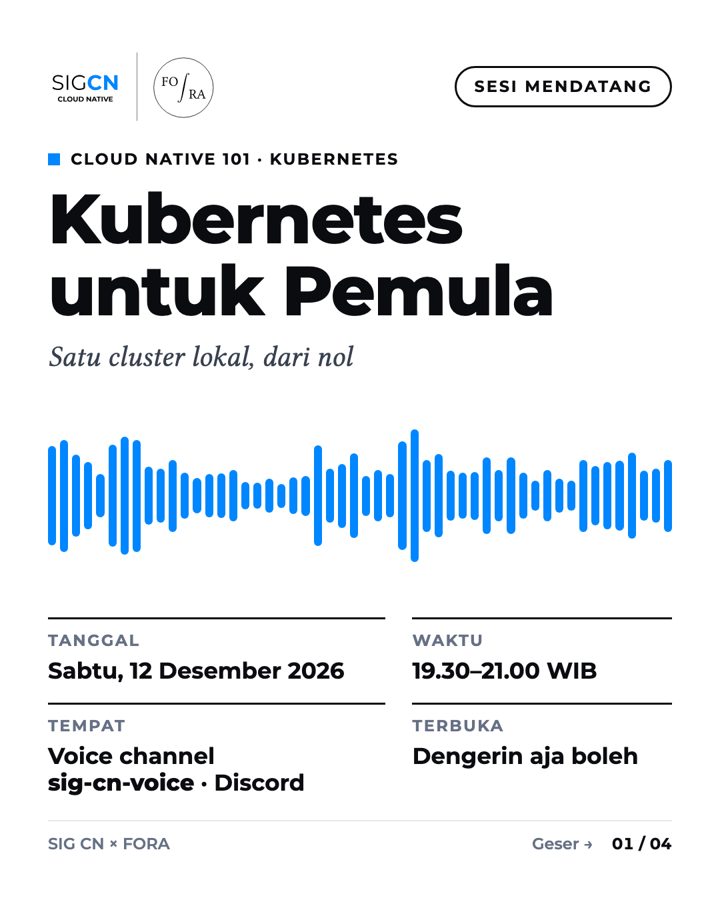    

**X**


**LinkedIn**

     [PDF](sigcn-kubernetes-pemula/li-doc/announce.pdf)

<details>
<summary>Captions</summary>

**Instagram**

```text
Kubernetes untuk Pemula, Sab, 12 Des jam 19.30 WIB.

Dulu saya baru paham Pod setelah sengaja mematikan satu dan lihat Deployment membuat gantinya. Kita ulangi percobaan itu bareng-bareng.

Bersama Bima (contoh) @bima_contoh dan Sari (contoh) @sari_contoh, dipandu Rina (contoh) @rina_contoh. Langsung masuk voice channel sig-cn-voice lewat discord.gg/rSepJu7Wb (ada juga di bio). Dengerin aja boleh, mic juga boleh.

#FORA #SIGCN #Kubernetes #Container
```

**X**

```text
Sab, 12 Des jam 19.30 WIB, kita kumpul di voice.
Kubernetes untuk Pemula
Di voice channel sig-cn-voice Discord FORA. Mau dengerin aja boleh, mau nyalain mic juga boleh.
https://discord.gg/rSepJu7Wb
#Kubernetes
```

**LinkedIn**

```text
Kubernetes untuk Pemula (SIG CN × FORA)

Dulu saya baru paham Pod setelah sengaja mematikan satu dan lihat Deployment membuat gantinya. Kita ulangi percobaan itu bareng-bareng.

Sabtu, 12 Desember 2026, 19.30–21.00 WIB, bersama Bima (contoh) @bima_contoh dan Sari (contoh) @sari_contoh, dipandu Rina (contoh) @rina_contoh.

• Kenapa container butuh orkestrasi
• Pod, Deployment, dan Service
• Deploy aplikasi pertama di minikube
• Debug dasar pakai kubectl describe dan logs

Kita ngobrol di voice channel sig-cn-voice Discord FORA. Boleh dengarkan saja, boleh juga ikut bicara. Undangan: https://discord.gg/rSepJu7Wb

#Kubernetes #CloudNative #DevOpsIndonesia
```

</details>

### Reminder

**Instagram**

  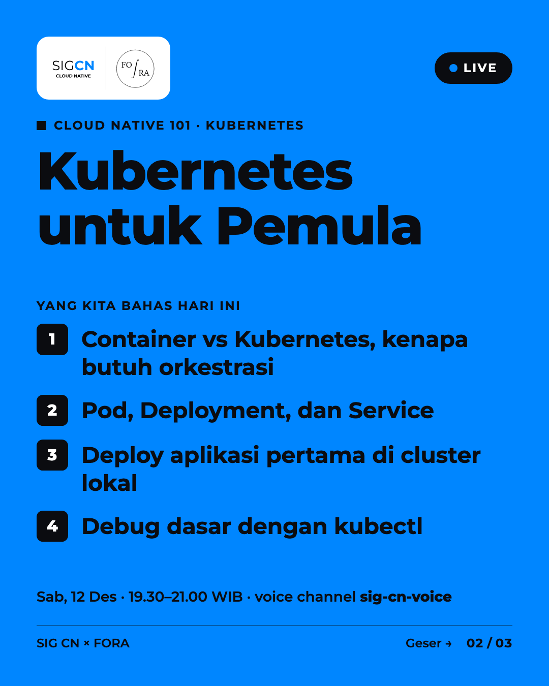  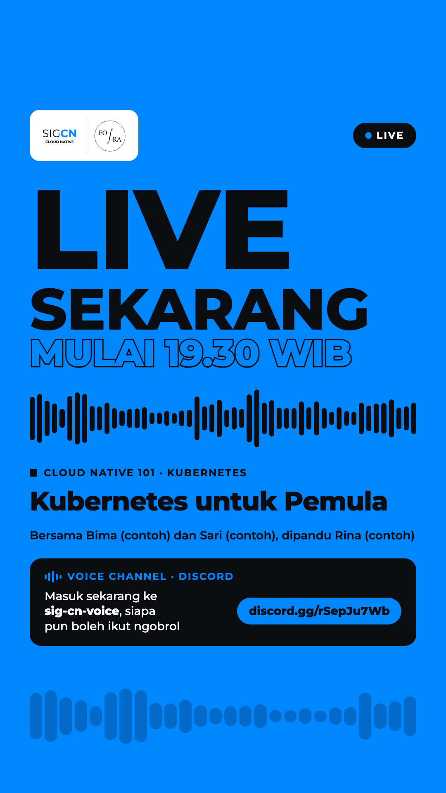

**X**


**LinkedIn**

    [PDF](sigcn-kubernetes-pemula/li-doc/reminder.pdf)

<details>
<summary>Captions</summary>

**Instagram**

```text
Kubernetes untuk Pemula mulai 19.30 WIB hari ini.

Dulu saya baru paham Pod setelah sengaja mematikan satu dan lihat Deployment membuat gantinya. Kita ulangi percobaan itu bareng-bareng.

Mampir ke voice channel sig-cn-voice di Discord FORA, link di bio atau discord.gg/rSepJu7Wb. Dengerin aja boleh, mic juga boleh.

#FORA #SIGCN #Kubernetes #Container
```

**X**

```text
Hari ini jam 19.30 WIB, Kubernetes untuk Pemula.
Di voice channel sig-cn-voice Discord FORA. Mau dengerin aja boleh, mau nyalain mic juga boleh.
https://discord.gg/rSepJu7Wb
#Kubernetes
```

**LinkedIn**

```text
Hari ini, 19.30–21.00 WIB
Kubernetes untuk Pemula

Dulu saya baru paham Pod setelah sengaja mematikan satu dan lihat Deployment membuat gantinya. Kita ulangi percobaan itu bareng-bareng.

Bersama Bima (contoh) @bima_contoh dan Sari (contoh) @sari_contoh, dipandu Rina (contoh) @rina_contoh. Kalau sudah mulai, silakan langsung masuk.

Kita ngobrol di voice channel sig-cn-voice Discord FORA. Boleh dengarkan saja, boleh juga ikut bicara. Undangan: https://discord.gg/rSepJu7Wb

#Kubernetes #CloudNative #DevOpsIndonesia
```

</details>

### Recap

**Instagram**

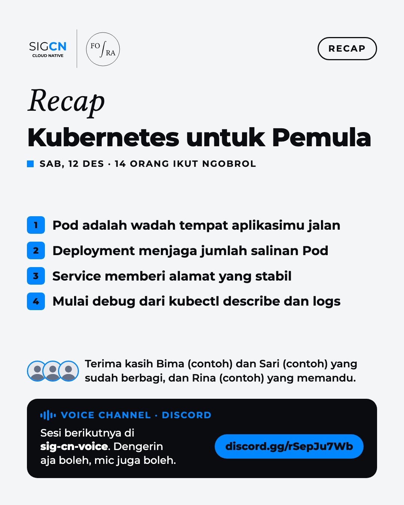 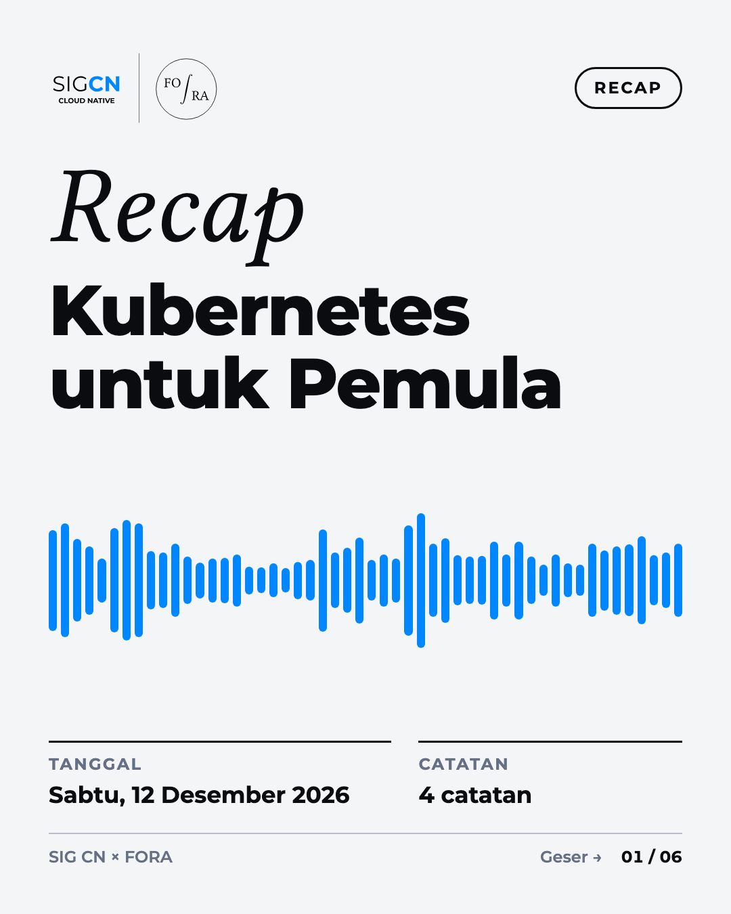   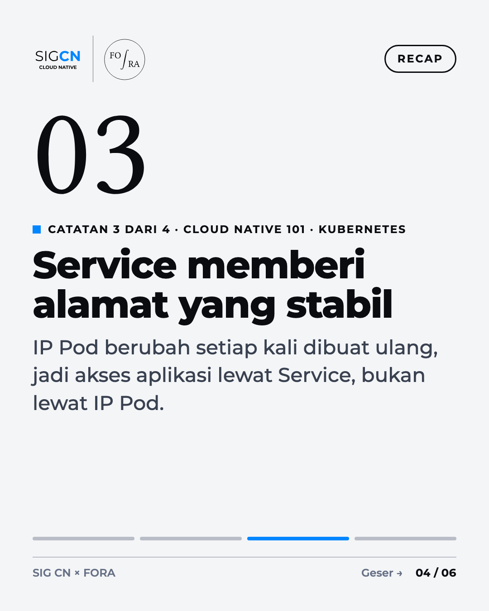 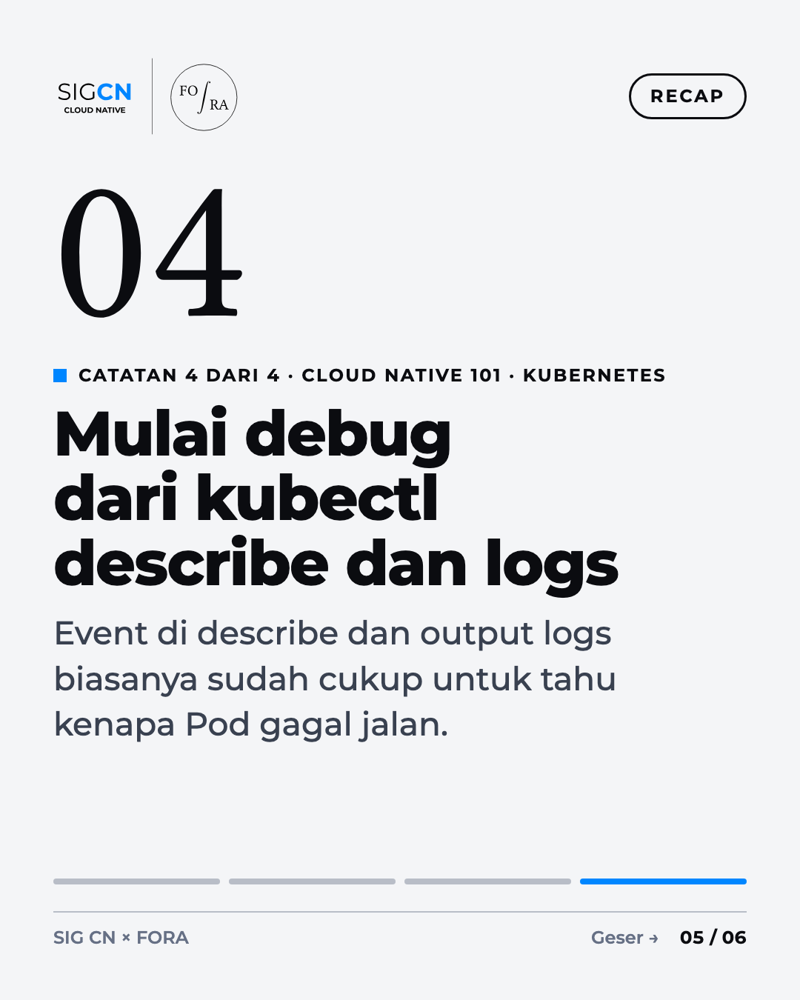  

**X**

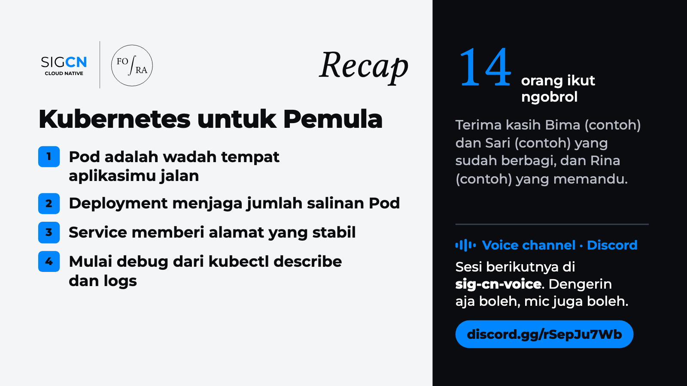

**LinkedIn**

     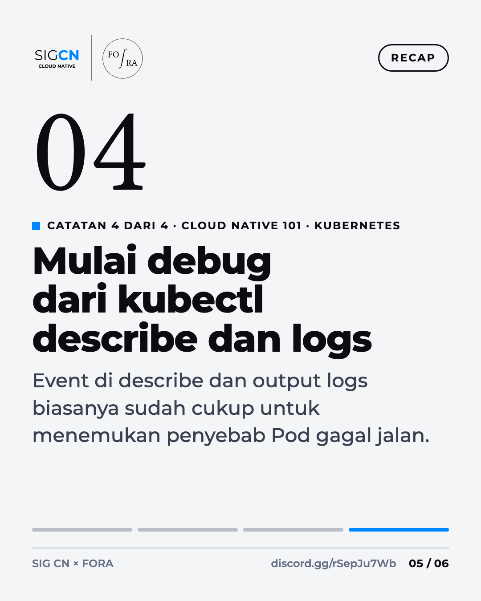 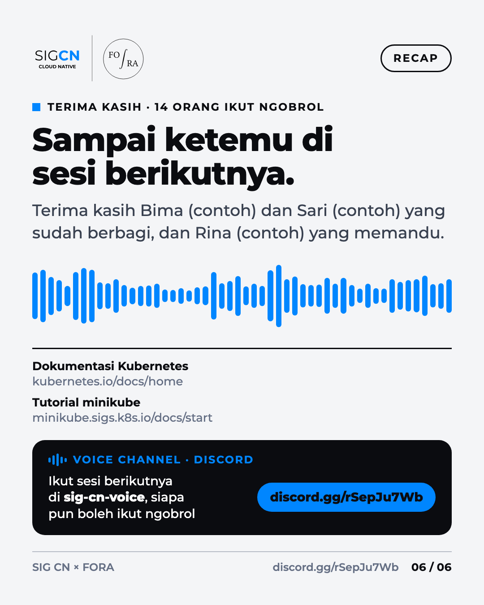 [PDF](sigcn-kubernetes-pemula/li-doc/recap.pdf)

<details>
<summary>Captions</summary>

**Instagram**

```text
Ini yang tercatat dari "Kubernetes untuk Pemula" (Sab, 12 Des).

- Pod adalah unit terkecil yang dijadwalkan. Satu Pod bisa berisi beberapa container yang berbagi network dan storage.
- Deployment menjaga jumlah replika. Kalau satu Pod mati, Deployment langsung membuat gantinya sampai jumlah replika sesuai.
- Service memberi alamat yang stabil. IP Pod berubah tiap kali dibuat ulang, jadi akses aplikasi lewat Service. Jangan pakai IP Pod langsung.
- Mulai debug dari kubectl describe dan logs. Event di describe dan output logs biasanya sudah cukup untuk tahu kenapa Pod gagal jalan.

Dokumentasi Kubernetes: https://kubernetes.io/docs/home/
Tutorial minikube: https://minikube.sigs.k8s.io/docs/start/

14 orang ikut ngobrol di voice channel. Makasih Bima (contoh) @bima_contoh dan Sari (contoh) @sari_contoh, sampai ketemu lagi. Sesi berikutnya kita umumkan di Discord FORA (link di bio atau discord.gg/rSepJu7Wb). Mau dengerin aja boleh, mau nyalain mic juga boleh.

#FORA #SIGCN #Kubernetes #Container
```

**X 1/3**

```text
Rekap "Kubernetes untuk Pemula". 14 orang ngobrol di voice channel. Makasih Bima (contoh) @bima_contoh dan Sari (contoh) @sari_contoh.
```

**X 2/3**

```text
Intinya:
1. Pod adalah unit terkecil yang dijadwalkan
2. Deployment menjaga jumlah replika
3. Service memberi alamat yang stabil
4. Mulai debug dari kubectl describe dan logs
```

**X 3/3**

```text
Dokumentasi Kubernetes https://kubernetes.io/docs/home/
Sesi berikutnya diumumkan di Discord FORA. Mau dengerin aja boleh, mau nyalain mic juga boleh.
https://discord.gg/rSepJu7Wb
#Kubernetes
```

**LinkedIn**

```text
Rekap "Kubernetes untuk Pemula" (Sab, 12 Des).

Terima kasih Bima (contoh) @bima_contoh dan Sari (contoh) @sari_contoh. 14 orang ikut ngobrol di voice channel.

1. Pod adalah unit terkecil yang dijadwalkan. Satu Pod bisa berisi beberapa container yang berbagi network dan storage.
2. Deployment menjaga jumlah replika. Kalau satu Pod mati, Deployment langsung membuat gantinya sampai jumlah replika sesuai.
3. Service memberi alamat yang stabil. IP Pod berubah tiap kali dibuat ulang, jadi akses aplikasi lewat Service. Jangan pakai IP Pod langsung.
4. Mulai debug dari kubectl describe dan logs. Event di describe dan output logs biasanya sudah cukup untuk tahu kenapa Pod gagal jalan.

Dokumentasi Kubernetes: https://kubernetes.io/docs/home/
Tutorial minikube: https://minikube.sigs.k8s.io/docs/start/

Sesi berikutnya akan kita umumkan di Discord FORA, di voice channel sig-cn-voice. Boleh dengarkan saja, boleh juga ikut bicara. https://discord.gg/rSepJu7Wb

#Kubernetes #CloudNative #DevOpsIndonesia
```

</details>

### Cover

**Instagram**

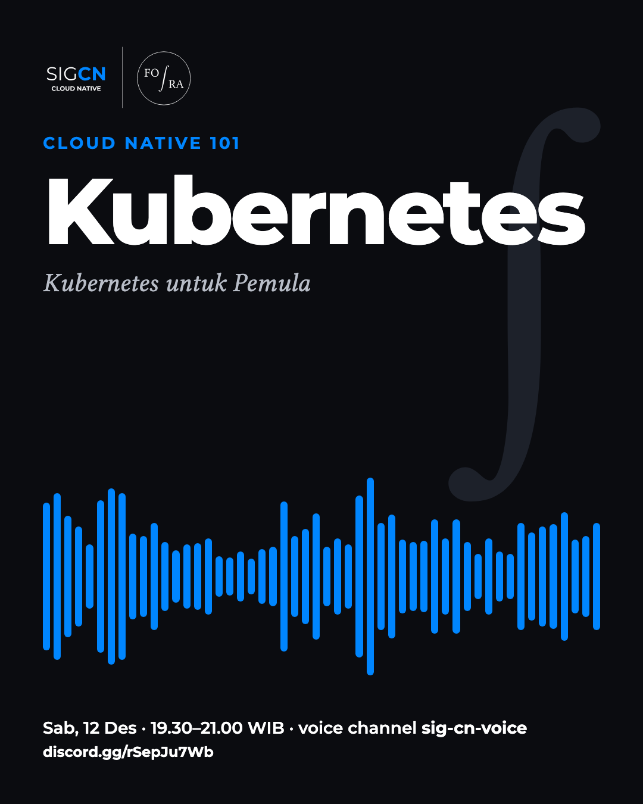    

**X**


**LinkedIn**

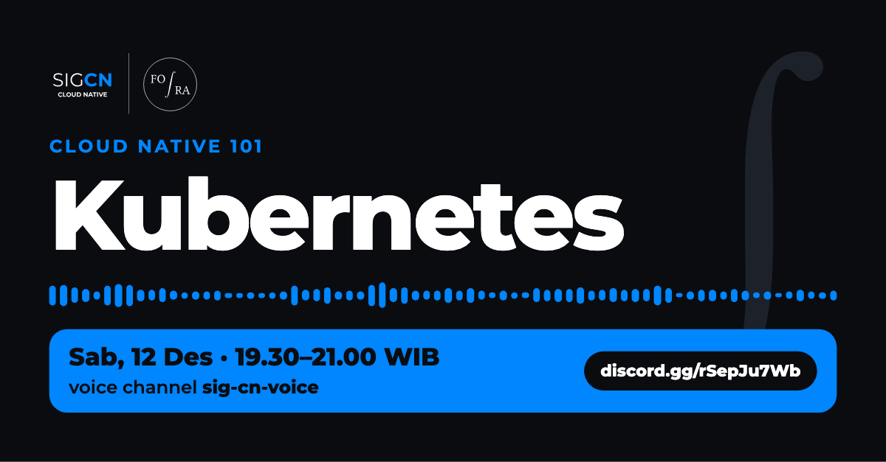    [PDF](sigcn-kubernetes-pemula/li-doc/cover.pdf)

<details>
<summary>Captions</summary>

**Instagram**

```text
Kubernetes untuk Pemula

Cloud Native 101 di SIG CN × FORA.

Dulu saya baru paham Pod setelah sengaja mematikan satu dan lihat Deployment membuat gantinya. Kita ulangi percobaan itu bareng-bareng.

Sabtu, 12 Desember 2026, 19.30–21.00 WIB. Mampir ke voice channel sig-cn-voice di Discord FORA, link di bio atau discord.gg/rSepJu7Wb. Dengerin aja boleh, mic juga boleh.

#FORA #SIGCN #Kubernetes #Container
```

**X**

```text
Cloud Native 101 bareng SIG CN × FORA.
Kubernetes untuk Pemula
Sab, 12 Des, 19.30–21.00 WIB
Di voice channel sig-cn-voice Discord FORA. Mau dengerin aja boleh, mau nyalain mic juga boleh.
https://discord.gg/rSepJu7Wb
#Kubernetes
```

**LinkedIn**

```text
Dulu saya baru paham Pod setelah sengaja mematikan satu dan lihat Deployment membuat gantinya. Kita ulangi percobaan itu bareng-bareng.

Cloud Native 101 di SIG CN × FORA. Sesinya "Kubernetes untuk Pemula", Sab, 12 Des, 19.30–21.00 WIB.

Gabung lewat https://discord.gg/rSepJu7Wb, lalu masuk ke voice channel sig-cn-voice. Boleh dengarkan saja, boleh juga ikut bicara.

#Kubernetes #CloudNative #DevOpsIndonesia
```

</details>

### SIG intro

**Instagram**

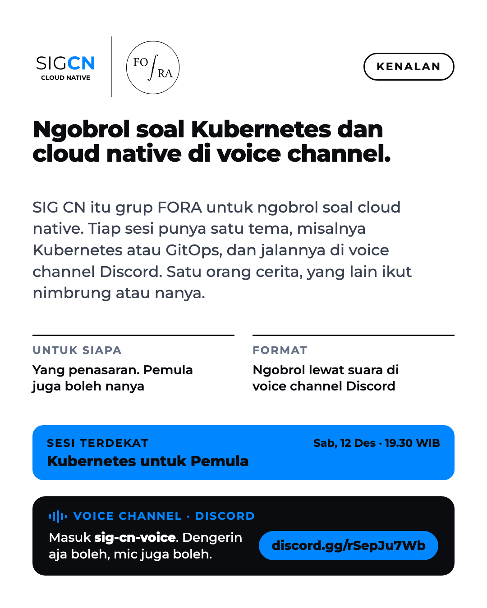     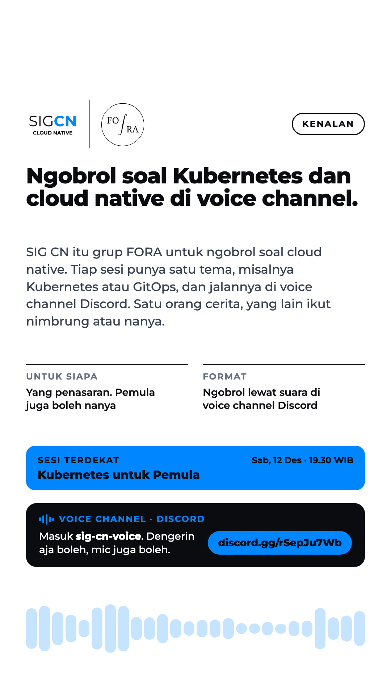

**X**


**LinkedIn**

     [PDF](sigcn-kubernetes-pemula/li-doc/sig-intro.pdf)

<details>
<summary>Captions</summary>

**Instagram**

```text
SIG CN di FORA. Ngobrol soal Kubernetes dan cloud native di voice channel.

Sesi terdekat soal "Kubernetes untuk Pemula", Sab, 12 Des jam 19.30 WIB.

Link Discord ada di bio (discord.gg/rSepJu7Wb). Masuk ke voice channel sig-cn-voice. Dengerin aja boleh, mic juga boleh.

#FORA #SIGCN #Kubernetes #Container
```

**X**

```text
SIG CN di FORA. Ngobrol soal Kubernetes dan cloud native di voice channel.
Sesi terdekat soal "Kubernetes untuk Pemula", Sab, 12 Des.
Di voice channel sig-cn-voice Discord FORA. Mau dengerin aja boleh, mau nyalain mic juga boleh.
https://discord.gg/rSepJu7Wb
#Kubernetes
```

**LinkedIn**

```text
SIG CN di FORA. Ngobrol soal Kubernetes dan cloud native di voice channel.

Sesi terdekat soal "Kubernetes untuk Pemula", Sab, 12 Des, 19.30–21.00 WIB.

Kita ngobrol di voice channel sig-cn-voice Discord FORA. Boleh dengarkan saja, boleh juga ikut bicara. Undangan: https://discord.gg/rSepJu7Wb

#Kubernetes #CloudNative #DevOpsIndonesia
```

</details>


## GitOps dengan Argo CD

SIG CN · Sabtu, 19 Desember 2026 · 19.30 WIB · `sigcn-gitops-argocd`

### Announce

**Instagram**

     

**X**

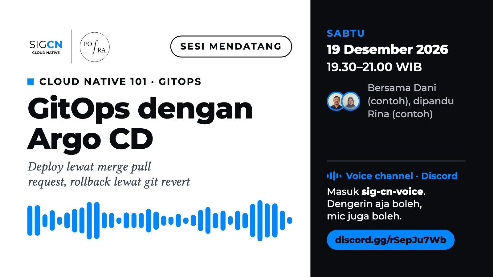

**LinkedIn**

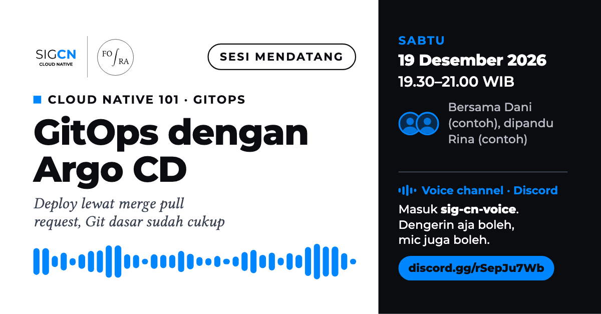    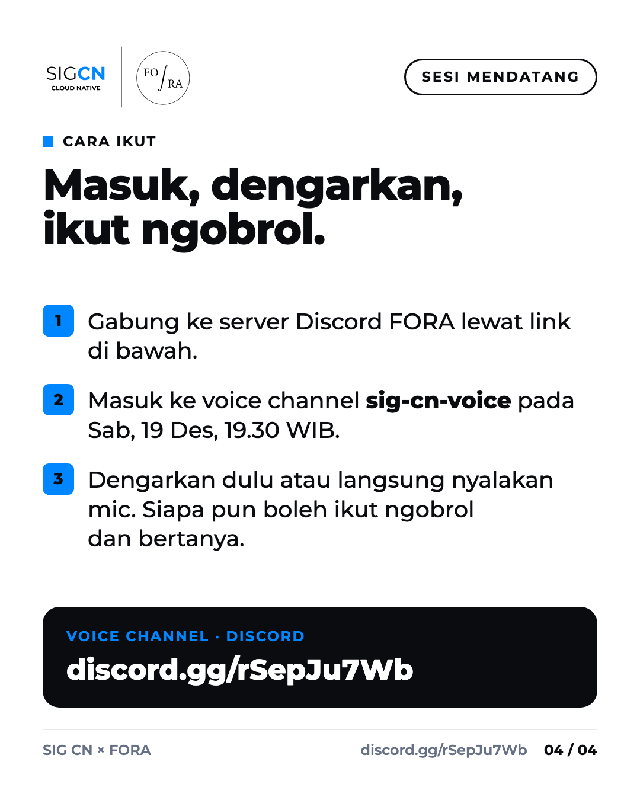 [PDF](sigcn-gitops-argocd/li-doc/announce.pdf)

<details>
<summary>Captions</summary>

**Instagram**

```text
GitOps dengan Argo CD

Pernah ada yang kubectl apply langsung ke prod jam 11 malam? Di tim saya pernah, dan dari situ saya pindah ke GitOps.

Sab, 19 Des, 19.30–21.00 WIB. Bersama Dani (contoh), dipandu Rina (contoh).

- Prinsip GitOps
- Argo CD Application dan sync
- Struktur repo manifest
- Rollback pakai git revert

Mampir ke voice channel sig-cn-voice di Discord FORA, link di bio atau discord.gg/rSepJu7Wb. Dengerin aja boleh, mic juga boleh.

#FORA #SIGCN #GitOps #ArgoCD
```

**X**

```text
GitOps dengan Argo CD
Sab, 19 Des jam 19.30 WIB.
Masuk aja ke voice channel sig-cn-voice di Discord FORA. Dengerin aja boleh, mic juga boleh.
https://discord.gg/rSepJu7Wb
#GitOps
```

**LinkedIn**

```text
Pernah ada yang kubectl apply langsung ke prod jam 11 malam? Di tim saya pernah, dan dari situ saya pindah ke GitOps.

GitOps dengan Argo CD. Sabtu, 19 Desember 2026, 19.30–21.00 WIB. Bersama Dani (contoh), dipandu Rina (contoh).

Gabung lewat https://discord.gg/rSepJu7Wb, lalu masuk ke voice channel sig-cn-voice. Boleh dengarkan saja, boleh juga ikut bicara.

#GitOps #CloudNative #Kubernetes
```

</details>

### Reminder

**Instagram**

   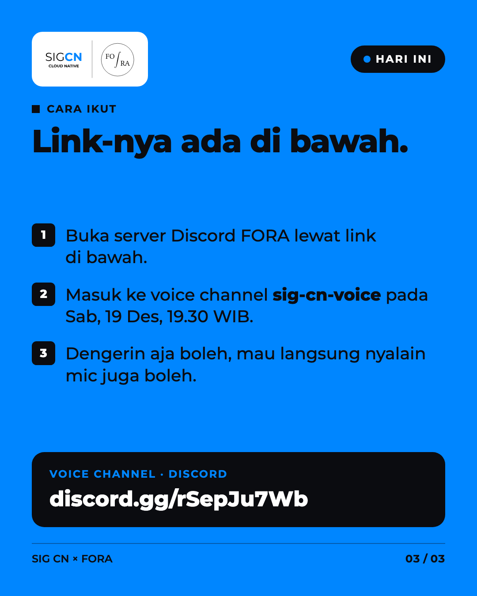 

**X**

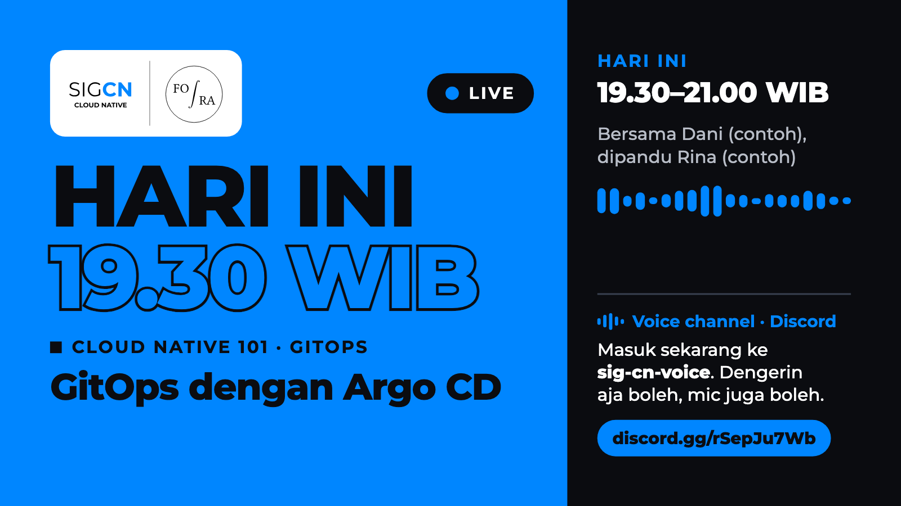

**LinkedIn**

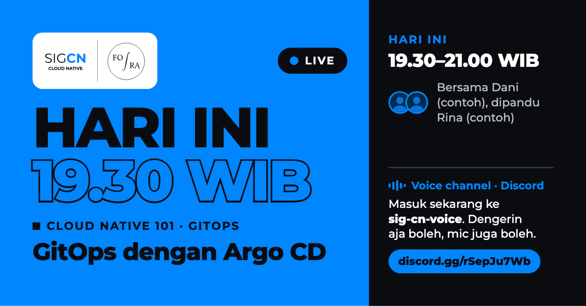    [PDF](sigcn-gitops-argocd/li-doc/reminder.pdf)

<details>
<summary>Captions</summary>

**Instagram**

```text
GitOps dengan Argo CD mulai 19.30 WIB hari ini.

Pernah ada yang kubectl apply langsung ke prod jam 11 malam? Di tim saya pernah, dan dari situ saya pindah ke GitOps.

Mampir ke voice channel sig-cn-voice di Discord FORA, link di bio atau discord.gg/rSepJu7Wb. Dengerin aja boleh, mic juga boleh.

#FORA #SIGCN #GitOps #ArgoCD
```

**X**

```text
GitOps dengan Argo CD mulai 19.30 WIB.
Kalau sudah jalan, nyusul aja.
Masuk aja ke voice channel sig-cn-voice di Discord FORA. Dengerin aja boleh, mic juga boleh.
https://discord.gg/rSepJu7Wb
#GitOps
```

**LinkedIn**

```text
Hari ini, 19.30–21.00 WIB
GitOps dengan Argo CD

Pernah ada yang kubectl apply langsung ke prod jam 11 malam? Di tim saya pernah, dan dari situ saya pindah ke GitOps.

Bersama Dani (contoh), dipandu Rina (contoh). Kalau sudah mulai, silakan langsung masuk.

Kita ngobrol di voice channel sig-cn-voice Discord FORA. Boleh dengarkan saja, boleh juga ikut bicara. Undangan: https://discord.gg/rSepJu7Wb

#GitOps #CloudNative #Kubernetes
```

</details>

### Recap

**Instagram**

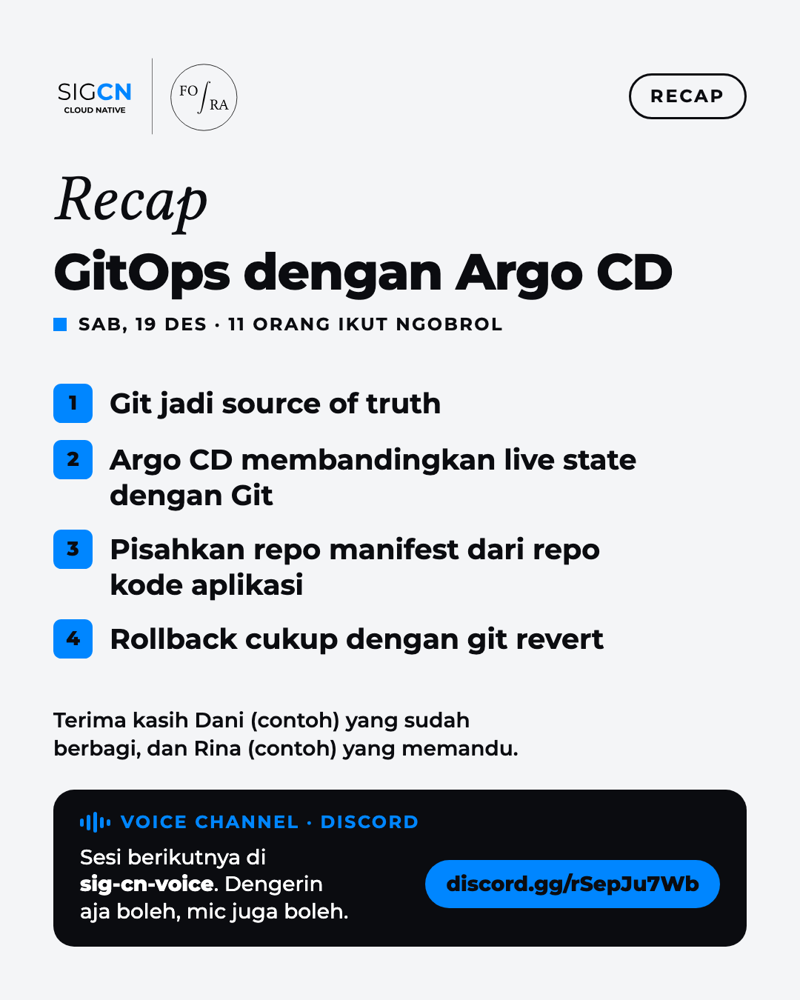  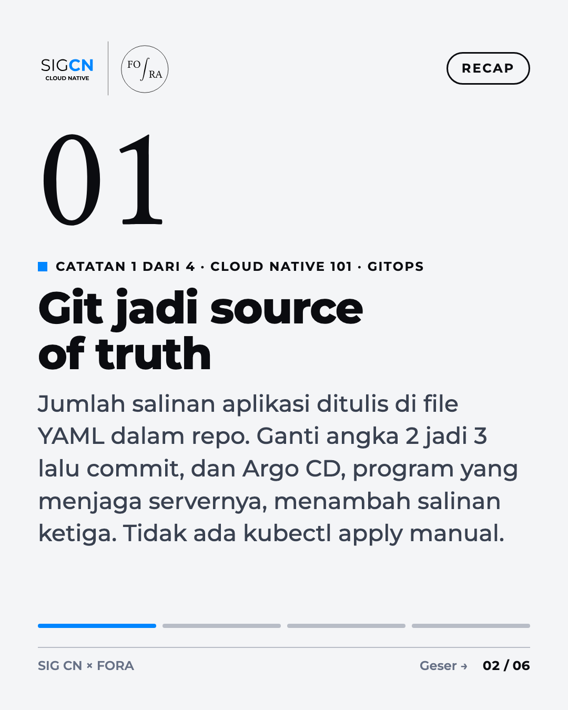 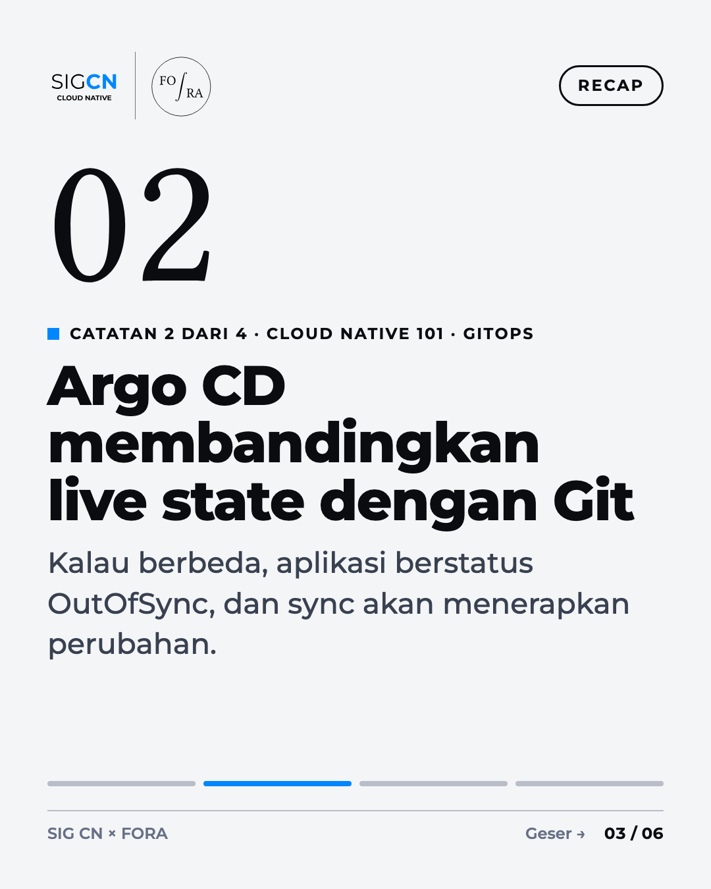   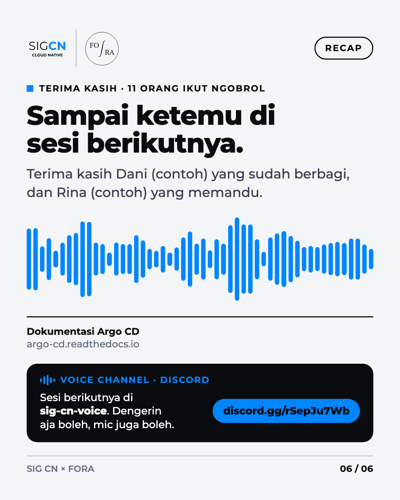 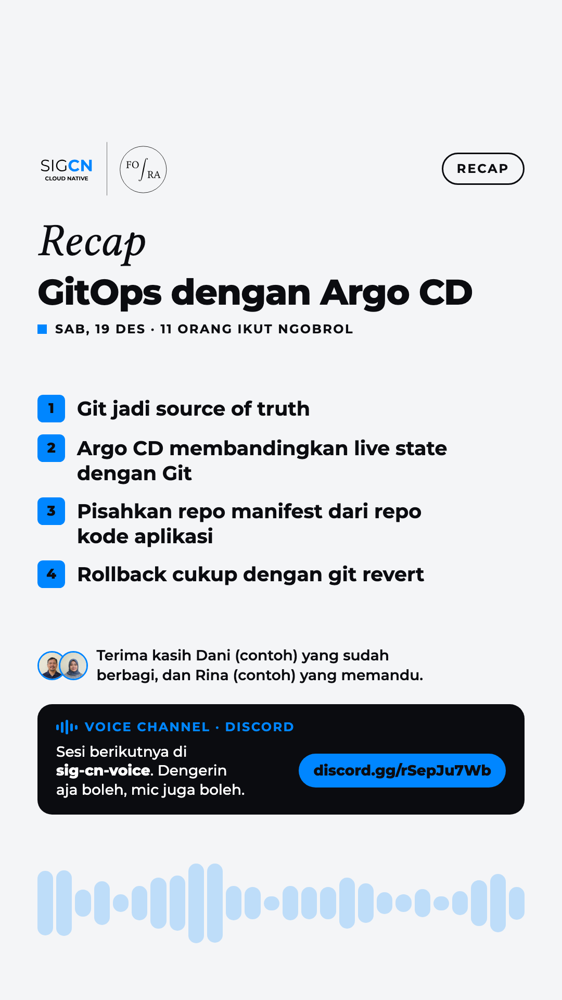

**X**


**LinkedIn**

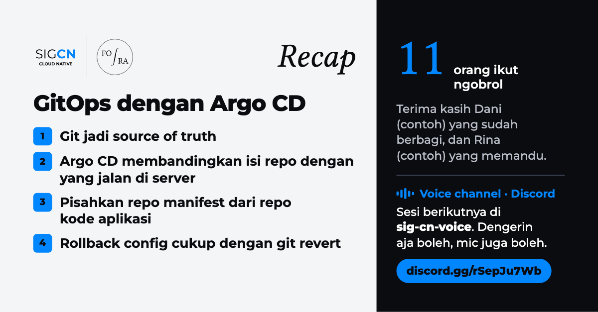    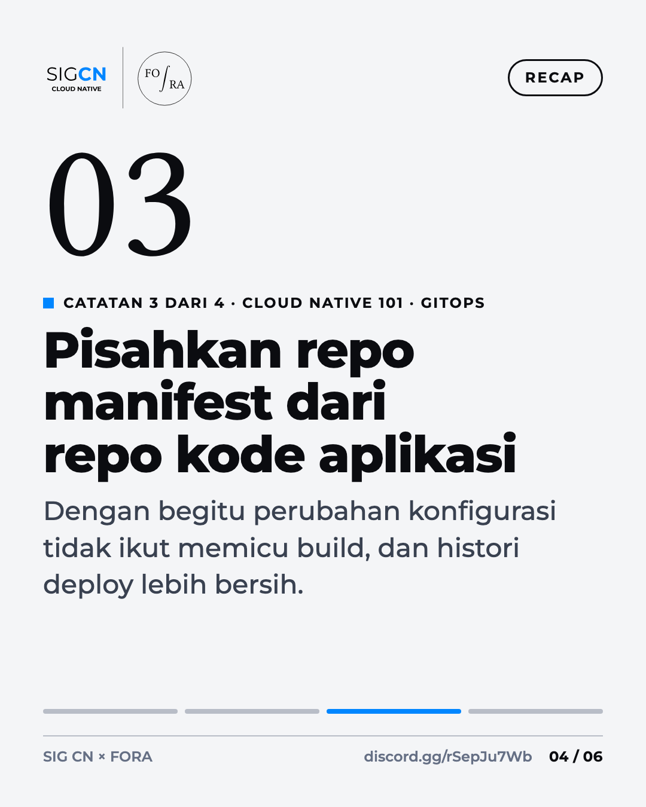   [PDF](sigcn-gitops-argocd/li-doc/recap.pdf)

<details>
<summary>Captions</summary>

**Instagram**

```text
Rekap "GitOps dengan Argo CD", Sab, 19 Des.

11 orang ikut ngobrol di voice channel. Makasih Dani (contoh).

1. Git jadi source of truth. Kondisi yang diinginkan ditulis di repo, dan controller yang menyamakan cluster dengan repo. Tidak ada kubectl apply manual.
2. Argo CD membandingkan live state dengan Git. Kalau beda, aplikasi berstatus OutOfSync, dan sync menerapkan perubahannya.
3. Pisahkan repo manifest dari repo kode aplikasi. Perubahan konfigurasi tidak ikut memicu build, dan histori deploy lebih rapi.
4. Rollback cukup dengan git revert. Commit baru yang membatalkan perubahan, lalu disync. Riwayatnya tetap tercatat.

Dokumentasi Argo CD: https://argo-cd.readthedocs.io/

Sesi berikutnya kita umumkan di Discord FORA (link di bio atau discord.gg/rSepJu7Wb). Mau dengerin aja boleh, mau nyalain mic juga boleh.

#FORA #SIGCN #GitOps #ArgoCD
```

**X 1/3**

```text
Rekap "GitOps dengan Argo CD". 11 orang ngobrol di voice channel. Makasih Dani (contoh).
```

**X 2/3**

```text
Intinya:
1. Git jadi source of truth
2. Argo CD membandingkan live state dengan Git
3. Pisahkan repo manifest dari repo kode aplikasi
4. Rollback cukup dengan git revert
```

**X 3/3**

```text
Dokumentasi Argo CD https://argo-cd.readthedocs.io/
Sesi berikutnya diumumkan di Discord FORA. Dengerin aja nggak apa-apa, ngomong juga silakan.
https://discord.gg/rSepJu7Wb
#GitOps
```

**LinkedIn**

```text
Rekap "GitOps dengan Argo CD" (Sab, 19 Des).

Terima kasih Dani (contoh). 11 orang ikut ngobrol di voice channel.

1. Git jadi source of truth. Kondisi yang diinginkan ditulis di repo, dan controller yang menyamakan cluster dengan repo. Tidak ada kubectl apply manual.
2. Argo CD membandingkan live state dengan Git. Kalau beda, aplikasi berstatus OutOfSync, dan sync menerapkan perubahannya.
3. Pisahkan repo manifest dari repo kode aplikasi. Perubahan konfigurasi tidak ikut memicu build, dan histori deploy lebih rapi.
4. Rollback cukup dengan git revert. Commit baru yang membatalkan perubahan, lalu disync. Riwayatnya tetap tercatat.

Dokumentasi Argo CD: https://argo-cd.readthedocs.io/

Sesi berikutnya akan kita umumkan di Discord FORA, di voice channel sig-cn-voice. Boleh dengarkan saja, boleh juga ikut bicara. https://discord.gg/rSepJu7Wb

#GitOps #CloudNative #Kubernetes
```

</details>

### Cover

**Instagram**

 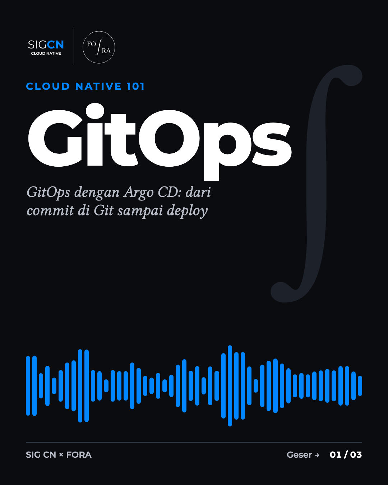   

**X**


**LinkedIn**

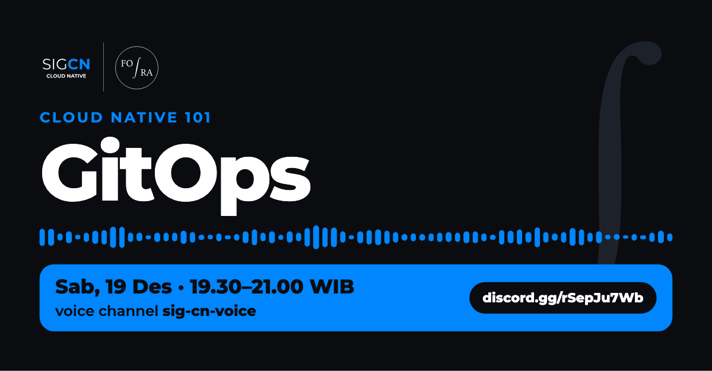    [PDF](sigcn-gitops-argocd/li-doc/cover.pdf)

<details>
<summary>Captions</summary>

**Instagram**

```text
GitOps dengan Argo CD

Cloud Native 101 di SIG CN × FORA.

Pernah ada yang kubectl apply langsung ke prod jam 11 malam? Di tim saya pernah, dan dari situ saya pindah ke GitOps.

Sabtu, 19 Desember 2026, 19.30–21.00 WIB. Mampir ke voice channel sig-cn-voice di Discord FORA, link di bio atau discord.gg/rSepJu7Wb. Dengerin aja boleh, mic juga boleh.

#FORA #SIGCN #GitOps #ArgoCD
```

**X**

```text
Cloud Native 101 bareng SIG CN × FORA.
GitOps dengan Argo CD
Sab, 19 Des, 19.30–21.00 WIB
Di voice channel sig-cn-voice Discord FORA. Dengerin aja boleh, mic juga boleh.
https://discord.gg/rSepJu7Wb
#GitOps
```

**LinkedIn**

```text
Pernah ada yang kubectl apply langsung ke prod jam 11 malam? Di tim saya pernah, dan dari situ saya pindah ke GitOps.

Cloud Native 101 di SIG CN × FORA. Sesinya "GitOps dengan Argo CD", Sab, 19 Des, 19.30–21.00 WIB.

Gabung lewat https://discord.gg/rSepJu7Wb, lalu masuk ke voice channel sig-cn-voice. Boleh dengarkan saja, boleh juga ikut bicara.

#GitOps #CloudNative #Kubernetes
```

</details>

### SIG intro

**Instagram**

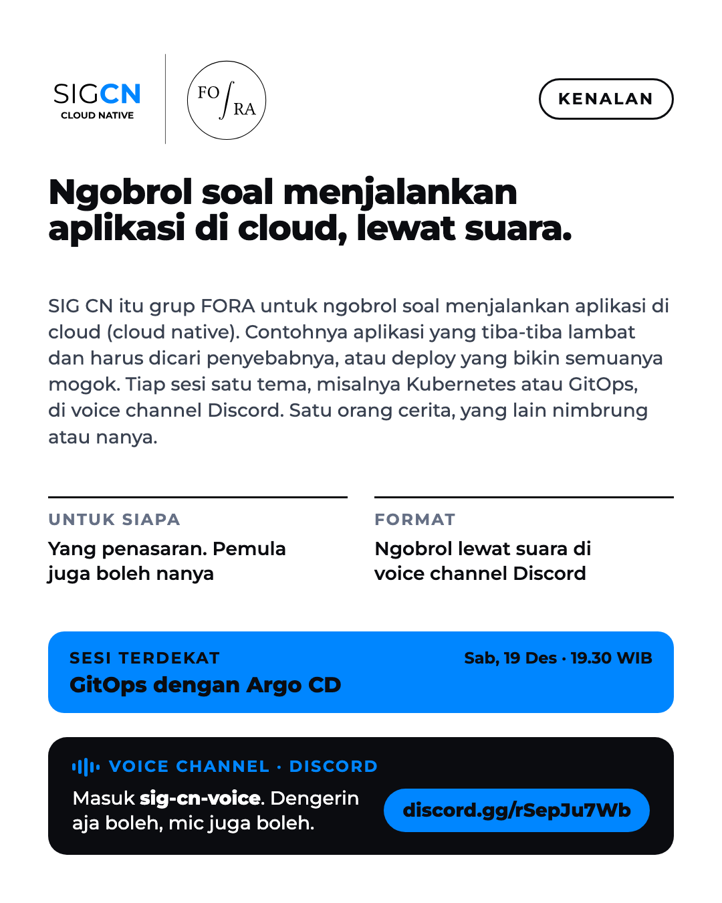   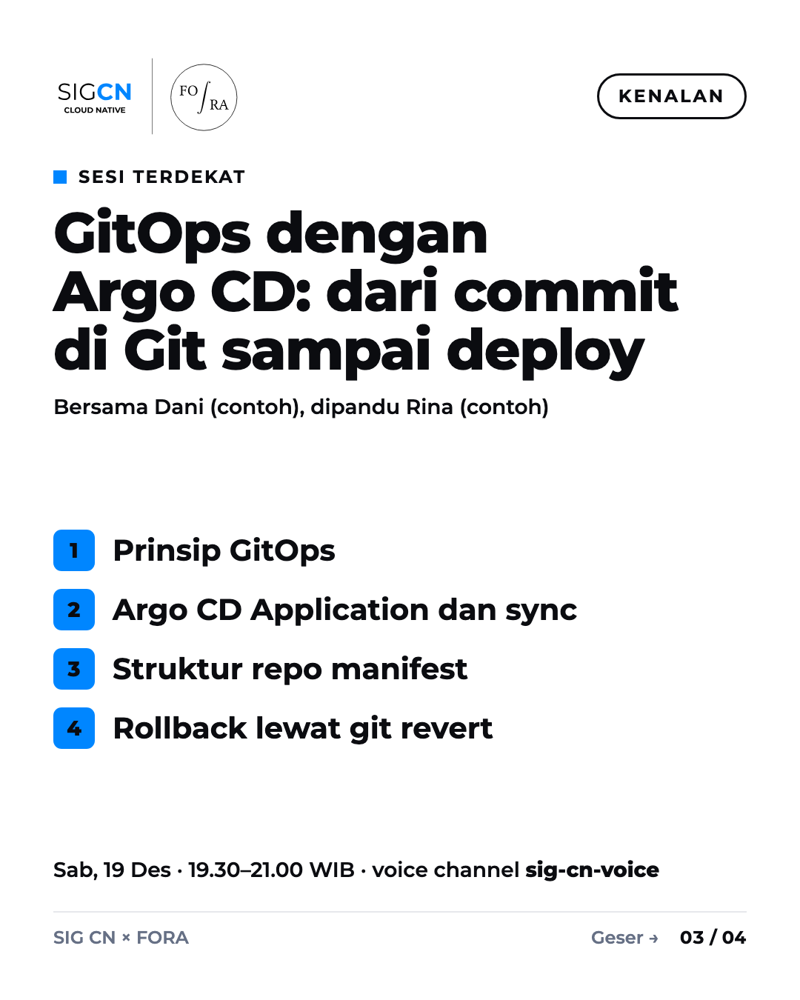 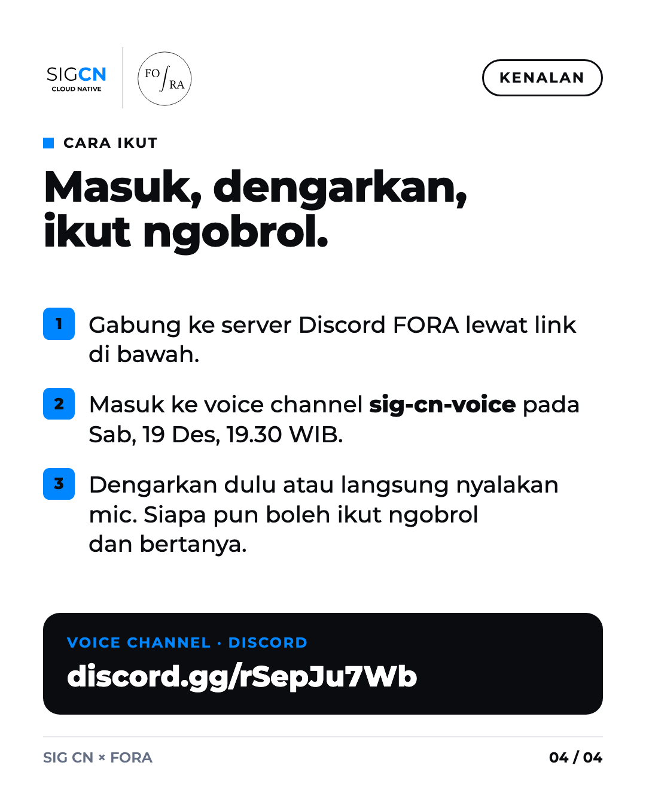 

**X**


**LinkedIn**

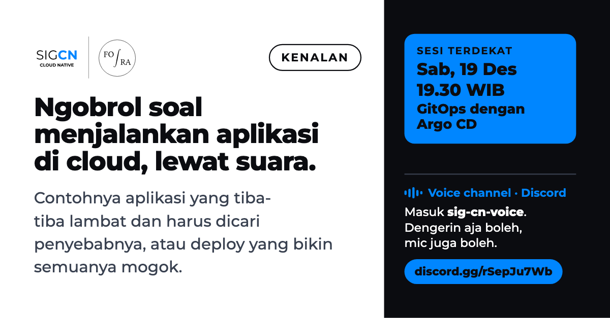   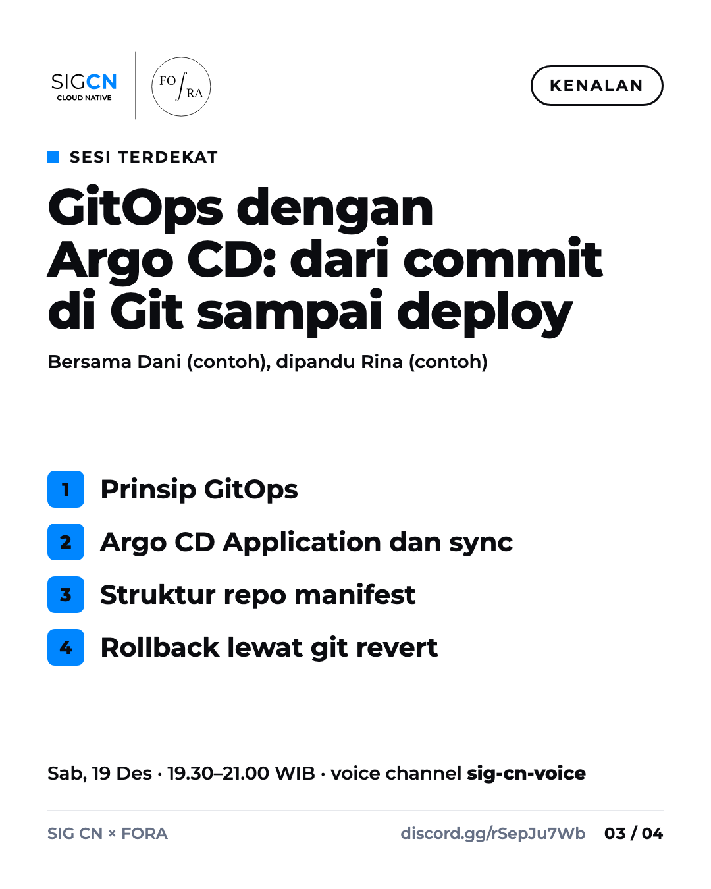  [PDF](sigcn-gitops-argocd/li-doc/sig-intro.pdf)

<details>
<summary>Captions</summary>

**Instagram**

```text
SIG CN itu grup FORA untuk ngobrol soal cloud native. Tiap sesi punya satu tema, misalnya Kubernetes atau GitOps, dan jalannya di voice channel Discord. Satu orang cerita, yang lain nyela dan nanya.

Yang terdekat "GitOps dengan Argo CD", Sab, 19 Des jam 19.30 WIB. Langsung masuk voice channel sig-cn-voice lewat discord.gg/rSepJu7Wb (ada juga di bio). Dengerin aja boleh, mic juga boleh.

#FORA #SIGCN #GitOps #ArgoCD
```

**X**

```text
SIG CN di FORA. Ngobrol soal Kubernetes dan cloud native di voice channel.
Sesi terdekat soal "GitOps dengan Argo CD", Sab, 19 Des.
Di voice channel sig-cn-voice Discord FORA. Dengerin aja boleh, mic juga boleh.
https://discord.gg/rSepJu7Wb
#GitOps
```

**LinkedIn**

```text
SIG CN di FORA. Ngobrol soal Kubernetes dan cloud native di voice channel.

Sesi terdekat soal "GitOps dengan Argo CD", Sab, 19 Des, 19.30–21.00 WIB.

Kita ngobrol di voice channel sig-cn-voice Discord FORA. Boleh dengarkan saja, boleh juga ikut bicara. Undangan: https://discord.gg/rSepJu7Wb

#GitOps #CloudNative #Kubernetes
```

</details>


## Observability: Logs, Metrics, Traces

SIG CN · Kamis, 14 Januari 2027 · 20.00 WIB · `sigcn-observability`

### Announce

**Instagram**

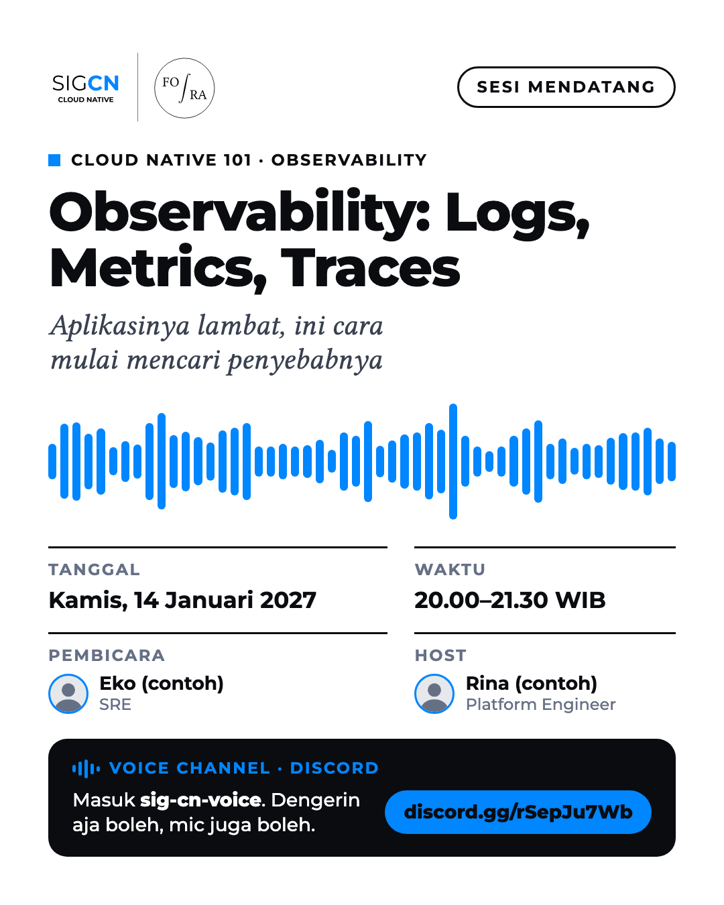     

**X**

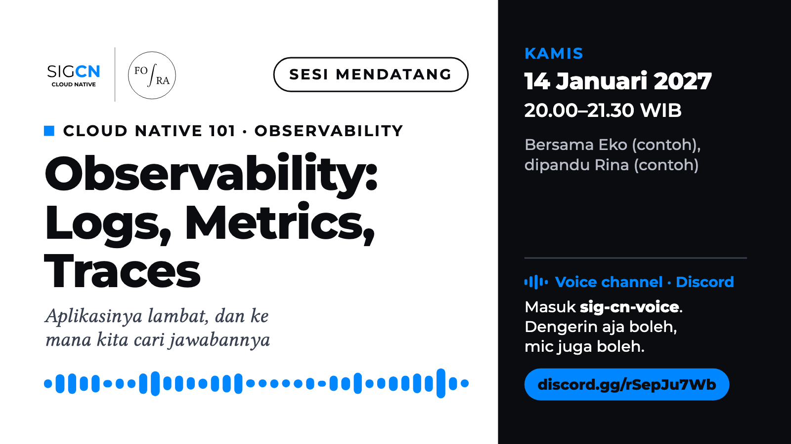

**LinkedIn**

   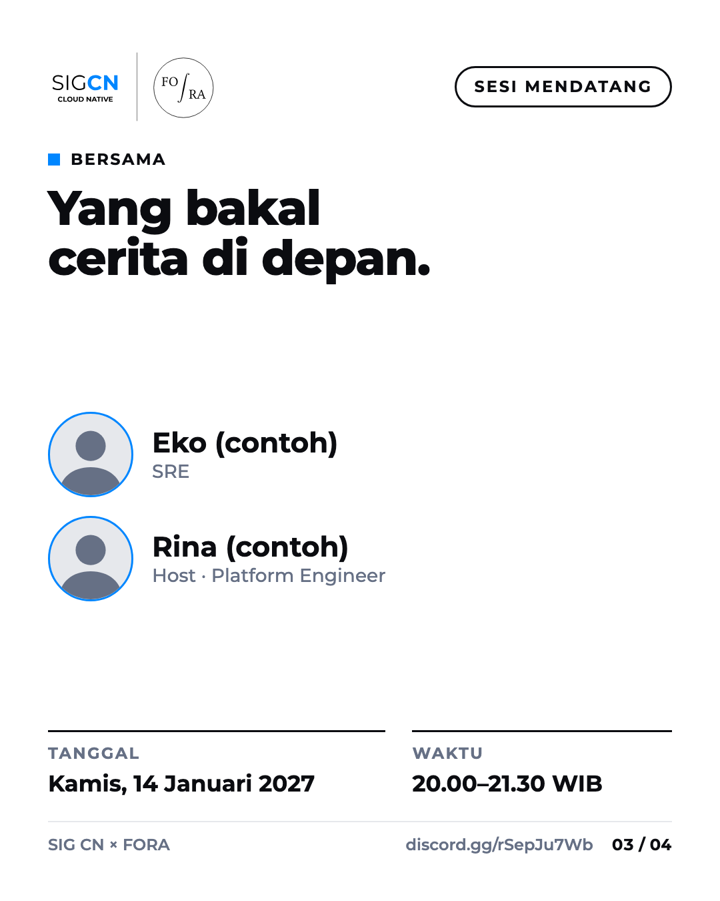  [PDF](sigcn-observability/li-doc/announce.pdf)

<details>
<summary>Captions</summary>

**Instagram**

```text
Observability: Logs, Metrics, Traces

Aplikasi jalan tapi lambat, dan kita nggak tahu kenapa. Kita lihat apa yang dijawab logs, metrics, dan traces, dan cara mulai tanpa pasang semuanya sekaligus.

Kam, 14 Jan, 20.00–21.30 WIB. Bersama Eko (contoh), dipandu Rina (contoh).

- Monitoring vs observability
- Logs terstruktur
- Metrics dan Prometheus
- Distributed tracing
- OpenTelemetry dan OTLP
- Alert yang nggak bikin capek

Mampir ke voice channel sig-cn-voice di Discord FORA, link di bio atau discord.gg/rSepJu7Wb. Dengerin aja nggak apa-apa, ngomong juga silakan.

#FORA #SIGCN #Observability #OpenTelemetry
```

**X**

```text
Observability: Logs, Metrics, Traces
Kam, 14 Jan jam 20.00 WIB.
Masuk aja ke voice channel sig-cn-voice di Discord FORA. Dengerin aja boleh, mic juga boleh.
https://discord.gg/rSepJu7Wb
#Observability
```

**LinkedIn**

```text
Observability: Logs, Metrics, Traces (SIG CN × FORA)

Aplikasi jalan tapi lambat, dan kita nggak tahu kenapa. Kita lihat apa yang dijawab logs, metrics, dan traces, dan cara mulai tanpa pasang semuanya sekaligus.

Kamis, 14 Januari 2027, 20.00–21.30 WIB, bersama Eko (contoh), dipandu Rina (contoh).

• Monitoring vs observability
• Logs terstruktur
• Metrics dan Prometheus
• Distributed tracing
• OpenTelemetry dan OTLP
• Alert yang nggak bikin capek

Kita ngobrol di voice channel sig-cn-voice Discord FORA. Dengarkan saja boleh, ikut bicara juga boleh. Undangan: https://discord.gg/rSepJu7Wb

#Observability #CloudNative #Kubernetes
```

</details>

### Reminder

**Instagram**

    

**X**


**LinkedIn**

    [PDF](sigcn-observability/li-doc/reminder.pdf)

<details>
<summary>Captions</summary>

**Instagram**

```text
Hari ini, 20.00 WIB. Observability: Logs, Metrics, Traces

Aplikasi jalan tapi lambat, dan kita nggak tahu kenapa. Kita lihat apa yang dijawab logs, metrics, dan traces, dan cara mulai tanpa pasang semuanya sekaligus.

Bersama Eko (contoh), dipandu Rina (contoh). Kalau sudah mulai, nyusul aja kapan pun. Link Discord ada di bio (discord.gg/rSepJu7Wb). Masuk ke voice channel sig-cn-voice. Dengerin aja nggak apa-apa, ngomong juga silakan.

#FORA #SIGCN #Observability #OpenTelemetry
```

**X**

```text
Jam 20.00 WIB nanti, Observability: Logs, Metrics, Traces.
Di voice channel sig-cn-voice Discord FORA. Dengerin aja boleh, mic juga boleh.
https://discord.gg/rSepJu7Wb
#Observability
```

**LinkedIn**

```text
Hari ini, 20.00–21.30 WIB
Observability: Logs, Metrics, Traces

Aplikasi jalan tapi lambat, dan kita nggak tahu kenapa. Kita lihat apa yang dijawab logs, metrics, dan traces, dan cara mulai tanpa pasang semuanya sekaligus.

Bersama Eko (contoh), dipandu Rina (contoh). Kalau sudah mulai, silakan langsung masuk.

Kita ngobrol di voice channel sig-cn-voice Discord FORA. Dengarkan saja boleh, ikut bicara juga boleh. Undangan: https://discord.gg/rSepJu7Wb

#Observability #CloudNative #Kubernetes
```

</details>

### Recap

**Instagram**

        

**X**


**LinkedIn**

        [PDF](sigcn-observability/li-doc/recap.pdf)

<details>
<summary>Captions</summary>

**Instagram**

```text
Rekap "Observability: Logs, Metrics, Traces", Kam, 14 Jan.

16 orang ikut ngobrol di voice channel. Makasih Eko (contoh).

1. Logs menjawab apa yang terjadi. Pakai format terstruktur seperti JSON supaya gampang dicari dan difilter.
2. Metrics menjawab seberapa sering dan seberapa lama. Angka agregat itu murah disimpan, dan cocok untuk dashboard dan alert.
3. Traces menjawab di mana waktunya habis. Satu request diikuti lintas service, jadi bagian yang lambat kelihatan.
4. OpenTelemetry memisahkan instrumentasi dari backend. Kode diinstrumentasi sekali, datanya bisa dikirim ke backend apa saja yang mendukung OTLP.
5. Alert pada gejala yang dirasakan pengguna. Contohnya error rate dan latency. CPU tinggi sebentar belum tentu masalah.

Dokumentasi OpenTelemetry: https://opentelemetry.io/docs/
Dokumentasi Prometheus: https://prometheus.io/docs/introduction/overview/

Sesi berikutnya kita umumkan di Discord FORA (link di bio atau discord.gg/rSepJu7Wb). Dengerin aja nggak apa-apa, ngomong juga silakan.

#FORA #SIGCN #Observability #OpenTelemetry
```

**X 1/3**

```text
Rekap "Observability: Logs, Metrics, Traces". 16 orang ngobrol di voice channel. Makasih Eko (contoh).
```

**X 2/3**

```text
Intinya:
1. Logs menjawab apa yang terjadi
2. Metrics menjawab seberapa sering dan seberapa lama
3. Traces menjawab di mana waktunya habis
4. OpenTelemetry memisahkan instrumentasi dari backend
5. Alert pada gejala yang dirasakan pengguna
```

**X 3/3**

```text
Dokumentasi OpenTelemetry https://opentelemetry.io/docs/
Sesi berikutnya diumumkan di Discord FORA. Mau dengerin aja boleh, mau nyalain mic juga boleh.
https://discord.gg/rSepJu7Wb
#Observability
```

**LinkedIn**

```text
16 orang ikut ngobrol di voice channel. Terima kasih Eko (contoh).

Catatan dari "Observability: Logs, Metrics, Traces":

1. Logs menjawab apa yang terjadi. Pakai format terstruktur seperti JSON supaya gampang dicari dan difilter.
2. Metrics menjawab seberapa sering dan seberapa lama. Angka agregat itu murah disimpan, dan cocok untuk dashboard dan alert.
3. Traces menjawab di mana waktunya habis. Satu request diikuti lintas service, jadi bagian yang lambat kelihatan.
4. OpenTelemetry memisahkan instrumentasi dari backend. Kode diinstrumentasi sekali, datanya bisa dikirim ke backend apa saja yang mendukung OTLP.
5. Alert pada gejala yang dirasakan pengguna. Contohnya error rate dan latency. CPU tinggi sebentar belum tentu masalah.

Dokumentasi OpenTelemetry: https://opentelemetry.io/docs/
Dokumentasi Prometheus: https://prometheus.io/docs/introduction/overview/

Sesi berikutnya akan kita umumkan di Discord FORA, di voice channel sig-cn-voice. Mau dengarkan saja atau ikut bicara, dua-duanya boleh. https://discord.gg/rSepJu7Wb

#Observability #CloudNative #Kubernetes
```

</details>

### Cover

**Instagram**

    

**X**


**LinkedIn**

    [PDF](sigcn-observability/li-doc/cover.pdf)

<details>
<summary>Captions</summary>

**Instagram**

```text
Observability: Logs, Metrics, Traces

Cloud Native 101 di SIG CN × FORA.

Aplikasi jalan tapi lambat, dan kita nggak tahu kenapa. Kita lihat apa yang dijawab logs, metrics, dan traces, dan cara mulai tanpa pasang semuanya sekaligus.

Kamis, 14 Januari 2027, 20.00–21.30 WIB. Mampir ke voice channel sig-cn-voice di Discord FORA, link di bio atau discord.gg/rSepJu7Wb. Dengerin aja nggak apa-apa, ngomong juga silakan.

#FORA #SIGCN #Observability #OpenTelemetry
```

**X**

```text
Cloud Native 101 bareng SIG CN × FORA.
Observability: Logs, Metrics, Traces
Kam, 14 Jan, 20.00–21.30 WIB
Di voice channel sig-cn-voice Discord FORA. Dengerin aja boleh, mic juga boleh.
https://discord.gg/rSepJu7Wb
#Observability
```

**LinkedIn**

```text
Aplikasi jalan tapi lambat, dan kita nggak tahu kenapa. Kita lihat apa yang dijawab logs, metrics, dan traces, dan cara mulai tanpa pasang semuanya sekaligus.

Cloud Native 101 di SIG CN × FORA. Sesinya "Observability: Logs, Metrics, Traces", Kam, 14 Jan, 20.00–21.30 WIB.

Gabung lewat https://discord.gg/rSepJu7Wb, lalu masuk ke voice channel sig-cn-voice. Dengarkan saja boleh, ikut bicara juga boleh.

#Observability #CloudNative #Kubernetes
```

</details>

### SIG intro

**Instagram**

     

**X**


**LinkedIn**

     [PDF](sigcn-observability/li-doc/sig-intro.pdf)

<details>
<summary>Captions</summary>

**Instagram**

```text
SIG CN itu grup FORA untuk ngobrol soal cloud native. Tiap sesi punya satu tema, misalnya Kubernetes atau GitOps, dan jalannya di voice channel Discord. Satu orang cerita, yang lain nyela dan nanya.

Yang terdekat "Observability: Logs, Metrics, Traces", Kam, 14 Jan jam 20.00 WIB. Langsung masuk voice channel sig-cn-voice lewat discord.gg/rSepJu7Wb (ada juga di bio). Dengerin aja nggak apa-apa, ngomong juga silakan.

#FORA #SIGCN #Observability #OpenTelemetry
```

**X**

```text
SIG CN di FORA. Ngobrol soal Kubernetes dan cloud native di voice channel.
Sesi terdekat soal "Observability: Logs, Metrics, Traces", Kam, 14 Jan.
Di voice channel sig-cn-voice Discord FORA. Dengerin aja boleh, mic juga boleh.
https://discord.gg/rSepJu7Wb
#Observability
```

**LinkedIn**

```text
SIG CN itu grup FORA untuk ngobrol soal cloud native. Tiap sesi punya satu tema, misalnya Kubernetes atau GitOps, dan jalannya di voice channel Discord. Satu orang cerita, yang lain nyela dan nanya.

Sesi terdekat soal "Observability: Logs, Metrics, Traces", Kamis, 14 Januari 2027, 20.00–21.30 WIB.

Gabung lewat https://discord.gg/rSepJu7Wb, lalu masuk ke voice channel sig-cn-voice. Dengarkan saja boleh, ikut bicara juga boleh.

#Observability #CloudNative #Kubernetes
```

</details>

<!-- gallery:end -->
